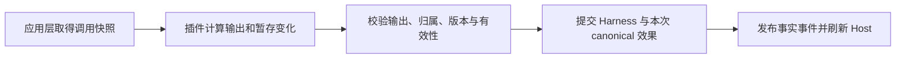

# OURO 会话撤销、Harness 状态与插件交互改进设计

> 文档类型：本次改进设计
> 状态：已实施并通过 M1–M6 验收
> 代码基线：2026-09-12
> 范围：会话撤销、原生 Harness 状态、插件调用与提交边界

本文说明本次改进的理由、结构与取舍。强制契约及验收编号以
[现行规格](../dev/specs/OURO_会话撤销与Harness状态规格_2026-09-08.md)为准，
其第 13 节记录测试入口、验收结果与平台边界。本文只覆盖本次工作，不承接其他路线图能力。

## 核心设计哲学（实施与评审约束）

- **从会话的一致性出发。** 撤销的对象是消息前缀及与之对应的 Harness 状态。任何方案都必须同时说明
  消息、状态和执行有效性如何对应，不能以界面删除成功或单独保存快照代替正确撤销。
- **先修正职责边界，再实现行为。** 状态直接写入、控制关系分开提交、运行事实混入业务快照等问题必须在
  所属层解决。必要时局部重构，不在撤销入口累积插件名称判断、补偿回调或异常兜底。
- **最小必要改良以整体复杂度为准。** 复用现有 Session、Catalog、Generation、结算和观察机制；新增机制
  必须承担明确且不可省略的职责，并删除被它取代的旧路径。改动行数少不等于设计简单。
- **只有一份 canonical 状态和一条提交管线。** 原生组件与插件共享 Harness 底座，owner 视图只是访问边界。
  不双写新旧状态、不复制控制状态机、不把缓存、事件投影或插件文件变成另一份真相。
  开发阶段只支持当前格式，不提供历史兼容或迁移入口；格式不符时明确诊断，由用户清理失效测试数据或使用新数据目录。
- **插件表达业务，框架拥有生效权。** 插件在授权调用内读取快照、提出类型化结果和暂存修改；应用层统一
  校验、提交、挂起、恢复与撤销。插件不需要了解其他插件，也不负责数据库事务或实现业务 undo。
- **按数据生命周期确定撤销范围。** 可撤销业务状态、实际执行/计费事实、运行许可与外部制品各归其位。
  恢复业务状态不抹除真实消耗，不复活旧任务或审批许可，也不联动文件系统回滚。
- **消息边界必须精确且符合逻辑顺序。** 状态锚点记录节点之前的真实状态；排队输入在消费时建立锚点。
  框架支持准确切口，应用限制直接用户输入；Provider 完整性问题在投影/执行边界处理，不暗中移动撤销位置。
- **提交决定是状态生效的唯一边界。** 控制关系、业务值及相关 canonical 效果共同结算。回调返回、文件写入
  完成或取消信号发出，都不能各自代表整个会话操作已经成功或回滚。
- **取消负责停止工作，有效性校验负责守住状态。** 每次会话效果都验证调用归属、版本和历史代次。旧线程、
  worker 或子会话即使迟到，也不能写回新历史；不能依赖“应该已经取消”保证正确性。
- **保持层次与接口直观。** core 定义规则，application 编排操作，adapter 实现持久化和协议，Host 选择并展示。
  共享机制不演变成万能结果字典、任意效果脚本或通用工作流；不为本次没有用例的能力预留接口。
- **性能来自有界工作和明确成本。** 状态变化才写快照，消息复用版本引用，撤销只处理相关后缀与状态。
  不逐 token 存状态，不全量重放事件，不以降低 durability 换速度；复杂优化必须有本次测量依据。
- **无法证明的历史不伪造。** 缺失锚点、未知 schema、竞争或契约不可用必须精确报告，不能静默清空、猜测
  或重跑外部效果。恢复只应用当前格式中已记录的提交决定。
- **以完整链路验收，并在本次边界停止。** 两种存储、两种插件运行形态、内置插件、队列、取消恢复与 Host
  必须遵循同一契约。通过正常路径不足以完成；全部验收通过后结束，不追加无关能力或后续拓展清单。

## 1. 问题本质与目标

对撤销而言，会话的语义状态由两部分构成：有序消息前缀，以及使后续运行呈现某种行为的 Harness 状态。
实际执行事实、进程资源与外部文件具有不同生命周期，不能作为同一份快照整体恢复。

撤销消息 m 的目标是：保留 m 之前的消息，恢复 m 对应逻辑边界之前的 Harness 状态，终止旧历史继续产生
会话效果的权利。仅裁剪消息会留下过期模式或插件数据；仅增加状态快照不能阻止旧回调重新写入。

本次完成以下能力：

- 框架可以撤销至任意有有效状态锚点的 canonical 消息节点之前，不受用户角色或工具帧边界限制。
- 应用层只允许撤销直接用户输入，包括已经提交、仍在排队的输入；撤销后返回完整可编辑输入。
- 原生控制状态与插件状态共享原生版本化机制，框架无需理解 Plan、Goal、Todo 的业务字段。
- 插件通过受本次调用约束的状态视图提出变更，应用层统一提交、恢复和处理失效。
- 中断、撤销、重新提交、重启恢复、其他 Host 观察具有一致语义。

不增加完整事件溯源平台、redo、多分支时间线 UI、插件专用撤销钩子、通用工作流引擎或文件系统回滚。
现有会话分支、导出和跨后端导入只保存当前数据契约。

## 2. 复用基础与职责边界

| 机制 | 复用基础 | 职责 |
|---|---|---|
| [消息裁剪](message-history-editing.md) | 稳定消息身份、尾部定位、SQLite 事务、压缩清理 | 精确切口、状态恢复和历史代次；Provider 投影单独保证协议完整性 |
| [Harness 状态](../ouro/core/harness.py) | 原生 owner 归属、schema、会话生命周期 | 唯一可恢复状态；extension 查询投影当前版本 |
| [插件状态调用](../ouro/plugins/harness_calls.py) | owner 隔离、Generation 门禁 | 调用内快照和暂存修改，随调用关闭 |
| [控制器协调](../ouro/application/session_controls.py) | claim、控制归属、转换校验 | 控制关系和 owner 数据一次结算；准备阶段不发布半完成状态 |
| [续跑结算](../ouro/application/run_continuations.py) | 持久化结算计划、稳定交付身份 | 状态变更与续跑决策共用提交和恢复边界 |
| [Catalog 与 Generation](../ouro/plugins/catalog.py) | 不可变目录、lease、gate、执行契约 | 管理代码与资源生命周期；会话操作仍单独检查版本和历史代次 |
| [队列](../ouro/application/queued_inputs.py) | queue_id、来源、批次、消费消息查找 | 消息与消费一次提交，和撤销共享竞争边界 |

撤销依赖可证明的消息前状态，不能从当前 controls 或 owner 数据推算过去。框架统一拥有版本、提交与恢复，
插件只解释自己的业务值；Run 绑定和实际计费事实由原生运行记录及 usage 账本拥有。这些边界使状态回退
不依赖插件名称或业务恢复回调。

## 3. 最小数据模型

### 3.1 Harness 快照

一份逻辑 Harness 快照包含：

- 已提交的会话控制关系：稳定 owner、controller、activation 身份、claim、业务数据和所需执行契约引用。
- 按稳定 owner 唯一的 JSON 状态值，以及该值的 state schema 和既有分支/投影声明。

原生组件的 owner 由组合根保留，插件 owner 由框架绑定。框架负责完整性，owner 负责自身 payload 的业务解释。
Generation 实例、运行锁、等待中的回调、临时 activating/deactivating 过程不作为可恢复业务状态。
恢复逻辑 activation 不等于恢复旧进程中的资源或执行许可。

Harness 采用完整快照：只有业务状态实际改变时创建不可变版本，未改变状态的消息复用版本引用。
不复制消息正文，不逐 token 写快照，不引入字段级 diff、持久化树或单独的内容去重服务。
这是以小型控制数据换取简单、直接的恢复规则；性能验收同时覆盖多 owner 和较大 payload。

### 3.2 必须区分的身份

| 身份 | 作用 |
|---|---|
| message_id / queue_id | 精确定位消息和已接受输入，复用既有稳定身份 |
| harness_version | 定位不可变状态快照；版本身份不因撤销后的新写入而复用 |
| history_epoch | 会话历史代次；每次 canonical 撤销递增，阻止旧工作提交 |
| operation identity | 调用结算、挂起和恢复去重；优先复用既有 tool/interaction/continuation 身份 |
| state_schema_version | owner payload 的格式版本 |
| execution contract | 实际执行代码及 contribution 的兼容契约 |

不为每个只读回调新增持久化记录。需要持久化操作身份的范围限于产生 canonical 效果或已有恢复需求的操作。
并发校验使用状态版本与历史代次，不能依赖时间戳、消息数量或插件自己递增的业务 revision。

### 3.3 消息前状态锚点

每条新 canonical 消息保存 before_harness_version。锚点来自该消息所处的逻辑顺序，不能在 append 时
随手读取已被本次操作改变的当前状态。

- 直接输入：锚定接受该输入成为 canonical 消息之前的状态。
- 排队输入：接受排队不改变 Harness；实际消费时锚定消费之前的状态。
- 工具结果：锚定该工具操作提交其 Harness 变化之前的状态；结果与变化共同提交。
- 无消息状态命令：独立提交新状态版本；随后消息引用该版本。
- 一次提交含多条消息：应用层给出确定的逻辑顺序，在状态变化所在消息边界保存前后版本。
  后续消息引用前一边界后的状态，不能把所有消息都粗略标成整次操作前状态。

事务的物理原子性不抹掉消息之间的逻辑边界。多个消息同批落盘时，所需中间状态版本也必须一起持久化。
多个并发结果按应用层结算顺序建立边界，不按回调完成时间推测。

## 4. 架构与插件规范

### 4.1 分层

| 层 | 职责 |
|---|---|
| core | Harness/锚点/代次/变更等类型、纯规则、失败分类 |
| sessions port 与后端 | 快照、消息、操作结果的原子提交；查询与崩溃恢复 |
| application | 操作范围、插件调用编排、控制转换、队列消费、撤销、恢复和事件发布 |
| plugins 与 SDK/worker adapter | owner 绑定、类型适配、调用内状态视图、协议编解码 |
| CLI/TUI | 选择允许的输入、呈现结果、恢复编辑草稿和刷新投影 |

插件基础设施不得反向 import application。所需端口由应用层/组合根注入；原生功能和插件进入相同提交管线。
不向插件暴露 SessionStore、RuntimeService、事务对象或手工 commit。

### 4.2 调用内状态访问

PluginContext 保留实例级配置、文件、日志、凭证和资源。会话状态移入显式的调用范围，绑定当前 Session、
当前 owner、基准版本、历史代次、取消状态及读写能力。插件获得快照及自身暂存修改的视图。

可写调用支持替换或删除 owner 的完整 JSON 值；同一次调用可以读到自己的修改。普通会话写入不能自行选择
另一个 session_id/owner。SDK 不暴露任意路径修改语言，也不增加全局可写 KV。

同一视图只读提供当前 owner 已激活的控制关系，供插件判断自己的模式和业务归属；不要求 owner JSON 再保存
一份 activation 或模式开关。返回数据与 canonical 状态隔离，视图关闭后不能继续读取。

| contribution | 状态契约 |
|---|---|
| Observer | 读取已提交事实；不能修改 Harness 或依赖观察顺序驱动业务 |
| Context、Prompt/Tool/Turn Policy、Compaction | 读取当前逻辑阶段快照；返回各自类型化输出，由应用层处理 |
| Command、状态变更 Tool、Session Controller | 提出暂存状态变化和既有类型化控制请求 |
| Continuation | 提出状态变化与续跑决策，由既有结算服务一起验证和提交 |
| Background Service | 管理实例级资源；会话效果必须通过已支持的应用调度入口取得新的有效操作范围 |

只读 Tool 获得只读视图，复用现有 effect 声明。Context 返回持久化片段仍走既有应用层消息投影，不代表它能
直接写 Harness。多策略评估先保留各自提案，只有被接受的完整决策进入提交；失败或冲突不留下部分状态。

in-process 使用便捷视图，worker 随调用接收快照、随结果返回状态提案；两者共用同一类型校验与提交入口。
已有贡献类型和各自结果类型继续保留，共享状态变更封装不演变成任意效果脚本或第十四类 contribution。

### 4.3 提交链

Command 调用 Controller 时共享同一逻辑操作的暂存视图；禁止嵌套回调先行 commit。控制关系、owner 状态、
与之对应的消息或挂起/队列意图以及结算结果，必须具备同一个可恢复的提交决定。

replace 在同一草稿内依次接受旧 Controller 的 deactivate 与新 Controller 的 activate，后者看到前者已接受的
状态和控制移除；完成之前 canonical 状态保持原样。Continuation 的 durable settlement plan 保存已完成的
策略与嵌套 Controller 决策，恢复只提交这份决定，不重新执行回调。
deactivate 调用显式携带 `replacement_controller_id`（普通 release 为 None），供 owner 区分自身切换与退出；
不解析 reason 文本，也不扩展既有同 owner 的替换权限。

插件回调期间不持有数据库事务或文件 mutation 锁。短提交检查 history_epoch、基准状态版本、调用有效性、
消息头/队列前置条件及控制 claim；只读调用可以并发，现有排他工具规则继续生效。
发生竞争不覆盖新状态。只允许无外部副作用的纯决策重新计算，不能自动重跑已经执行过的工具。

等待用户/审批是明确的阶段提交：保存状态、请求与恢复身份，关闭当前调用范围；恢复时建立新范围。
回调异常、超时、取消或结果非法时丢弃未提交的变化。已经形成 durable 提交决定后发生取消，则先完成或恢复
该提交，再报告其实际结果；不得声称状态已回滚。

## 5. 撤销与继续执行

### 5.1 canonical 消息撤销

应用层先阻止受影响执行产生新效果，沿用执行所有权与取消结算机制，然后提交：消息后缀裁剪、Harness
指针恢复、history_epoch 递增、相关恢复/交付失效和派生投影清理。缺少锚点或版本损坏时，在破坏性修改前失败。

任何受影响的旧回调、挂起恢复、子会话交付和自动续跑，提交时均需通过代次与来源校验。旧 Generation 即使
还服务于其他会话，也不能让旧操作写回撤销后的 Session。真实迟到结果可以保留为旧执行审计，但不回注消息。

原生 `SessionCommit.before_message_id` 承担精确裁剪；应用 `SessionService.undo` 负责来源选择与执行所有权，
`RuntimeService.undo` 结算相关输入租约和 bound child。成功返回 `SessionUndoResult`，同时携带当前 Session、
完整 `ModelMessage`、资源引用及 message/queue 身份。取消发生在已接受决定之后时，完成所属结算再返回实际结果。
旧 Run 可以保留原状态作为审计，但活动 Run 查询、恢复和请求准备只接受当前 history_epoch；不能由旧 Run
状态重新构建当前活动投影。挂起交互同时绑定具体 controller activation，释放控制关系不能误取消同名控制器
的其他 activation 所属交互。

原生裁剪支持工具交换内部的准确切口。Provider 请求仍必须满足协议完整性：对被切开的不完整交换在上下文
投影中排除并给出诊断，不能偷偷继续删除 canonical 消息，也不能补交已撤回的旧工具结果。

撤销后的 /continue 使用当前历史与 Harness 开始新的执行，不恢复旧历史代次的 Run；不重复追加已保留输入。
没有保留输入时明确拒绝。未发生撤销的普通崩溃恢复仍沿用原 Run 的恢复协议。

保留输入包括合法的 Host/委派任务，不因其 scaffold 标记而失效。普通继续执行也保留已经持久化的中断片段，
由现有恢复投影提供 Provider 表示；只有显式撤销才裁剪 canonical 历史。被切开的工具交换在上下文中记录
`incomplete_tool_exchange` 诊断，旧代次的 Provider continuation artifact 仅从请求投影排除。
Supervisor 排队的继续请求固定接受时的代次；终态执行的自动 drain 也检查原 Run 代次，不能在撤销后消费保留输入。

### 5.2 排队输入

待消费直接用户输入的撤销是精确取消 queue_id，不裁剪消息、不回退 Harness，也不撤销其他排队输入。
消费操作把队列领取/确认、canonical 消息和状态锚点作为同一提交。若消费已经获胜，应用层通过原 queue_id
定位已提交消息，再执行 canonical 撤销；存在活动执行时报告需要先中断，不能悄悄选择另一条输入。

撤销历史时保留尚未消费的其他直接用户输入，但本次撤销不触发自动 drain；恢复消费前重新检查当前策略。
旧历史生成的自动续跑、控制器输入和子会话交付失效；已消费项不会因为状态恢复重新进入队列。
已有批次接受/消费的原子性保持不变，不等于撤销时禁止在已形成的 canonical 消息序列中定位。

新 Run 的批次启动与活动 Run 的边界消费，都把整批消息、锚点、Run 和队列移除纳入同一原生决定；不保留
独立 acknowledge 路径或“消息已追加但仍在队列”的修复分支。输入接受身份复用现有提交回执保存，Host 重试
不能用已经接受、消费后又撤回的 queue_id 复活输入，不增加第二套接受日志。

### 5.3 Host 与子会话

应用层按真实来源限制直接用户输入，不能把插件声明的 role=user 当作用户来源。
/undo 默认先选最后一条尚未消费的直接用户输入，否则选最后一条保留的直接用户消息；显式目标按稳定身份定位。
返回完整正文、资源引用与技能内容，不把底层撤销能力限制为纯文本。

TUI 成功提交后统一重读会话、活动和输入队列，再恢复草稿；所有观察者按递增事件游标与新代次重新同步。
不能只从当前 widget 删除节点，不能把旧流式状态重新投影成“准备上下文”。

父会话撤销只恢复父会话。保留 child Session、Run 和资源审计；撤销相关父投递许可，按既有归属规则取消
受控子工作。父代次检查负责拒绝迟到交付，无需跨父子会话事务或级联回滚。

`HostSessionInput.history_epoch` 显式表达依赖某代历史的交付；未绑定代次的独立 Host 输入保留其接受事实。
插件/委派自动输入固定接受时的代次，独立输入在下一次正常消费前重新取得策略和 Catalog 许可。
对子会话当前前缀显式继续时，新 Run 复用现有委派准备边界，保留冻结的任务定义、工具范围、约束和预算，
更新 Delegation 的当前执行归属；不复制旧 checkpoint、交互许可或旧 Catalog 租约。

## 6. 内置插件的必要整理

| 插件 | 本次改动 |
|---|---|
| Todo | 列表作为 owner 业务状态；工具变更和结果一起提交，验证最简单的完整链路 |
| Plan | 模式、计划业务数据及审批阶段一致结算；pending request 由原生交互记录拥有；文件继续走现有制品路径 |
| Goal | 目标业务数据进入 Harness；Run/activation 绑定由原生运行快照提供；usage 以原生账本为事实，续跑与业务状态统一结算 |

Goal 的计数按稳定目标身份关联原生 usage，避免撤销清除实际消耗或重试重复累计。恢复同一目标时仍计入其已发生
消耗，创建新目标不继承另一个目标的消耗。预算判断从业务预算与该账本投影得出，不在快照里复制可回滚的计费事实。

控制器激活输出可声明 owner 内的 `usage_scope`。每轮原生运行准备时把控制身份与该标识固定到 Run 控制快照，
Provider usage 按请求的快照归属写入现有账本 metadata；迟到响应不改挂到当前 Harness 的目标。相同 owner/scope
在一次请求中只计一次，原有 usage entry 身份承担重试去重，不另建 Goal 计费日志。
调用视图的 `run_controls()` 提供该 Run 的控制绑定，`usage_tokens()` 提供本 owner 各标识的原生消耗；没有
账本能力时返回 `None`，已知无消耗时返回空映射。二者只读且随调用关闭，不进入可撤销业务值。
账本在既有内存缓存中维护按 Session/owner/scope 的可重建索引，本进程追加时增量更新；正常调用不遍历 Run
或消息历史。运行与插件命令共享组合根注入的 UsageService。
插件内保留业务校验，删除已由框架取代的持久化锁、Run 绑定和存储并发 revision；不进行无关业务重写。

## 7. 持久化、版本与成本

SQLite 使用本地事务；文件后端将现有 history-cut 恢复意图收敛到本次会话提交机制，先持久化不可变状态和
完整提交决定，再执行可重入更新。所有 canonical 读取先处理目标会话的未完成决定，不能观察到消息与状态的
半提交组合。该日志仅用于完成提交，不作为新的通用事件源。

事件仍进入现有事件日志，序号单调。提交通知需可恢复去重；Catalog、索引和 Host 缓存不成为第二份 canonical 状态。
保留文件尾部裁剪能力、SQLite 范围删除和有界消息查询，不重写保留消息前缀或扫描全部事件恢复 Harness。

仅接受当前持久化模型、File layout 和 SQLite schema，不扫描或转换历史数据。
分支、导出、导入、回收站及 File/SQLite 转移保留可达快照与引用，按现有 branch policy 处理 owner 状态。

Host 观察携带 history_epoch，用同一次一致读取取得消息、状态、活动和队列。新代次复用标准快照重载；
旧代次事件和 Run 结果不再修改界面，也不查询已撤回的消息。当前代次缺失消息仍是可见的数据错误。
完整编辑输入由 Host 草稿负责，正文与资源选择同存，技能复用已有输入表示；不在 Controller 另存隐式附件状态。

生命周期操作处理完整状态闭包：导出和后端转移保存版本、锚点与接受回执；历史分支取消息边界状态，
分支策略一致作用于保留版本，不能通过 undo 复活 reset 状态。owner JSON 保持不透明，
不单独改写可能被它引用的 Session 内 activation 身份。已知内置 schema 转换走显式会话维护入口，
不在启动、普通读取或撤销时自动扫描历史。

新增成本主要是变更时的一份 Harness 快照、消息上的常量大小引用、短提交校验与必要恢复信息。
撤销成本由被移除后缀、目标快照和受影响派生记录决定；不能随保留消息正文长度增加而复制正文。
同步存储操作以完整 query/commit 为单位离开事件循环；每个逻辑阶段取得一次快照并分发 owner 视图，避免
每个插件逐一读取全部 owner 数据或 worker 高频往返。

## 8. 完成边界

完成意味着两种存储后端、in-process/worker、内置插件、排队输入、恢复和 CLI/TUI 均满足同一组规格。
不得以“快照已经保存”或“普通文本 /undo 成功”代替完整验收。
测试矩阵和通过证据见现行规格第 12–13 节；本设计不追加条件性拓展或后续能力清单。
