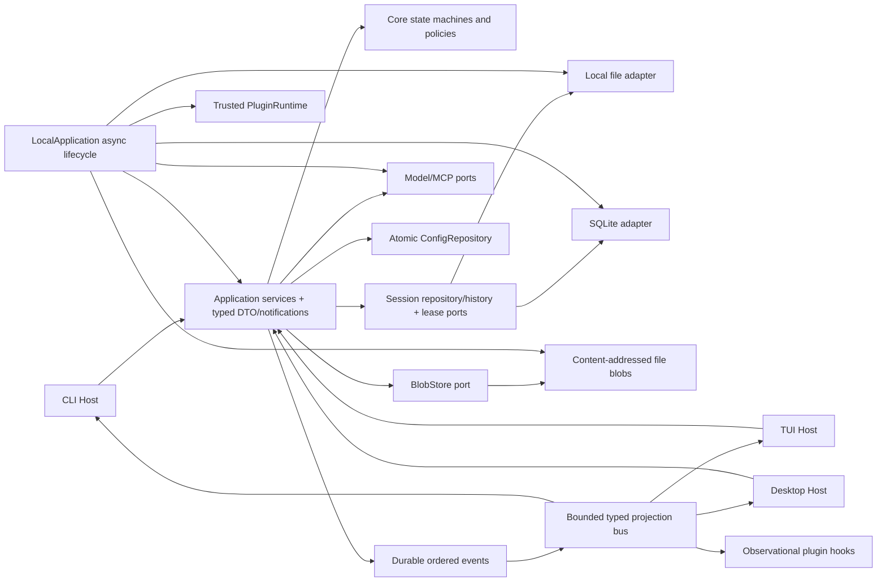

# OURO 架构与代码深度审查报告

> 文档性质：历史审查快照。本文的行号、测试数量和差距判断只对应审查日期，不作为当前状态说明。
> 审查日期：2026-07-16  
> 审查对象：OURO 0.1.0 当前仓库  
> 演进约束：插件系统、TUI、Desktop、SQLite 后端  
> 审查准则：`docs/OURO_AGENT_编码准则_ZH.md`

## 1. 结论摘要

审查初始结论：**有条件通过，不建议直接在原底层上叠加多 Host、多存储后端和完整插件系统。**

整改后结论：**通过本轮架构质量验收。P0/P1 阻断项已全部从底层消除，File/SQLite、多 Host 应用契约和插件
contribution 安全边界已经形成可继续演进的基础。** 尚未完成的是 TUI/Desktop 产品实现、完整插件安装与
entrypoint 生命周期、SQLite 用户迁移体验；这些是后续能力，不再要求修改当前领域底座。

当前 OURO 已经具备扎实的单机 CLI Agent Runtime 基础：核心依赖方向清楚，领域记录与持久化投影分离，Run/ToolBatch/ToolCall 状态较完整，Provider SDK 基本被隔离，文件写入、锁、恢复、权限和错误分类也有系统性设计。静态质量门禁表现良好，说明项目并非需要推倒重来。

审查时若直接增加 SQLite、Desktop/TUI 和插件 entrypoint，会把以下设计问题固化并放大：

1. `SessionStore`、`ResourceStore`、`UsageLedger` 名义上是端口，实际暴露本地文件路径、索引维护和初始化细节，SQLite 无法自然实现。
2. `LocalSessionStore` 在读取时执行 Run/ToolCall 领域恢复，持久化适配器已承担业务状态机，第二种后端必然复制规则。
3. Session 资源引用由 SessionStore 和 LocalResourceStore 共同拥有，LocalResourceStore 直接扫描本地 Session 目录，是 SQLite Session + 文件 Blob 的直接阻塞点。
4. 异步事件关键路径在一把共享锁中串行执行同步磁盘写入、Host sink 和插件 Hook；慢 I/O 或第三方扩展可拖慢其他会话。
5. 共享配置文件只有“原子替换”，没有“原子读改写”，Desktop/TUI/CLI 并发修改时存在确定性的丢失更新窗口。
6. 插件 manifest 可自行声明 `official` 来源，loader 又未按声明能力和权限限制 contribution；在真正启用 entrypoint 前必须先修正信任模型。
7. application 已提供分页接口，但 `open`、Supervisor 订阅和 activity 回退仍全量加载历史，不符合 Desktop/TUI 的长历史消费方式。
8. Runtime 的创建与资源所有权仍主要位于 CLI，多个 CLI 路径没有关闭 Runtime/Provider，MCP 还通过 `runtime.store.root` 获取配置根目录。

实施保留了原有核心状态模型和 application 分层，没有引入 ORM、UoW、远程协议层或 UI DSL；改造沿真实
变化轴完成：后端中立存储、显式恢复、非阻塞事件、原子配置、统一装配生命周期、类型化 Host 契约和
可执行的插件信任规则。

### 1.1 整改状态

| 发现 | 状态 | 实施结果 |
|---|---|---|
| F-00 | 已解决 | 并发测试改用同步屏障；普通/覆盖率测试、lint、format、type、compile、build 全绿 |
| F-01～F-03 | 已解决 | `SessionRepository`/`SessionCatalogStore` 后端中立；显式恢复；Session 单独拥有资源引用；SQLite 与文件契约一致 |
| F-04～F-05 | 已解决 | durable event、Host sink、Hook 解耦为有界 worker；配置 command 具备跨进程原子 read-modify-write |
| F-06 | 已解决底层阻断 | provenance 由安装来源注入，capability/permission/timeout 实际执行；完整安装器仍属路线图 |
| F-07～F-11 | 已解决 | Host 查询/订阅有界；`LocalApplication` 生命周期；MCP 收口；类型化事件；统一脱敏 |
| F-12～F-13 | 已解决 | 删除不完整大转发 façade；Host 依赖内聚 service；插件命令改为 namespaced typed contract |
| F-14 | 已按变化轴收敛 | LocalSessionStore 移除恢复和资源双所有权；Runtime 装配移出；其余大文件保持内聚，不为行数新增空层 |
| F-15 | 已解决 | 删除 `ConfigService`、FollowUpQueue 和 OpenAI transport 内部兼容别名 |

## 2. 审查范围与验证结果

### 2.1 范围

- 生产代码：142 个 Python 文件，约 28,673 行。
- 测试代码：70 个 Python 文件，约 16,113 行。
- 重点模块：`core`、`application`、`sessions`、`resources`、`config`、`providers`、`tools`、`plugins`、`mcp`、`billing`、`cli`。
- 文档基线：项目概述、开发架构、开发路线图、编码准则。
- 审查维度：分层、依赖方向、状态所有权、事务/恢复、并发、生命周期、Host 契约、扩展信任、安全输出、冗余与测试可信度。

### 2.2 工具验证

| 检查 | 结果 |
|---|---|
| `ruff check ouro tests` | 通过 |
| `ruff format --check ouro tests` | 通过，212 个文件已格式化 |
| `mypy ouro` | 通过，142 个源文件无问题 |
| `python -m compileall -q ouro` | 通过 |
| `uv build` | 通过，sdist 与 wheel 均成功 |
| 完整 pytest | 605 passed，2 skipped |
| 完整 pytest + branch coverage | 605 passed，2 skipped；总覆盖率 82.88%（门槛 80%） |
| `git diff --check` | 通过，仅有仓库既有 CRLF 转换提示 |

当前本地验证环境为 Windows / Python 3.14.6。CI 已固定 Python 3.12 并覆盖 Windows/Linux/macOS；三平台
结果必须以代码进入 CI 后为准，本报告不把“已配置 CI”误写成“已在本机执行三平台”。

### 2.3 初始测试失败与处理

1. `tests/application/test_tool_call_batches.py::test_parallel_batch_preserves_one_assistant_message_and_source_order`
   - 测试用 `sleep(0.05)` 与 `sleep(0.01)` 推断并行完成顺序。
   - 工具真正进入 handler 前，`checkpoint_started` 会持锁同步持久化状态/事件；启动偏差可能超过 40ms，重复运行可得到不同结果。
   - 这是“脆弱测试 + 异步关键路径存在阻塞”的共同信号，不能只增大 sleep。
2. 两个 `tests/cli/test_interactive_io.py` 用例仍期待 `model_wait` 首帧 `◐`，当前主题首帧已经是 `⁙`。
   - 这是 UI 主题变更后断言未同步，说明当前主测试门禁不是全绿。

处理结果：并发用例已用 `asyncio.Event`/barrier 证明 handler 重叠启动，再验证结果按 `source_index` 提交；
spinner 断言已与权威主题同步。两项不再依赖现实调度时序，完整门禁已恢复全绿。

## 3. 做得好的部分

这些设计应保留并作为重构约束，而不是在调整中重写：

- `core` 不依赖外层，`application` 不依赖 CLI 或具体 Provider；`tests/architecture/test_boundaries.py` 已将主要 import 方向固化为测试。
- Session、Run、Message、Event、ToolBatch、Compaction 使用显式领域记录，持久状态不是隐藏在进程内 registry 中。
- 工具批次区分计划、执行、提交与恢复状态，结果按源顺序提交；副作用工具的未知结果也有专门语义。
- Provider 配置、传输、重试和 SDK 适配边界总体清楚，第三方协议对象没有扩散到 core。
- 本地文件后端使用 staging、原子替换、JSONL 和 OS 锁；Cursor 分页、索引脏标记和恢复场景已有较多测试。
- 错误类型、权限模式、资源校验、输出截断和本地工作区约束不是散落的字符串判断。
- 文档已经明确 Desktop 只依赖 application façade/DTO、长历史应增量读取、插件为同进程可信扩展、SQLite 不应泄漏 ORM 到 core；方向正确。

## 4. 问题分级总览

优先级含义：P0 为扩展前阻断项或当前质量门禁问题；P1 为近期必须收敛的高风险边界；P2 为可维护性债务，应随相邻改造清理。

| ID | 优先级 | 问题 | 整改状态 | 主要影响 |
|---|---:|---|---|---|
| F-00 | P0 | 当前测试门禁非全绿，且并发测试依赖时间假设 | 已解决 | 所有演进 |
| F-01 | P0 | 存储端口泄漏文件系统实现且缺少真实事务能力 | 已解决 | SQLite |
| F-02 | P0 | LocalSessionStore 负责领域恢复，读取会写入 | 已解决 | SQLite、可预测性 |
| F-03 | P0 | Session 资源引用存在双重所有权 | 已解决 | SQLite、资源一致性 |
| F-04 | P0 | 事件关键路径串行同步 I/O、Host sink 与插件 Hook | 已解决 | TUI、Desktop、插件、多会话 |
| F-05 | P0 | 共享配置读改写无锁/CAS，可能丢失更新 | 已解决 | Desktop、TUI、CLI 并发 |
| F-06 | P0* | 插件来源可自报，能力与权限未约束 contribution | 底层阻断已解决 | 完整插件系统 |
| F-07 | P1 | Host 查询与订阅仍有全历史加载 | 已解决 | Desktop、TUI、长会话 |
| F-08 | P1 | Runtime 装配和资源生命周期由 CLI 零散管理 | 已解决 | 所有 Host、Provider/MCP 释放 |
| F-09 | P1 | MCP 配置绕过 application，配置根目录依赖 store path | 已解决 | Desktop、SQLite |
| F-10 | P1 | Event envelope 类型信息被擦除，Host 重复解析 payload | 已解决 | TUI、Desktop、插件 |
| F-11 | P1 | 公共配置/诊断缺少统一敏感数据边界 | 已解决 | 插件、MCP、安全 |
| F-12 | P2 | ApplicationFacade 是运行期可缺能力的“大转发器” | 已解决 | 多 Host API 可理解性 |
| F-13 | P2 | Slash command 被当成插件通用命令契约 | 已解决 | TUI/Desktop 命令呈现 |
| F-14 | P2 | 巨大类与微型 Protocol 同时存在，认知成本偏高 | 按变化轴部分收敛 | 可维护性 |
| F-15 | P2 | 0.1.0 阶段已积累无生产消费者/兼容别名 | 已解决 | 冗余、公共面膨胀 |

`P0*` 表示当前尚未完成自动 entrypoint 生命周期，因此不是现有自动加载漏洞；但在开放插件执行前必须处理。

## 5. 详细发现与调整方案

### F-01：存储端口并不后端中立

证据：

- `ouro/sessions/base.py:47-129` 的 `SessionStore` 强制暴露 `root: Path`、`sessions_dir: Path`、初始化、文件索引扫描/重建/脏更新和 OS 锁语义。
- 真正影响一致性的 `session_mutation` 与 `append_ordered_event` 却不在 Protocol 中，而在 `ouro/sessions/base.py:131-150` 通过 `getattr` 做可选能力降级。
- `ouro/resources/base.py:10-50` 和 `ouro/billing/base.py:9-26` 也把 `root: Path`、`initialize()` 和索引维护放进端口。
- `docs/OURO_AGENT_开发路线图.md` 当前写着 SQLite 应保持 `SessionStore` 契约稳定；按现有契约执行会迫使 SQLite 伪造目录和索引方法。

根因：端口是从 `Local*Store` 的现有方法集合向上提取，而不是从 application 所需的原子行为向下定义。

调整：

1. 先写一套存储行为契约测试，覆盖创建、冲突、原子 mutation、事件序号、分页、lease、恢复输入和并发，而不是覆盖文件名。
2. 把 `Path`、`initialize`、索引重建和文件布局移出 application port，归到本地部署/运维 adapter。
3. 让原子 mutation、顺序事件追加和 lease 成为显式、必需的能力；删除 `getattr` 降级，避免“不支持事务也看似实现了 SessionStore”。
4. 只按真实变化轴拆 2～3 个内聚协议，例如 Session repository/history 与 lease；同一个文件或 SQLite adapter 可以同时实现它们，不需要额外 manager 层。
5. File 与 SQLite 共同通过同一套 contract tests；SQLite 表结构和事务对象不得进入 core。

不要做：创建通用 Repository 泛型、ORM façade 或跨所有 Store 的抽象 UnitOfWork。OURO 只需要表达自己的原子用例。

验收：application/core 的存储协议中不再出现 `Path`、目录名、索引重建；缺失 mutation/ordered append 的 fake store 在类型检查或构造期失败。

### F-02：恢复策略下沉到本地持久化，读取具有副作用

证据：

- `ouro/sessions/local_files.py:241-328` 的 `load_session(..., recover=True)` 和 `load_runtime_session` 在读取时检测不完整 Run。
- `ouro/sessions/local_files.py:470-580` 把 Run 改成 `recoverable`、把 running ToolCall 改成 `unknown_outcome`、追加恢复事件并保存 Session/Run。
- `ouro/sessions/local_files.py:630-705` 根据事件重建 partial assistant message。
- 同时 `ouro/application/recovery.py:13-160` 又存在 `RunRecoveryService`，负责补齐中断的工具协议结果；恢复规则分布在 adapter 和 application 两层。

影响：

- SQLite 必须复制 LocalSessionStore 的领域恢复规则，两个后端迟早产生不同行为。
- `open_session`/普通 load 可能修改 canonical 数据，Host 无法区分查询与恢复命令。
- persistence adapter 需要理解 Run、ToolBatch、ToolCall 和对话协议，违反编码准则中“业务逻辑不进入数据库访问层”。

调整：

- Store 只负责检测结构损坏、读取 snapshot、原子提交和暴露 lease/崩溃事实。
- application 的单一 `RecoveryService` 根据 snapshot 生成恢复计划，并在一个显式 mutation 中提交 Run、Message、Event 和 Session 投影。
- 普通 `get/open` 保持纯读；启动或用户操作调用显式 `recover_session`/`resume_run` 命令。
- staging 清理、截断 JSONL 检测、损坏文件诊断仍属于本地 adapter，不要上移。

验收：File 和 SQLite 对同一中断 snapshot 产生完全相同的恢复记录；对普通查询做前后内容哈希，存储不发生变化。

### F-03：Session 资源引用有两个所有者

证据：

- `LocalSessionStore.create_session_snapshot` 在 `ouro/sessions/local_files.py:72-111` 创建 `sessions/<id>/resources/index.json`。
- `LocalResourceStore` 直接导入 `ouro.sessions.local_io` 和 `ouro.sessions.locks`（`ouro/resources/local.py:29-30`），并假设 `root/sessions` 布局。
- GC/索引在 `ouro/resources/local.py:208-268` 扫描所有 `sessions/*/resources/index.json`。
- `ResourceStore` 同时承担不可变 Blob、资源 record、Session 引用和 GC，`ResourceService` 又同时协调 SessionStore 与 ResourceStore。

影响：SQLite Session + 本地内容寻址 Blob 无法组合；引用增删和 Session 事务也没有单一所有者。

调整：

- Session 对资源引用负责：文件实现可保存为 Session 子记录，SQLite 实现保存为引用表；二者属于 Session aggregate 的事务范围。
- `BlobStore` 只负责内容寻址 blob/record 的 stage、publish、read、export 和 orphan GC，不再扫描 Session 目录。
- 导入顺序采用：stage blob → 在 Session mutation 中 attach reference → 幂等 publish；失败时补偿，孤儿由周期 GC 清理。
- 保留本地创建 Session 时 staging 整体 rename 的优化，但它只能是 adapter 内部实现，不应进入公共端口。

验收：用 SQLite Session repository + 本地 BlobStore 的组合测试完成 import/list/remove/export 和崩溃恢复，无任何 adapter 读取另一个 adapter 的目录布局。

### F-04：事件关键路径会被磁盘、Host 或插件阻塞

证据：

- `RuntimeEventRecorder.emit` 在 `ouro/application/events.py:42-83` 持有一个 `_dispatch_lock`，依次执行同步 `append_ordered_event`、所有 event sink 和 `on_event` Hook。
- `_notify_event_sinks` 在 `ouro/application/events.py:120-138` 顺序 await sink，没有超时或背压策略。
- `HookRegistry.dispatch` 在 `ouro/core/hooks.py:98-123` 顺序 await 任意插件 handler，没有超时；“异常隔离”不能隔离永久等待。
- 该 recorder 属于 RuntimeService，一个 Supervisor 可运行多个 Session，因此共享锁会制造跨 Session 头阻塞。
- 本地 Store 的 fsync、文件锁等待和读写均为同步操作，却被大量 async 运行路径直接调用。

调整：

1. 事务关键路径只做：状态变更 + 有序事件持久化；事件序号由 Store 原子分配，按 Session 保序，不使用 Runtime 全局锁保序。
2. Host 通知和纯观察型 `on_event` Hook 通过有界队列异步发布，定义满队列策略、订阅断开诊断和 durable cursor 重放。
3. 会改变语义的 `before_context`、工具预检等 Hook 仍可 await，但必须有明确 timeout、取消和失败策略。
4. 将同步持久化按“完整原子 mutation”放到专用 worker/executor，避免把每个小 Store 方法盲目改成 async 并破坏锁范围。
5. 插件失败诊断进入统一脱敏边界；观察者失败不能阻塞或回滚已经持久化的业务事件。

验收：一个永不返回的观察型插件、一个慢 Host sink、一个慢 Session 文件写入，都不能阻塞其他 Session 的事件持久化；相同 Session 的 durable sequence 仍严格单调。

### F-05：共享配置存在丢失更新

证据：

- `JsonConfigFile.write` 在 `ouro/config/file.py:34-55` 使用临时文件替换，能防半写，但 `read` 与 `write` 之间没有共享锁或版本检查。
- Provider、Prompt、Permission、RunBudget、QueuedInput、Compaction、Skill、MCP 等 manager 各自实例化同一文件并执行完整 JSON 的 `read → 修改一个 section → write`。
- 例如 `ouro/mcp/configuration.py:64-115` 和 `ouro/config/providers.py:800-815` 都会基于旧快照覆盖整个文件。

场景：Desktop 保存 Provider 配置的同时 CLI 修改 MCP，后写入者会把先写入者的 section 恢复成旧值。原子 replace 不能解决 lost update。

调整：

- 在一个共享 `ConfigRepository.mutate(section, callback)` 中持跨进程锁，锁内重新读取最新值、验证候选配置、原子替换。
- 所有 manager/facade 注入同一个 repository；manager 保留各 section 的领域校验，不再自行管理整文件读改写。
- 若以后配置迁入 SQLite，沿用相同 command 语义，以数据库事务实现。

验收：跨线程和跨进程并发更新不同 section 不丢数据；同 section 冲突具有明确的串行化或版本冲突语义。

### F-06：插件信任、能力和权限不是可执行契约

证据：

- `PluginManifest` 在 `ouro/plugins/manifest.py:43-58` 允许插件自行填写 `source_type`、capabilities、permissions 和大量尚未实现的 contribution 类型。
- `PluginLoader.register_contributions` 在 `ouro/plugins/loader.py:69-156` 直接用 manifest 的 `source_type` 注册 Tool/Hook/Command/Context/Compaction，没有检查 contribution 是否属于授权 capabilities，也没有执行 permissions。
- Hook 排序和失败隔离依赖来源；`official` 优先且失败后不会像第三方插件一样在当前 Run 禁用（`ouro/core/hooks.py:85-123`）。

调整：

- provenance/trust 由 installer/registry 根据安装来源生成不可变运行时元数据，manifest 不得自报 `official`。
- loader 校验“实际 contributions ⊆ 已声明且已授权 capabilities”；权限在 Tool、Context、Resource/Network 边界执行，而不只是布尔展示字段。
- 0.1 的 manifest 只保留已经实现并可验证的字段；未支持 capability 应明确拒绝并给出诊断，后续按 schema version 扩展。
- 明确第三方插件是“用户信任的同进程代码”，不宣称 Python 进程内权限布尔值构成沙箱。

验收：第三方 manifest 写 `official` 无效；未授权 capability 无法注册；权限变化后既有 contribution 被撤销；慢/失败插件遵守统一隔离策略。

### F-07：Host API 仍隐式全量加载历史

证据：

- `SessionService.open` 在 `ouro/application/sessions.py:88-98` 返回所有 messages/events/runs/compactions。
- `SessionDetail` 在 `ouro/application/session_models.py:141-159` 同时携带完整集合，尽管已经存在 message/event page DTO。
- `RuntimeSupervisor.subscribe` 在 `ouro/application/supervisor.py:241-278` 先 `load_session`，再排序并重放全部事件。
- activity cache miss 在 `ouro/application/supervisor.py:326-349` 和 `_on_event` 回退中也加载完整 Session。

调整：

- `open_session` 只返回 Session metadata、当前/最近 Run 摘要和必要 activity；历史消息、事件、Run 分别分页。
- 订阅握手返回“某个 durable sequence 上的 typed activity snapshot + live queue”；backlog 通过 cursor/sequence page 获取，不先构造全量 snapshot。
- Store 增加真正被用例驱动的轻量查询，例如 latest run/current activity source 和 after-sequence event page；不要为 Desktop 建 UI 专用 repository。
- TUI、Desktop、CLI 都消费同一 application DTO/notification，渲染差异留在 Host。

验收：创建十万事件的 Session，打开详情、查询 activity 和新订阅的内存/延迟不随全部历史线性增长。

### F-08：装配与资源所有权不完整

证据：

- `build_default_runtime` 位于 `ouro/cli/run.py:35-86`，本地 Store、Provider、配置、工具和专用压缩 Provider 的装配归 CLI 所有。
- `run_print`/`run_json` 在 `ouro/cli/run.py:112-208` 只关闭 MCP，没有调用 `runtime.close()`。
- Interactive、approval、provider check 和部分 session 命令也创建 Runtime，但没有统一关闭；Supervisor 自己关闭 Runtime，导致所有权规则不一致。
- `RuntimeService.close` 在 `ouro/application/runtime.py:174-179` 用 `getattr` 关闭 model catalog；`RuntimeAdapterCatalog` Protocol 本身没有 close 契约。
- 专用 compaction adapter 由 `ouro/cli/run.py:95-109` 单独创建，不属于 model catalog 的关闭集合。

调整：

- 增加一个 Host 无关的本地部署装配对象，例如 `LocalApplication`/`LocalRuntimeAssembly`，实现 async context manager，显式拥有 Runtime、Provider catalogs、专用 compaction adapter、MCP、插件生命周期和后台 worker。
- “注入资源由调用方拥有，装配对象创建的资源由装配对象拥有”写成构造契约并测试。
- CLI/TUI/Desktop 均通过同一装配入口启动，Host 只选择参数和输出适配器。
- 关闭能力进入明确 Protocol；在成功、异常、取消和部分启动失败路径都关闭已创建资源。

验收：所有 CLI 命令的 Provider/MCP close spy 均被调用一次；专用压缩 client 不泄漏；Supervisor 与单次 CLI 使用同一 ownership 规则。

### F-09：MCP 配置绕过 application 且绑定存储路径

证据：

- `ouro/cli/mcp_commands.py:11-180` 直接构造 `MCPConfigStore`，绕过项目宣称的跨 Host application façade。
- `ConfigurationSection` 没有 MCP；`ConfigurationFacade` 也没有对应查询/命令。
- `build_default_mcp_runtime` 在 `ouro/cli/run.py:89-92` 从 `runtime.store.root` 推导配置根目录，SQLite Store 不应具备这个属性。

调整：

- 把 MCP 的 list/show/update/remove/check 与脱敏 DTO 放入 application 的 configuration/connectivity 用例；MCPConfigStore 继续是基础设施实现。
- 本地装配对象显式携带 OURO home/config repository，不从任意 Store 倒推出部署目录。
- CLI 只做参数转换和格式化；Desktop/TUI 直接复用相同命令与 DTO。

### F-10：事件类型对 Host 来说过弱

证据：

- `ouro/core/events.py:10-58` 虽定义 `EventType`，但 `EventRecord.event_type` 是 `EventType | str`，等价于运行时任意字符串，payload 是 `dict[str, Any]`。
- `RuntimeEventRecorder.emit` 也接受 `str` 和任意 dict；它还产生未列入 `EventType` 的 `event_sink_failed`。
- CLI 和 runtime activity 大量重复 `payload.get(...)` 与字符串比较，未来 Desktop/TUI 会复制相同解析。

调整：

- 保留可前向兼容的 persisted envelope 和 unknown event passthrough，不必为几十种事件建立类层级。
- 对 Host 可见的稳定事件建立集中校验和 typed projection（可用少量 discriminated model 或 TypedDict registry）。
- Supervisor 向 Host 输出 `RuntimeNotification` 的类型联合；旧/未知事件投影为 `UnknownEvent`，迁移期不丢数据。

验收：稳定事件缺必填字段时在 emitter/projection 边界失败或生成明确诊断；三个 Host 不再各自解析相同 payload 字段。

### F-11：敏感数据公共边界不完整

证据：

- `mcp_config_to_public_dict` 在 `ouro/mcp/configuration.py:170-178` 只处理 credential reference，却原样返回 `env` 和 `headers`；用户可能把 Authorization、API key 或 token 直接填入这些字段。
- `ToolExecutor`、Hook 和 event sink 失败路径会把 `str(exc)` 放入 ToolResult 或 durable diagnostic event（如 `ouro/tools/executor.py:151-167`、`ouro/application/events.py:120-160`）。第三方 SDK/插件异常可能包含 URL query、header 或 payload。

调整：

- 公共 DTO 默认只展示 env/header 的键和“是否已配置”，或强制敏感值只能通过 credential refs；至少集中屏蔽 token/password/authorization/api-key 等键。
- 建立一个面向 public DTO、durable diagnostic、日志和模型可见 ToolResult 的统一 redactor；保留内部异常链用于本地调试，但不能未经处理进入公共面。
- 对嵌套 mapping、URL query、Header 和插件自定义异常增加测试。

### F-12：ApplicationFacade 的能力在运行期才可知

证据：

- `ApplicationFacade` 在 `ouro/application/facade.py:45-87` 允许 runtime/resources/usage 为空，并提供 `for_sessions`、`with_resources`、`with_usage` 等不完整构造方式。
- 调用某方法是否可用，要到 `_require_*`（`ouro/application/facade.py:293-306`）运行时才以 `OuroError` 暴露。
- façade 大部分方法只是转发，增加了一个不诚实的“所有 Host 统一接口”。

调整：

- 要么始终构造完整 façade；要么提供一个 `ApplicationServices` 容器，暴露必需的内聚 facet：sessions、runtime、resources、usage、configuration、connectivity。
- Host 按需要依赖 facet，但每个 facet 本身是完整契约；不要为每个方法再造一层 interface。

### F-13：插件命令契约过早绑定 slash UI

证据：

- `PluginCommandRegistry` 在 `ouro/plugins/registry.py:10-68` 强制命令名以 `/` 开头，handler 接收 `str + Mapping[str, Any]`，返回 `str | Mapping`。
- 这是 CLI/TUI slash command 的呈现协议，不是 Desktop 可自然消费的 application command。

调整：

- 若它只服务交互终端，明确重命名为 `InteractiveSlashCommand` 并归 Host adapter。
- 若要跨 Host，改为最小 typed command descriptor/invocation/result；CLI/TUI 映射为 `/name`，Desktop 映射为 action/menu。
- 暂不设计通用 UI extension framework，等 Desktop 出现真实扩展用例再扩展。

### F-14：巨大类与微型抽象同时存在

热点：

| 文件 | 约行数 | 主要问题 |
|---|---:|---|
| `ouro/cli/parser.py` | 1,298 | 命令定义集中，机械修改冲突高 |
| `ouro/application/runtime.py` | 1,218 | 运行、队列、审批、恢复、模型选择和生命周期聚合 |
| `ouro/sessions/local_files.py` | 926 | 文件 I/O、索引、锁、恢复、领域投影混合 |
| `ouro/core/inner_loop.py` | 850 | 约十个单方法 Protocol，签名巨大，Loop 仍很长 |
| `ouro/config/providers.py` | 815 | schema、模板、默认选择和整文件持久化集中 |
| `ouro/application/configuration.py` | 785 | 多 section façade 与 manager 组装集中 |
| `ouro/application/runs.py` | 775 | Run 状态、消息提交、checkpoint 与失败处理聚合 |
| `ouro/application/tool_calls.py` | 694 | 批次规划、审批、并发、checkpoint、提交聚合 |

行数本身不是缺陷；问题在于这些热点与本报告发现的变化轴重合。`inner_loop.py:24-199` 用许多单方法 Protocol 做依赖倒置，却仍把大参数表暴露给 Loop，抽象数量没有降低认知负担。

调整顺序：

1. 先用 characterization/contract tests 固化行为。
2. LocalSessionStore 按“纯存储”和“application 恢复”拆，不按文件长度拆。
3. RuntimeService 把本地装配/所有权移走，再按 run command、queue control、approval/resume 的真实用例拆。
4. InnerLoop ports 合并成 2～3 个内聚 collaborator（lifecycle、interaction/context、tools），或将状态转移提炼为纯 reducer；不要增加更多 callback protocol。
5. Parser 只按 command domain 拆文件，这是机械组织调整，不新建命令框架。

### F-15：兼容层和未使用抽象已开始膨胀

高置信冗余：

- `ouro/config/service.py` 的 `ConfigService` 只有导出和测试，没有生产消费者，与现有强类型各 section manager 并存。
- `ouro/application/followups.py` 明确是旧 follow-up-only API 的 compatibility wrapper；Runtime 同时暴露 `queued_inputs` 和 `follow_ups`，后者只被兼容测试/旧用例使用。
- `ouro/providers/openai_transport.py` 仅为 provider-neutral transport 提供旧命名别名，`openai_compatible.py` 自己仍通过兼容模块导入。
- `PluginCommandRegistry` 目前只有 loader 和测试消费者，且契约又是 Host 特定；属于尚未被真实插件生命周期验证的预留面。

调整：项目版本仍为 0.1.0，若没有已承诺的外部 API，优先删除 `ConfigService`，让内部代码直接使用 neutral transport，标记并在下一个破坏性版本移除 FollowUpQueue。若已有使用者，则给出明确 deprecation window 和迁移文档；不要永久维护内部自用兼容层。

## 6. 建议目标架构

关键约束：

- Core 继续不知道文件、SQLite、UI、MCP SDK 和插件 manifest。
- Application 定义 OURO 用例所需的原子行为，不定义数据库技术抽象。
- File/SQLite 是同一行为契约的实现；文件格式仍可作为导出/受支持后端。
- Blob 与 Session 引用分开，引用只有 Session aggregate 一个所有者。
- Host 不解析本地文件、不复制恢复/审批/批次规则、不全量拉取长历史。
- 插件通过受控 registry 贡献能力，来源与授权由安装器/运行时决定。

## 7. 分阶段调整计划

### 阶段 0：恢复可信质量门禁

- 修正两个 spinner 陈旧断言。
- 用 barrier 重写并行工具测试，增加“两个 handler 已经同时进入”的证据。
- 增加慢持久化/慢 sink 的并发特征测试，为 F-04 重构建立基线。
- 在 Python 3.12 的 CI 环境确认全平台全绿。

完成条件：普通 pytest 与 coverage pytest 均全绿，不能用 rerun/放宽断言掩盖调度问题。

### 阶段 1：收敛存储与恢复内核

- 建立 SessionStore 行为 contract suite。
- 从端口移除 Path/index/init；使 mutation、ordered append、lease 成为真实契约。
- 把领域恢复移到 application 的单一 RecoveryService；普通读取纯化。
- 把 Session resource reference 所有权移入 Session aggregate，BlobStore 独立。
- Local file adapter 通过新契约后，再实现 SQLite adapter 和显式导入/验证/回滚工具。

完成条件：File 与 SQLite 跑同一契约；SQLite 实现没有伪造路径方法；恢复结果逐字段一致。

### 阶段 2：收敛运行时并发与生命周期

- 重构事件持久化/通知边界，取消跨 Session 的全局关键路径。
- 为插件 semantic hook 与 observational hook 定义不同的 timeout/失败策略。
- 将同步 Store mutation 粗粒度移出 event loop。
- 引入 Host 无关的 `LocalApplication` async lifecycle，统一关闭 Provider、MCP、插件、worker 和专用 compaction adapter。

完成条件：慢扩展不拖慢其他 Session；成功/错误/取消/部分启动均不泄漏资源。

### 阶段 3：稳定 TUI/Desktop 应用契约

- 纯化 `open_session`，历史统一分页。
- Supervisor 采用 sequence-bound activity snapshot + live notification；backlog 按 cursor 获取。
- MCP/configuration/connectivity 纳入 application facet。
- 用同一 application contract 做一个无 UI 的 Host contract test，再分别接 TUI/Desktop。

完成条件：Host 代码不导入 `sessions.local_*`、`resources.local`、`MCPConfigStore` 或 Provider 实现；长 Session 打开成本有界。

### 阶段 4：开放完整插件生命周期

- installer/registry 赋予 provenance；manifest schema 收缩并版本化。
- capability/permission 逐 contribution 校验，明确撤销和升级语义。
- entrypoint 加载、启停、失败诊断和卸载走统一 lifecycle。
- 决定 slash command 是 Host 扩展还是 typed application command，避免两套并存。

完成条件：插件不能绕过 Tool 权限、Session mutation、事件失败边界或资源关闭；第三方插件不能自升为 official。

### 阶段 5：清理结构债务

- 删除未使用 `ConfigService`、旧 FollowUpQueue 和 transport compatibility names（或完成正式 deprecation）。
- 在边界迁移完成后拆 RuntimeService、LocalSessionStore、InnerLoop 和 Parser；每次只沿一个变化轴拆。
- 更新三份架构文档，尤其修正“当前 SessionStore 契约保持稳定”的错误前提。

## 8. 防止过度设计的明确边界

现在应该做：

- 基于真实 File + SQLite、CLI + TUI/Desktop、内建 + 第三方插件这三组已知变化轴提炼端口。
- 用 contract tests、typed DTO、显式 lifecycle 和少量内聚 service 收敛规则。
- 继续保留 local-first、JSONL/文件导出和进程内 application 调用。

现在不应该做：

- 通用 ORM/Repository/UoW 框架。
- 为尚不存在的远程服务提前设计 RPC、Client SDK 或网络 DTO 层。
- Python 进程内“沙箱”抽象；当前插件应明确是可信同进程代码。
- 通用 UI extension DSL；先让 TUI/Desktop 复用稳定 application 命令与通知。
- 为每种 Event 建一棵庞大继承树，或为每个 Store 方法创建单独接口。
- 仅为了缩短文件而拆空转 manager/service。

## 9. 最终质量验收清单

- [x] 当前 Windows 环境普通测试、覆盖率、ruff、format、mypy、compile、build 全绿。
- [ ] Python 3.12 Windows/Linux/macOS CI 复验（工作流已配置，等待提交后运行）。
- [x] application 存储端口不暴露 Path、目录、文件索引和 ORM。
- [x] 普通查询无写副作用；恢复是显式、可测试、后端一致的 application command。
- [x] File/SQLite 通过同一并发、排序、分页、资源引用和迁移 contract tests。
- [x] CLI Host 在单一部署组合边界选择 File/SQLite，显式参数覆盖环境默认值且不隐式迁移。
- [x] Session resource reference 只有一个 canonical owner。
- [x] Host sink/观察型 Hook 慢或挂起时不阻塞 durable event 和其他 Session。
- [x] 配置并发更新不丢失，公共 DTO/事件/错误经过统一脱敏。
- [x] 现有 CLI 只调用 application service；未来 TUI/Desktop 的契约已有 DTO、event、activity 与 cursor 测试。
- [x] 长历史查询与订阅不隐式全量加载。
- [x] Runtime 创建者和资源所有者明确，所有关闭路径有测试。
- [x] 插件 provenance 不可自报，capability/permission 与实际 contribution 一致。
- [x] 删除无生产消费者的抽象和内部兼容层。

当前 P0/P1 已完成。OURO 的现有 core/application 契约可作为 SQLite、多 Host 和插件生态的扩展基础；后续
仍应在新增 TUI/Desktop、插件安装器或 SQLite 产品入口时运行同一 contract/architecture/coverage 门禁。
