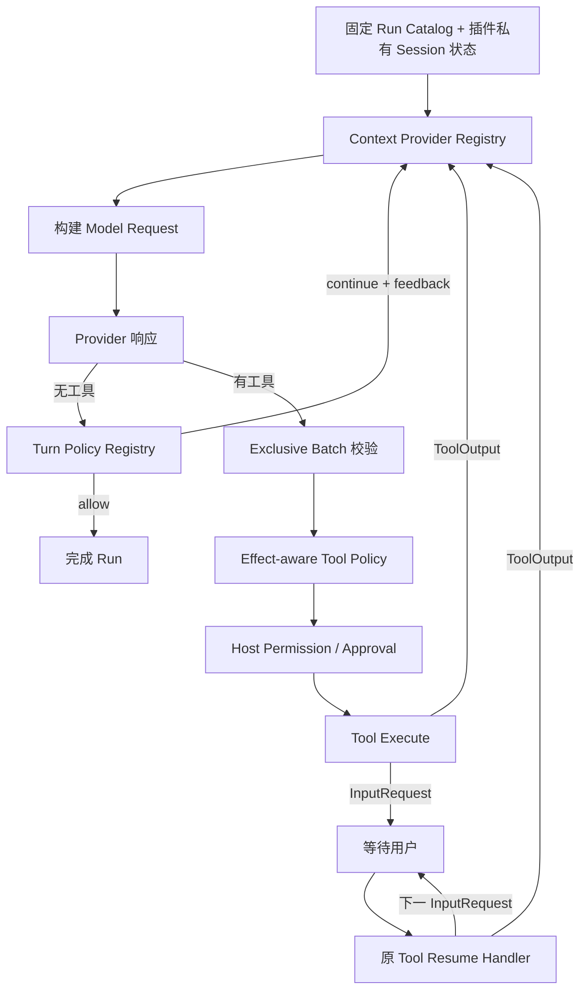

# OURO 框架与插件系统编排扩展性分析

> 文档性质：历史架构分析。当前契约以 [`dev/specs/plugin-system.md`](../dev/specs/plugin-system.md) 为准。
>
> 日期：2026-07-18
>
> 审查对象：OURO Core、Application Runtime、Tool/HITL、Plugin SDK、Plugin Runtime 与 Extension Catalog
>
> 压力测试用例：计划模式插件
>
> 结论性质：当前实现审查与底层演进建议，不是计划模式实现方案

## 0. 结论

**OURO 的插件包、Generation、不可变 Catalog、Run lease 和 durable execution contract 已经为深层插件建立了正确的生命周期底座；但当前公开 contribution 面仍不足以正确实现一个编排型计划模式插件。**

更准确地说：

- 当前能力足以做一个演示原型：插件可以贡献控制工具、每轮上下文、工具策略、命令、私有状态和结构化用户输入请求；
- 当前能力不足以做一个语义闭合、可恢复、可与其他插件正确组合的实现：缺少轮次收束策略、工具副作用语义、独占控制工具批次和用户交互恢复回调，且 `permission_control="tool"` 会绕过全部插件工具策略；
- 因此当前结论是 **“插件生命周期架构可承载，现有 Harness 扩展契约不可直接承载”**，而不是“插件系统整体不可用”；
- 不应把 `plan_mode`、`EnterPlanMode`、计划文件特例或第二套循环写进 Core。应先补齐少量通用、类型化的 Agent Harness 扩展原语，再把计划模式完全实现为普通 user plugin。

决策建议：

| 决策 | 结论 |
|---|---|
| 仅使用当前 Plugin SDK 开发正式计划模式插件 | **No-Go** |
| 先修正通用 Harness 扩展契约，再开发插件 | **Go** |
| 在 Core 增加 `plan_mode` 分支或第二套循环 | **No-Go** |
| 引入通用工作流引擎、事件总线或安全沙箱 | **No-Go** |

本报告遵循[编码准则](OURO_AGENT_编码准则_ZH.md)和[计划模式 Harness 调研](开源Agent计划模式Harness设计模式调研_2026-07-18.md)，但不把计划模式当成 OURO 的基础概念。计划模式只用于检验：一个受信任插件能否改变 Agent 的阶段性上下文、合法动作、交互暂停与轮次退出规则。

## 1. 第一性原理：框架应该提供什么，插件应该拥有何物

### 1.1 不可变的是能力目录，可变的是一次会话中的策略状态

`ExtensionCatalogLease` 冻结一个 Run 使用的代码、工具定义、策略实现和 contract；它不应冻结插件内部的会话状态。计划、审阅、诊断、教学、发布向导等编排插件都需要在同一个 Catalog 下改变自身阶段。

因此正确边界是：

```text
Run Catalog：冻结“有哪些实现、实现属于谁、契约是什么”
Plugin State：保存“当前 Session 正处于什么阶段”
Core Loop：在固定检查点读取 Catalog 中的策略，并把当轮事实交给策略判断
Application：执行并持久化策略返回的类型化意图
```

这与当前“一次 Run 持有一个不可变 Catalog”的设计不冲突，也不要求运行中替换 Catalog。

### 1.2 权限、副作用和阶段合法性是三个不同概念

- **权限**回答：这个调用是否需要用户审批；
- **副作用**回答：这个工具在语义上是只读、会改变状态，还是未知；
- **阶段合法性**回答：在当前插件阶段中是否允许提出或执行这个动作。

三者不能继续由 `permission_mode` 和工具名猜测共同承担。只读工具也可能因敏感数据需要审批；一个 `auto` 工具也可能在某个编排阶段中不合法；一个已获用户审批的写工具则可能被阶段策略允许。

副作用元数据是组合语义，不是安全沙箱。插件仍是 full-trust 系统模块，OURO 不试图阻止它绕过 Host API 直接调用 OS。

### 1.3 用户交互不是普通工具的终点，而是可恢复调用的中间状态

工具返回用户输入请求时，Host 持久化请求并暂停 Run。用户回答后，若插件需要根据答案更新自身状态、校验表单或继续多步交互，答案必须重新进入原贡献实现；Host 不能只把答案直接伪造成最终 ToolResult。

这适用于计划审批、部署确认、OAuth、冲突解决和多步表单，不是计划模式特例。

### 1.4 模型的纯文本响应只是“候选完成”，不是永远不可拦截的终态

Core 可以默认接受纯文本并完成 Run，但编排策略必须有一个在完成前介入的类型化检查点。策略只能决定“接受完成”或“持久化反馈并继续同一 Run”，不能接管 Provider、SessionStore 或自行创建 Run。

### 1.5 Provenance 只用于归因，不应决定受信插件的运行待遇

插件的来源、owner 和 digest 必须继续进入诊断与 durable contract；但安装并信任后的 user plugin 不应因为被标记为 `third_party` 而天然排在 builtin 之后，或使用另一套失败规则。排序和失败行为应由 contribution 语义、显式 priority 与稳定 identity 决定。

## 2. 现有架构中应保留的部分

### 2.1 Core 循环边界基本正确

`ouro/core/inner_loop.py` 已把单个 active Run 的模型循环与 Session 创建、锁、恢复、队列和持久化分开。`InnerLoopPorts`（第 188—199 行）显式承载上下文、工具批次、完成、失败、暂停和 turn-boundary input；循环每轮重新准备上下文，并没有为某种业务模式建立第二套路径。

尤其值得保留的是：

- 每轮都重新调用 `prepare_context`（第 403—419 行）；
- 工具调用与结果维持完整 turn 边界；
- 等待审批和等待用户输入是 durable Run 状态；
- `consume_turn_boundary_inputs` 已经位于纯文本完成前（第 367—375 行），这正是接入通用轮次策略的自然位置。

所以底层不需要重写循环，只需要把已有内部 seam 提升为可组合、可持久化归因的策略边界。

### 2.2 Plugin Runtime 与 Catalog 生命周期设计正确

`ouro/plugins/catalog.py` 和 `ouro/plugins/runtime.py` 已经实现：

- candidate Generation 完整构建后才发布；
- 一个 Run 持有一个 `ExtensionCatalogLease`；
- Tool、Hook、Command、Compaction、Continuation、Tool Policy 和 Skill 都随 lease 固定；
- 插件更新不改变旧 Run 使用的实现；
- pending invocation 持久化 execution contract，重启后可重建精确旧 Generation；
- generation gate、owner 和资源回收边界明确。

这正是实现“编排状态可变、实现契约不漂移”的基础，不应为了计划模式引入可变全局 registry 或运行中 Catalog 热替换。

### 2.3 已有 contribution 覆盖了大部分输入面

当前 SDK 已提供：

- `ContextContribution`：每轮追加 system synthetic context；
- `ToolPolicyContribution`：要求审批或拒绝工具；
- `ToolContribution`：提供模型驱动的阶段控制入口；
- `CommandContribution`：提供用户驱动的 Host 入口；
- `ToolInputRequest`：用任意 JSON 表达 Host-neutral 交互界面；
- `PluginDataStore`：保存插件私有持久状态；
- `ContinuationPolicyContribution`：控制跨 Run 自动续跑。

这些能力说明插件系统已经不是“脚本/工具安装器”，而是进入了真实 Agent 生命周期。问题集中在若干关键语义没有闭合，而不是缺少更多通用 Hook。

## 3. 计划模式压力测试矩阵

| Harness 能力 | 当前支持度 | 事实依据 | 判断 |
|---|---|---|---|
| 同一循环内多轮执行 | 支持 | `InnerAgentLoop.run` 的固定模型/工具循环 | 保留 |
| Run 绑定不可变插件实现 | 支持 | `RuntimeService._attach_extension_snapshot`；`ExtensionCatalogLease` | 保留 |
| Session 级插件阶段状态 | 部分支持 | `PluginDataStore` 可按 `session_id` 自行保存；无 CAS/Session 生命周期 API | 初版可用，需插件自带 schema/revision/idempotency |
| 每轮注入阶段提醒 | 部分支持 | `ContextContribution` 最终映射为 `after_context_build` Hook | 能注入，但抽象与失败语义不正确 |
| 动态裁剪模型可见工具 | 不支持 | 每轮读取的仍是 Run Catalog 中固定 `ToolRegistry.definitions()` | 不是首版阻塞项，可先保留工具列表并执行期拦截 |
| 按副作用限制动作 | 不支持 | `ToolDefinition` 无只读/写入/未知语义；策略只能看名称、参数和来源 | 正式实现阻塞项 |
| 对所有工具执行阶段闸门 | 不支持 | `ToolCallCoordinator._evaluate_tool_policies` 第 855—856 行跳过 tool-controlled 工具 | 正式实现阻塞项 |
| 模型调用 Enter/Exit 控制工具 | 部分支持 | 插件可贡献 `permission_control="tool"` 工具 | 缺少独占批次语义 |
| 控制工具必须单独成批 | 不支持 | 现有 `execution_mode="sequential"` 仅改变执行顺序；全部调用先统一 preflight | 正式实现阻塞项 |
| 结构化计划确认 UI | 支持 | `ToolInputRequest.data` 可持久化任意 JSON；测试已有 `plan_confirmation` | 保留 |
| 用户回答后由插件恢复调用 | 不支持 | `resolve_user_answer` 直接生成 ToolResult，不再次调用工具实现 | 正式实现阻塞项 |
| 插件按自身语义拦截候选完成 | 支持 | 通用 Turn Policy 可在完成前返回 `allow/continue` | 保留为通用扩展点；计划模式不使用 |
| 用 continuation 补救纯文本结束 | 仅可作为旁路 | continuation 在 Run 已 terminal 后才执行，并创建下一 Run | 不作为计划模式流程 |
| 计划 artifact 持久化 | 支持 | 可复用内置 Write/Edit 并由插件限制调用资源，也可使用插件私有数据；只有语义确实不同时才需要专用 artifact tool | 不需要 Core 计划文件特例或重复工具 |
| 用户 `/plan` 入口 | 支持 | Plugin Command 只变更插件 Session 状态，不返回 `SessionInput` | 不创建 Run，不伪造消息历史 |
| 等待交互后的旧 Generation 恢复 | 支持底座 | Run 保存 execution contract，`answer_user` 会恢复对应 Run snapshot | 可直接复用于 resumable tool |

### 3.1 对现有候选计划模式设计的判定

当时的 OURO PLAN 模式候选设计中，以下方向是正确的，应保留在插件内部：

- 不改变主循环；
- 用会话内状态、每轮提醒、工具执行闸门和显式 Exit 表达阶段；
- Enter/Exit 是 Harness 控制工具，不受普通 Session approval mode 改写；
- Exit 信号与计划 artifact 分离；
- 用户批准前不开放普通写能力；
- 同一 Session 可多次进入，每次产生独立 artifact。

但按当前框架直接实现时，以下部分必须调整：

- “系统提示词和工具列表不变”可以保留，但工具闸门不能再按 Write/Edit/Bash 名称推断副作用类别，必须以 Tool effect 为默认规则并覆盖 tool-controlled 工具；对计划 artifact 等精确例外，再使用 canonical identity 和校验后的调用参数限定资源范围；
- `/plan` 不应让 Host 伪造 Enter 的 assistant tool call/result，也不应隐式提交模型输入。Plugin Command 只调用与 Enter tool 相同的插件领域状态迁移；下一条用户消息按正常入口创建 Run；
- “只有计划文件可写”不应修改通用 Write/Edit 的全局权限或在 Core 中加入计划路径特例。默认应复用共享 Write/Edit，由插件在调用级策略中只对当前计划 artifact 放行；只有更新计划具有不同参数结构、原子性或业务语义时，才提供专用 artifact tool；
- 当前 Exit handler 返回 `ToolInputRequest` 后不会收到用户答案，因而无法可靠实现“批准后退出、拒绝后保持 active”；必须先有 resumable tool；
- Exit 的 `options` 可以继续作为 `plan_confirmation` request data，但答案校验和状态迁移属于 resume handler，不属于 observational Hook；
- “只能 AskUser 或 Exit 收轮”不是计划模式的运行时约束。计划模式可以通过提示表达推荐工作流，但不拥有 Run 的续断权；纯文本可以正常结束当前 Run，而插件 Session 状态继续保持 active。

## 4. 关键架构问题

### F1. Context Provider 被实现成通用 Hook，语义边界错误

现状：

- `ContextContribution` 在 `ouro/plugins/api.py` 第 624—637 行被转换成 `after_context_build` Hook；
- `ContributionTypeAdapter` 又把 `context_providers` 投影到 `HOOK_PROJECTION_ADAPTER`；
- `ContextPreparationService.prepare` 第 364—377 行调度 Hook、记录失败，然后无条件继续构建上下文；
- 事件名叫 `after_context_build`，实际发生在 `ContextBuilder.build` 之前；
- `HookRegistry` 用同一个 `HookResult.added_context` 同时服务 observational Hook 和 context enrichment。

这使“观察失败可忽略”和“模型请求所必需的上下文缺失”无法表达不同失败语义。计划模式若状态仍为 active，而提醒 provider 一次失败后被隔离，工具策略仍可能继续拒绝写操作，模型却失去解释当前阶段的上下文。

底层修正：建立独立的 `ContextProviderRegistry` 和类型化 `ContextFragment`，由 Catalog 单独持有；provider 声明运行期失败是 `omit` 还是 `block`。观察型 Hook 继续 fail-open，必需的阶段上下文失败则阻止本次模型请求并产生可诊断状态。

不接受的补丁：让计划插件同时注册多个重复 Hook、在 Tool Policy 的拒绝 reason 中补提示，或在 `RuntimeService` 中识别计划插件。

### F2. Tool Policy 与 Host permission 耦合，不能表达全局阶段合法性

现状：

- `ToolPolicyDecision` 的 `ignore | require_approval | deny` 组合规则本身合理；
- 但 `ToolCallCoordinator` 对 `permission_control="tool"` 直接跳过 registry；
- `ToolExecutor` 也只在 `permission_control="host"` 时应用 policy 结果；
- Plugin SDK 的 policy call 看不到工具定义、owner、canonical identity 或副作用语义；
- `ToolDefinition` 没有 `read_only/state_changing/unknown` 等字段。

`permission_control` 原本用于保护 Harness 控制工具不被 Session approval mode 锁死，却同时让它们逃逸了所有其他插件的阶段策略。结果是任何另一个受信插件贡献的 tool-controlled 工具都无法被计划、审阅、只读诊断等编排插件约束。

底层修正：

1. 为 Tool contract 增加最小 `effect = read_only | state_changing | unknown`，默认 `unknown`；
2. 将 tool policy 作为独立的限制性组合层，对所有工具评估；`permission_control` 只决定 Session/配置 permission 是否能覆盖工具自身声明，不再决定是否运行其他策略；
3. policy call 接收类型化 tool subject（canonical identity、owner、source、effect）、schema 校验后的 arguments 和 Session/Run 上下文，使策略既能按副作用类别限制，也能对一次具体调用限定资源范围；
4. `require_approval` 仍只能收紧，绝不能把 Host 的 `deny` 或 `approval` 降为 `auto`。

计划插件可对自己的 Enter/Exit 控制工具返回 `ignore`；复用共享 Write/Edit 时，仅当规范化后的目标等于当前计划 artifact 才返回 `ignore`，其余 `state_changing/unknown` 调用返回 `deny`。这里的 `ignore` 只是“不增加限制”，不能覆盖 Host 已有的 `deny` 或 `approval`。若另一个受信策略与它冲突，按最严格值组合并暴露 owner/reason；不需要建立插件优先级安全中心。

#### F2.1 `effect` 的声明、归一化与未知兜底

OURO 无法从工具名称、自然语言描述或 handler 代码中可靠推导副作用。`effect` 必须由工具所有者声明，再由各接入 adapter 归一化为 OURO 的 Tool contract；无法确认时保持 `unknown`，不做启发式猜测。

| 工具来源 | contract 来源 | 缺失或无法确认时 |
| --- | --- | --- |
| OURO builtin | `ToolDefinition.effect` 显式声明，并由 Core 测试覆盖 | 视为内置定义错误；Catalog 构建或测试失败 |
| user plugin | `ToolContribution.effect` 显式声明 | 为兼容旧插件映射为 `unknown` |
| MCP | 映射 `Tool.annotations.readOnlyHint` | 映射为 `unknown` |
| 用户显式配置 | 对稳定 canonical tool identity 设置 override | 不存在 override 时沿用上游结果 |

MCP 的 `ToolAnnotations` 目前提供 `readOnlyHint`、`destructiveHint`、`idempotentHint` 和 `openWorldHint`，但规范明确说明它们只是提示，不保证忠实描述工具行为；OURO 不应把名称或 `destructiveHint=false` 猜成只读。按照 OURO “安装/配置即信任该扩展”的边界，被接入 Catalog 的 MCP server 与已安装插件一样，由用户承担信任决定，OURO 不再建立第二套注解安全等级；其显式注解归一化如下：

```text
readOnlyHint == true   -> read_only
readOnlyHint == false  -> state_changing
readOnlyHint 缺失      -> unknown
```

`destructiveHint=false` 仍可能新增数据，`idempotentHint=true` 仍可能写入状态，`openWorldHint` 描述外部交互范围而不是可写性，因此三者都不能单独推出 `read_only`。参考 [MCP ToolAnnotations schema](https://modelcontextprotocol.io/specification/2025-11-25/schema) 和 [MCP 官方对 annotations 信任边界的说明](https://blog.modelcontextprotocol.io/posts/2026-03-16-tool-annotations/)。

对于没有注解的既有 MCP server，用户可以按 canonical tool identity 显式覆盖 `effect`。adapter 应保留声明来源用于诊断，但 execution contract hash 只需纳入最终归一化的 `effect` 和其他影响执行语义的 contract 字段；最终 `effect` 发生变化时，不能让等待恢复的旧 Run 静默采用新语义。优先级固定为“用户显式 override > 来源声明/协议注解 > `unknown`”，用户将工具覆盖为 `read_only` 即表示主动承担该声明责任。

插件信任并不意味着框架能证明声明绝对正确；这里追求的是清晰的责任边界和保守失败，而不是新增 sandbox 或运行时行为审计。编排策略必须把 `unknown` 当作不能证明只读，而不是自动放行。若后续多个插件都需要跨不同工具表达资源范围，再基于真实用例增加标准化的 per-call `resolved_effects`；首版先使用 canonical identity 与校验后的 arguments，避免过早设计资源权限 DSL。

### F3. 顺序执行不是阶段控制工具需要的独占批次

现状：`ToolCallCoordinator.handle_batch` 第 117—130 行会先对整批调用逐个 preflight，之后才执行；`execution_mode="sequential"` 只影响第 176 行之后的执行顺序。Plugin SDK 甚至没有暴露 `execution_mode`。

若模型同一响应产生 `EnterPlanMode + Write`：

1. 两个调用都在 Enter 执行前完成 policy preflight；
2. Write 看到的仍是旧阶段；
3. 即使整批最终顺序执行，状态边界也已被穿透。

底层修正：Tool contract 增加 `batch_behavior = compatible | exclusive`。含 exclusive 工具的响应若还有兄弟调用，整批在任何 handler 执行前生成可回注的协议错误，要求模型下一轮单独调用。Enter、Exit、认证跳转、事务提交等控制工具都可复用。

不接受的补丁：在 Enter handler 中扫描其他调用（handler 看不到批次）、依赖提示词要求模型“不要并行”，或把全局工具执行永久改为 sequential。

### F4. `ToolInputRequest` 是单向暂停，不是可恢复工具协议

现状：工具首次执行可以返回 `ToolInputRequest`；Host 持久化它并进入 `waiting_user`。但 `ToolCallCoordinator.resolve_user_answer` 第 625—668 行直接把答案转换为 `ToolResult(structured={"answer": ...})`，不会再次调用插件 handler。

计划插件若要在用户批准后切换阶段，目前只有三种旁路：

- 在 `after_tool_call` 观察 Hook 中识别答案并补写状态；
- 让模型看到答案后再调用第二个提交工具；
- 提前退出阶段，再在拒绝时尝试回滚。

三者都不正确。第一种把关键状态迁移放进 fail-open 观察者；第二种把用户授权变成模型自我声明；第三种在审批前开放动作空间。

底层修正：扩展 Tool contribution 为 resumable invocation。首次 handler 可返回 input request；`answer_user` 在精确 Run Catalog/Generation 下调用该工具的 `resume` handler，传入原 invocation、answer 和 request-scoped context。resume 可返回 `ToolOutput`、错误或下一个 `ToolInputRequest`。Host 持久化 interaction checkpoint，并以 `tool_call_id + interaction revision` 支持幂等重放；worker 对应增加 `tool.resume`。

现有 execution contract、Run lock、active tool batch 和 `_ensure_extension_snapshot` 已经提供了大部分恢复底座，不需要另建 workflow engine。

### F5. Core 把无工具文本直接视为不可拦截的 Run 完成

现状：模型返回文本且无工具时，`InnerAgentLoop` 在第 357—386 行直接调用 `complete_run`。插件只能等 `after_run` 或 continuation，此时 assistant 消息和 terminal Run 已经提交。

用 continuation 重新提示会产生以下错误语义：

- 原 Run 已对 Host 表示完成；
- 补救发生在新 Run，不是同一 agentic loop 的下一轮；
- 探索文本被当作正式交付写入历史；
- 每个新 Run 重置单 Run budget，可能形成跨 Run 自续跑；
- 原调用方返回的仍可能是前一个 Run 的 final text。

底层修正：新增 snapshot-bound `turn_policies` contribution，在“无工具候选完成、尚未 complete Run”处评估。最小输出只有：

- `allow_complete`；
- `continue(feedback_context)`。

多个策略中任一 `continue` 即不完成，反馈按稳定 identity 合并，由 application 持久化 assistant attempt 与带 owner 的 synthetic feedback，再进入同一 Run 下一模型轮。策略失败应暂停/阻止完成，而非静默放行；现有 `RunBudgetPolicy` 继续提供有界兜底。

该能力可直接接在现有 `consume_turn_boundary_inputs` seam，而不是改写 Provider 循环。

这是框架提供给确实需要控制候选完成的编排插件的通用能力，不是计划模式的必选组成。计划模式的 Enter/Exit 通过工具结果向模型提供状态迁移语义，不注册 Turn Policy，也不据 active 状态要求同一 Run 续跑。

### F6. Provenance 正在影响语义顺序和失败待遇

现状：

- `ContributionCoordinator.prepare` 把所有 user plugin 固定标记为 `third_party`；
- `HookRegistry.registered` 先按 `_SOURCE_ORDER`、再按 priority 排序；
- Hook 失败后，非 `official` contribution 会被本 Run 禁用，`official` 则不会。

这与“安装并信任后，插件是系统的自然扩展模块”不一致，也让 priority 无法真正表达跨 builtin/user contribution 的组合顺序。

底层修正：保留 provenance 供 UI、日志和审计展示；运行期排序只看 contribution priority、canonical identity 和必要的显式依赖。失败规则由 observation/enrichment/guard/lifecycle 等 contribution 语义决定，不由来源等级决定。

这不是取消 owner、digest、代码信任或执行契约，而是避免把来源事实误用成语义权限。

### F7. Session-targeted Command 与 active Run 可能来自不同 Catalog

现状：`PluginService.execute_command` 总是从 current Catalog 取得 lease；而 active Run 始终使用启动时的 Catalog。Command 返回的 attributed `SessionInput` 可 steer 到 active Run，但 `RuntimeService.submit_plugin_input` 不验证该 contribution execution contract 是否存在于目标 Run Catalog。

正常未更新时二者相同；插件在长 Run 中更新后，用户命令可能由新 Generation 修改共享插件状态，而旧 Run 仍执行旧 Generation 的 context/policy。对于模式切换、目标控制等有状态命令，这是实际一致性风险。

底层修正：有 `session_id` 且存在 active Run 时，session-targeted command 应从该 Run 的 Catalog 解析；至少也必须在提交 steer 前校验 attribution contract 与目标 Run snapshot 一致，不一致则拒绝或只允许进入下一 Run。

该问题不是计划模式首版的唯一阻塞项，但属于通用 session-control 正确性，不能靠插件自行判断。

## 5. 最小目标架构

建议只补齐下图中的类型化检查点，不增加通用 middleware：



Catalog 只需新增或修正以下 snapshot-bound contract：

1. 独立 `context_providers` registry，不再借用 Hook registry；
2. `turn_policies` registry；
3. Tool 的 `effect`、`batch_behavior` 与 optional resume handler；
4. 对所有工具生效的限制性 `tool_policies`；
5. session-targeted command 的 Run Catalog 绑定。

每项都必须进入 Manifest、SDK、worker protocol、contract hash、Catalog adapter、owner/gate、durable recovery 和边界测试。不要只改 in-process SDK，否则 worker 与恢复契约会再次分叉。

## 6. 修正后计划模式插件应如何映射

以下内容仅证明抽象足够，不把这些概念放入 OURO Core。

### 6.1 插件私有领域状态

插件在私有数据中维护带 schema/version 的 Session 状态，例如：

```text
inactive
active(plan_artifact_ref, revision)
awaiting_approval(plan_artifact_ref, tool_call_id, interaction_revision)
```

状态迁移记录稳定 transition id，resume 重放必须幂等。是否使用真实 Markdown 文件、插件私有 artifact 或 workspace 文件，是插件产品选择；Core 不提供“计划文件”特权路径。

### 6.2 Contributions

- `Command /plan`：用户驱动激活；只更新插件状态，不提交模型输入、不创建 Run，也不伪造消息历史；
- `EnterPlanMode`：模型驱动激活；tool-controlled、exclusive；
- artifact 写入：默认复用系统内置 Write/Edit；Tool Policy 只对当前 Session 的规范化 `plan_artifact_ref` 返回 `ignore`。若计划更新具有不同参数结构、原子性或业务语义，可选贡献 `UpdatePlanArtifact`，但它不是实现局部写权限的前提；
- `ExitPlanMode`：tool-controlled、exclusive、resumable；首次返回 `plan_confirmation`，resume 根据 accept/revise/reject 原子迁移状态；
- required Context Provider：active 时每轮注入完整/精简阶段说明和 artifact 引用；
- Tool Policy：active 时对 `read_only` 和自身控制工具不增加限制；对共享 Write/Edit，仅在调用目标严格等于当前 `plan_artifact_ref` 时不增加限制；其余 `state_changing/unknown` 要求审批或拒绝；
- 不贡献 Turn Policy：计划模式不控制当前 Run 的继续或完成；Enter/Exit 的 ToolResult 与 Context Provider 提示由模型自行理解和决策；
- 可选 Command：取消/重新进入/查看当前 artifact。

这里不改变 Write/Edit 的 ToolDefinition 或 Host permission，也不把计划路径写入 Core。计划插件只在自己的领域状态和调用策略中表达资源例外；Bash 等无法可靠结构化判定影响目标的工具不能使用该例外。这样工具列表仍只有一套共享写工具，其他审阅、审计或发布编排插件也能复用同一机制。

### 6.3 批准后的同构继续

用户接受计划后，Exit 的 resume handler 先把插件状态切到 inactive，再返回包含批准计划的 ToolOutput。该结果进入原 tool call 的 canonical history；下一模型轮读取同一个 Run Catalog，但 Context Provider 和 Tool Policy 根据新状态自然恢复普通行为。

没有第二套循环、没有 Runtime plan 分支、没有伪造用户消息，也不需要运行中替换 Catalog。

## 7. 实施顺序

### P0：建立正确的 Harness 契约

1. 拆分 Context Provider 与 Hook registry，明确 block/omit 失败语义；
2. 为 Tool 增加 `effect` 和 `batch_behavior`，完成 builtin、plugin、MCP 与用户 override 的归一化，并纳入所有 contract hash；
3. 让限制性 Tool Policy 对所有工具生效，并传入类型化 tool subject、校验后的 arguments 和 Session/Run 上下文；
4. 实现 resumable ToolInputRequest；
5. 在现有 turn-boundary seam 增加 `turn_policies`。

这五项是正式计划模式插件的最小底层前置。应先写 Core/Application 行为测试，再同步 Plugin SDK、worker、Manifest、Catalog adapter 和 durable recovery。

### P1：收敛跨边界一致性

1. session-targeted command 绑定 active Run Catalog；
2. 为插件私有状态并发积累真实用例；只有出现多个需要 CAS 的插件后，再把 `PluginDataStore` 扩展为 revisioned mutation API；
3. 根据 token 与模型行为证据决定是否增加动态 tool visibility policy。首版计划插件可以保持工具列表不变，用 effect-aware 执行闸门兜底。
4. 只有多个插件确实需要跨异构工具表达资源范围后，再从 canonical identity 与 validated arguments 提炼通用 per-call `resolved_effects`；首版不引入资源权限 DSL。

### P2：实现计划模式插件

在 P0 契约稳定后，计划模式只新增 user plugin package、测试和 Host 对 `plan_confirmation` 数据的展示映射。Host 不解释“计划模式”，只解释通用的 ToolInputRequest JSON。

## 8. 明确不做

- 不在 `SessionRecord`、`RunRecord` 或 `InnerAgentLoop` 增加 `plan_mode` 字段/分支；
- 不建立第二套 agent loop；
- 不让插件直接取得 `RuntimeService`、`SessionStore` 或可变 Catalog；
- 不把 plan artifact 路径或权限硬编码进 Write/Edit/Bash；资源例外属于插件的调用级策略；
- 不以工具名称约定只读性；
- 不用 observational Hook 承担阶段状态提交；
- 不用跨 Run continuation 冒充同一 Run 的轮次收束；
- 不引入 workflow engine、任意事件总线、动态 extension-point 注册或 UI DSL；
- 不为插件增加 OS sandbox、publisher policy 或企业权限中心；
- 不为了首版计划模式实现动态工具裁剪、清上下文重开或流式标签解析器。

## 9. 验收场景

底层改造完成后，至少应以以下集成测试证明它支持的不是一个硬编码计划模式：

1. active 编排策略能限制后续新增的 builtin、user plugin 和 MCP 工具，不依赖名称清单；
2. tool-controlled 工具仍绕过 Session approval mode，但不能绕过其他限制性 Tool Policy；
3. `Enter + state-changing tool` 同批时，所有 handler 都未执行，模型收到 exclusive batch 错误；
4. resumable tool 在进程重启后由原 execution contract Generation 接收答案，且重复 answer/recovery 不重复迁移状态；
5. 用户 reject 后阶段仍 active，accept 后在下一模型请求前已经 inactive；
6. active 阶段下的无工具文本不会完成 Run，而是在同一 Run 获得反馈；Run budget 仍能停止无限继续；
7. required Context Provider 失败会阻止模型请求并暴露诊断，observer Hook 失败仍 fail-open；
8. contribution 排序不因 `official/third_party` 来源改变，priority 与 identity 决定稳定顺序；
9. 插件更新期间，session-targeted command 不会把新 Generation 的状态控制意图注入旧 Catalog Run；
10. 同一组原语还能实现只读审阅模式或发布确认向导，测试中不出现任何 `plan` Core 类型。
11. builtin、plugin、MCP 和用户 override 的 `effect` 归一化稳定；未声明的扩展工具为 `unknown`，计划阶段不会将其当作只读放行，override 变化会改变 contract hash；
12. 计划插件复用同一个内置 Write/Edit：当前计划 artifact 目标可通过策略，其他目标被拒绝，工具列表中不出现仅为权限范围不同而复制的写工具。

## 10. 最终判断

OURO 当前最有价值的资产是清晰的 Core/Application 边界和成熟的 Plugin Generation/Catalog 生命周期；最需要修正的不是安装、信任或资源管理，而是 **Catalog 内的插件如何以类型化策略参与每个 Agent turn**。

计划模式揭示了五个真实变化轴：上下文必需性、动作副作用、控制工具批次边界、交互恢复和候选完成判定。把这五个变化轴做成通用、封闭、可组合的契约后，计划模式会自然成为一个普通插件；如果绕过它们直接拼 Hook、工具名和 continuation，OURO 会得到一个能运行但无法继续演进的特例。
