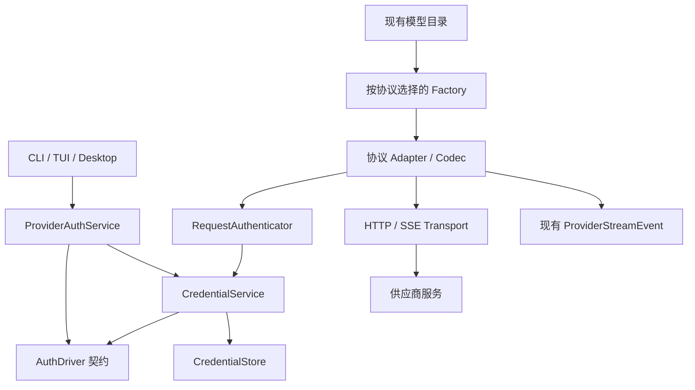

# 模型订阅认证扩展设计

> 文档类型：目标设计，完整订阅接入尚未实现
> 设计基线：2026-09-16
> 首期交付：OpenAI / ChatGPT 订阅接入；架构面向后续多厂商接入。

本文解释边界、取舍与扩展方式。精确行为由[模型订阅认证规格](../dev/specs/OURO_模型订阅认证规格_2026-09-16.md)统一定义，实施顺序见[实施计划](../dev/plans/OURO_模型订阅认证实施计划_2026-09-16.md)。现行能力仍以[Provider 配置规格](../dev/specs/OURO_Provider配置规格_2026-09-02.md)为准。

独立凭据核心的现行行为见[凭据核心规格](../dev/specs/OURO_凭据核心规格_2026-09-16.md)，驱动契约及单次授权资源见[认证驱动与授权规格](../dev/specs/OURO_认证驱动与授权规格_2026-09-16.md)，通用登录与条件提交见[Provider 认证用例规格](../dev/specs/OURO_Provider认证用例规格_2026-09-16.md)；轻量 CLI 与现有协议请求认证已接入，见[请求认证规格](../dev/specs/OURO_请求认证规格_2026-09-17.md)；生产 OAuth、Runtime 共享认证装配、Responses 与 TUI 尚未完成。

## 目标与结论

建立可组合的认证与模型调用边界，首个组合是 OpenAI OAuth 驱动、ChatGPT 订阅产品档案和 Responses adapter。后续接入厂商主要增加驱动、产品数据和必要的服务适配；使用相同线协议时复用 adapter。Core、Application 和 Host 不包含厂商品牌判断。

保留 OURO 的 Provider 实例、产品类型、线协议分离，继续使用 `provider_id/endpoint_id` 路由。登录、凭据刷新和协议编码各有唯一所有者，模型选择、工具、审批、会话、压缩与 Run 生命周期继续由现有运行时负责。

OAuth 是取得授权的方式，订阅是服务端的权益和计费方式，两者不等价。首期 OpenAI 接入使用账户具备的 Codex 权益，不能把 access token 当成普通 Platform API Key，也不意味着可使用所有 ChatGPT 功能或所有 OpenAI 模型。[OpenAI 认证文档](https://learn.chatgpt.com/docs/auth)

首期覆盖浏览器与设备码登录、受管理凭据、刷新/注销、SSE、文本、自定义工具、多轮续接与实际 token 用量。图像和结构化输出仅在目标后端验证后声明支持。账户池、自动付费回退、动态认证插件、代理服务、远端会话管理与 WebSocket 优化不进入本期。

## 调研依据

调研固定到以下源码，避免将后续上游变更混入本设计的证据：

| 项目 | 提交 |
|---|---|
| OURO | `3df3e850ad62d43c4a2fd2786f9c289d6c249ed4` |
| OpenCode | `e03db9bc6908f75c9334d8aa997deeaac81c0298` |
| OpenAI Codex | `04581f96044a9fe6062593c4d557036477aee961` |

OpenCode 主仓库的内置 Codex 插件提供浏览器 PKCE 和设备码登录，在请求时读取认证状态并刷新 Token，将请求发往 Codex 后端，并提供所需账户头。其 OpenAI provider 使用 Responses，认证与协议适配缺一不可。[Codex 插件源码](https://github.com/anomalyco/opencode/blob/e03db9bc6908f75c9334d8aa997deeaac81c0298/packages/opencode/src/plugin/openai/codex.ts)、[协议选择源码](https://github.com/anomalyco/opencode/blob/e03db9bc6908f75c9334d8aa997deeaac81c0298/packages/opencode/src/provider/provider.ts)

其认证编排与凭据存储已经分开，适合借鉴职责划分。SDK 占位 API Key、fetch URL 改写及品牌分支不适合直接复制到 OURO；原生 adapter 可以直接构造最终请求。[认证编排](https://github.com/anomalyco/opencode/blob/e03db9bc6908f75c9334d8aa997deeaac81c0298/packages/opencode/src/provider/auth.ts)、[凭据存储](https://github.com/anomalyco/opencode/blob/e03db9bc6908f75c9334d8aa997deeaac81c0298/packages/opencode/src/auth/index.ts)

官方 Codex 源码可用于交叉核验回调、PKCE、设备码轮询与超时；它证明客户端实现路径，不构成 OURO 已取得可用客户端注册的证明。[浏览器登录源码](https://github.com/openai/codex/blob/04581f96044a9fe6062593c4d557036477aee961/codex-rs/login/src/server.rs)、[设备码源码](https://github.com/openai/codex/blob/04581f96044a9fe6062593c4d557036477aee961/codex-rs/login/src/device_code_auth.rs)

## 当前架构的扩展位置

| 现有位置 | 观察 | 必要增量 |
|---|---|---|
| `config/provider_models.py`、`provider_codec.py` | 严格产品/协议模型及显式 codec | 认证驱动引用、managed credential 和 Responses 协议 |
| `config/credentials.py`、`providers/factory.py` | 构造时将 env/inline 解析为静态字符串 | 保留静态解析，注入请求认证端口 |
| `application/models.py` | 默认及其他 adapter 均可能被缓存 | 请求时取得动态凭据，刷新不靠重建 adapter |
| `config/provider_templates.py`、模板绑定 | 强制 `credential_env` | 以产品认证默认值表达订阅模板，绑定不保存账户 |
| `application/configuration_views.py` | 直接解析秘密来推导可用状态 | 使用认证服务的安全状态查询 |
| `providers/http_transport.py`、`retrying.py` | 共享 SSE 与输出前重试 | 复用尝试预算，添加必要错误事实和认证恢复 |
| `core/messages.py` | 已有不透明的 continuation blocks | Responses 在自有 envelope 内保存续接作用域，不新增 Core 认证字段 |
| `core/billing.py`、`application/usage.py` | 已保留未知金额及 priced/unpriced 请求计数，CLI 已区分未知与部分金额 | 复用汇总，补充请求计费来源及 Host 展示 |

## 架构与依赖方向

图表示调用关系。具体 driver、store 和服务规则只由 `LocalApplication` 装配；Application 不直接 import 其实现。

| 责任层 | 唯一职责 | 不负责 |
|---|---|---|
| `config` | 配置结构、产品组合、默认值与模板持久化 | 网络登录、Token 存取、运行状态 |
| `application/provider_auth.py` | Provider 登录用例、内存 operation、取消与 Host DTO | OAuth 报文、HTTP 对象、刷新调度 |
| `auth/credentials.py` | 凭据生命周期、刷新协调、注销与版本竞争 | Provider 配置、模型路由、Session/Run |
| `auth/drivers/` | 供应商授权/刷新协议及认证材料编码 | UI、模板写入、工具执行 |
| `auth/store.py` | 凭据记录、原子保存、受限权限与互斥原语 | 认证流程、权益判断 |
| `providers` | 请求编码、响应解码、协议注册、服务请求差异 | 登录操作、凭据文件、模型选择 |
| `local_application` | 显式构建、共享实例、关闭顺序 | 厂商业务与协议实现 |

`auth/contracts.py` 放纯类型和端口，不导入具体 driver/store。新增允许依赖为 `auth → core/local_io/local_locks`，以及 `application/providers/local_application → auth`；Application/providers 仅使用公开契约及通用服务。config 保持原有依赖，不读取 driver 注册表或启动客户端。现有 Core 零外层依赖和 Application 不依赖 providers 的规则保持不变。

产品档案保存声明式的认证与服务规则引用；config 只解析引用及配置数据，组合根负责解析对应实现并注入 factory。Factory 只按 `protocol` 选择 adapter，既不读取产品类型，也不猜测实例名称。服务规则按已选协议提供必要的参数约束和错误分类；允许目标以 auth 契约中的纯数据交给 RequestAuthenticator，auth 不反向依赖 providers。

## 最小必要抽象

| 契约 | 为什么需要 |
|---|---|
| `AuthDriver` 与方法描述 | 各厂商授权/刷新协议确实不同；Host 需要稳定的交互描述 |
| `AuthorizationAttempt` | 一次浏览器回调或设备轮询拥有可取消、可关闭的生命周期 |
| `CredentialStore` | 将凭据持久化与生命周期分离，支持测试及后续系统存储 |
| `RequestAuthenticator` | 三种模型协议均可组合静态或受管理认证，避免缓存 Token 过期 |

`CredentialService` 是有状态的具体服务，不再拆 token broker、refresh manager、revocation service。方法描述是数据，不为每个字段建立一层接口。服务规则沿用已注册协议的类型化参数能力和少量策略，不建立独立的 profile 生命周期、第二套模板或可执行 JSON 转换语言。

所有真实协议 adapter 使用同一个请求认证端口。API Key 沿用现有 resolver，并由静态实现编码对应认证头；静态路径不需要伪造登录/刷新 driver。managed 实现借用 CredentialService，同一次请求尝试的认证头、凭据 revision 和续接 scope 来自一次取得的内部快照。这项小范围改造必须本期完成，不能只让 Responses 支持动态认证，否则第二家采用 Messages 的订阅服务仍需重构。

授权方式与协议可以独立演进；产品档案约束哪些组合实际可用。注册表首期只是进程构建时的显式映射，不具备运行时发现、热更新、插件 generation 或动态 schema。

## 配置收敛

保留 `provider_type`、`protocol`、`credential_ref`，新增单一 `auth_driver` 引用。不再同时持久化 `auth.method`；OAuth 类型及 browser/device 方法由驱动描述。服务规则由产品档案解析，不增加可任意组合的用户 `service_profile` 字段。

订阅产品与 API 产品可以各有实例，如 `personal-chatgpt/coding` 和 `work-api/coding`。首期产品类型 `openai-codex`、认证驱动同名、协议 `openai-responses`，三者名称相似但职责独立。完整拟议 schema 和字段约束只在规格中定义。

既有静态认证仍是普通路径，无需为了统一而把 API Key 搬入秘密仓库。模板保持声明式：认证默认值归模板，实际 credential ref 归实例。模板更新不得隐式切换账户或认证方式。

## 校验与安全控制的取舍

判断标准是：检查是否位于真实的信任或状态变化边界，是否防止具体失败，是否已有唯一所有者。内部类型化对象不在每一层重新序列化/验证。

| 保留项 | 唯一执行边界 | 必要原因 |
|---|---|---|
| 配置结构及产品/协议/认证组合 | config 的权威解析与 mutation 校验 | 防止错误配置和歧义默认值 |
| 注册实现完整性 | composition root 构建时 | 防止声明了能力但未装配实现 |
| callback state、PKCE、操作时限 | 认证 driver/attempt | 防止错误授权归属及授权码误用 |
| Token 响应所需字段 | driver 的网络解码边界 | 外部响应不可信且可能变化 |
| 最终请求目标是否允许携带凭据 | RequestAuthenticator 的发送前边界 | URL 可经 Endpoint/命令覆盖后变化 |
| 凭据版本、原子更新及互斥 | CredentialService/Store | 避免轮换丢失、刷新竞争及注销后复活 |
| 协议终态、工具关联、opaque 续接作用域 | 对应 codec | 避免重复输出、错配工具和错误账户续接 |
| 秘密权限及对外脱敏 | store 写入、公开 DTO/错误出口 | 避免凭据意外披露 |

以下机制不纳入首期：

- 多层重复的产品组合表、URL allowlist 和 Token schema 校验；最终 URL 的检查集中一次执行。
- 独立授权 epoch、持久化登录 operation、凭据事件账本或后台轮询守护任务；凭据统一使用单调 revision 和互斥，状态查询使用本地事实。
- 将同一 OS 用户内的 Provider 实例当成不同安全主体；managed ref 是定位符，不另建 owner ACL 或跨实例授权系统。
- 通用 JWT/JWKS/OIDC 验证平台；首期不使用本地 ID Token 断言授予权限，驱动只解析所需路由元数据，服务端判断权益。后续驱动确需把 ID Token 当身份断言时，由该驱动按其协议处理。
- 同时交付 keyring/file/ephemeral 等多套生产存储；首期受限文件存储，内存实现只供测试，系统凭据存储保留接口演进空间。
- 每次请求扫描目录权限、额外订阅资格探测和新确认弹窗；权限在写入边界落实，显式登录/check 与用户已发起的调用就是相应动作入口。

保留外部浏览器、S256 PKCE、loopback 回调和 TLS，这些是 OAuth 客户端的基本正确性要求。[RFC 8252](https://www.rfc-editor.org/rfc/rfc8252)、[RFC 9700](https://www.rfc-editor.org/rfc/rfc9700)

## 状态与资源的收敛

登录 operation 只在 Application 内存中存在。凭据只有一份权威记录，刷新可用性由有效期推导，不再持久化 ready/refresh_due 等镜像状态。状态查询不登录、不刷新，也不承诺模型可访问。

同一 credential 的刷新、注销和提交使用同一互斥及 revision。刷新在锁内完成重读、换取和原子保存；注销排在已开始的刷新之后清空秘密并递增 revision，因此不需要另设 epoch 来阻止迟到写入。交互式等待浏览器不持锁，完成时才比较 begin 时的版本；并发修改产生明确冲突，旧凭据保持不变。

首期凭据位于 OURO_HOME 的独立受限目录，复用本地原子 I/O 和锁语义。原子替换临时文件也必须具有受限权限；文件模式不宣称加密。系统钥匙串可以以后替换 store，不改变认证用例。

Provider 配置和凭据不假装组成跨文件事务。网络授权完成后先等待该 credential 的锁，再进入短暂配置 mutation 边界，核对绑定与 revision 并条件保存凭据；等待刷新不占配置锁。刷新/注销只取 credential 锁，配置管理只取配置锁，因此不需要双锁试抢与重试编排。配置删除不暗中注销其他引用者；未绑定凭据由显式认证管理用例清理。具体并发顺序由规格统一约束。

LocalApplication 先停止新操作并取消 pending 登录，按现有顺序关闭模型消费者，再关闭共享认证资源。独立认证 CLI 使用轻量 composition context，不启动 Agent/MCP/插件。adapter 只借用认证句柄，不关闭整个 CredentialService。

## OpenAI 首个组合

OpenAI driver 实现浏览器 PKCE、设备码和刷新；Codex 服务规则提供允许目标及参数约束；Responses codec 负责 input、instructions、function call/output、SSE 与 usage。三者不修改 OURO 的工具执行循环。

Codex 的后端契约需要实测，不能由 Platform 文档全量推导。首期采用 SSE 和无远端持久会话模式；opaque reasoning、item 标识与必要顺序保存在 Responses 自有 continuation envelope 内，Core 继续只保存不透明 blocks。无需给 Core 新增 OAuth scope 或凭据字段。

continuation 的账户作用域是协议正确性信息，不是权限系统。其编码只由 Responses codec 与认证句柄协作；普通 Token 刷新不会使续接失效。服务端不支持的温度、输出上限或结构化输出参数不能静默转发或丢弃，应复用 Endpoint 参数能力明确表达。

Responses 的事件与 Chat Completions 不同，需要独立 codec；加密 reasoning 不能由公开摘要替代。[Responses 流式文档](https://developers.openai.com/api/docs/guides/streaming-responses)、[Reasoning 文档](https://developers.openai.com/api/docs/guides/reasoning)

token 用量复用现有账本，金额未知保持 `None`。计费来源随请求记录；已知金额和未知请求数复用现有 `UsageTotals`，只补齐 Host 对计费来源与部分金额的展示，不新建汇总模型、订阅计费系统或推算远端额度。

## 后续厂商扩展检查

新增厂商的正常路径：确认认证/权益契约，增加 AuthDriver，登记产品档案与服务规则，复用已有协议或在确有差异时新增 codec，补充脱敏 fixture 和契约测试。

新增厂商不应修改 ProviderAuthService 的登录流程、CredentialStore 的通用结构、刷新协调、Core/Run 状态机或 Host 的品牌分支。新交互形态、认证材料类型或线协议只有在真实需求出现时扩展；不预先声称任意厂商都可零改动接入。

使用测试用第二驱动验证上述边界：采用不同方法描述和认证头，复用同一 Application/Store；跨不同 adapter 注入认证测试证明协议独立性。它是现有多厂商目标的验收证据，不是另一个生产厂商实现。

## 实施前验证项

- 明确 OURO 可采用的 OAuth 客户端与回调/scope，不能把上游公开 client id 当作已获支持的产品承诺。
- 用实际账户验证最小 Responses、工具两轮、刷新、错误码、模型能力及必要的账户/区域约束。
- 验证首期文件 store 的 Windows ACL、POSIX 权限、临时文件与原子替换行为。

以上由实施计划的接入验证里程碑形成明确结果，不建立额外的认证审批平台。通用核心验收不能替代真实登录或推理的接入证据。
