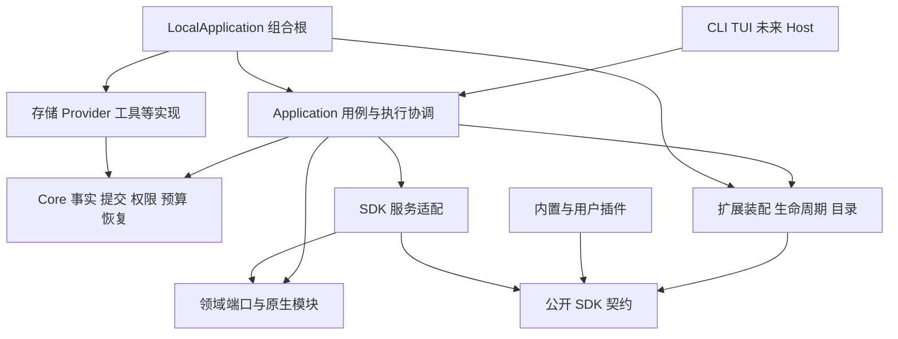

# OURO 框架与插件系统重构验收

> 状态：已完成。P0–P5 实施、功能回归、平台专项、性能对照与工程门禁均已完成；本记录保留设计决策和验收证据。
> 日期：2026-10-12。
> 代码基线：v0.1.0，`96ebb7e387aedfcfe9bb93906916af5ada9c726e`。
> 范围：框架扩展边界、插件开发契约、执行与资源生命周期、状态与升级、实施及验收。本文不替代现行规格。

OURO 应当形成**稳定的执行内核、可以替换和组合的能力模块、具有完整生命周期的插件包**。插件可以改变智能体如何工作，也可以提供其他插件继续扩展的能力；系统负责执行事实、资源所有权、权限和恢复的一致性。

当前主要缺口是插件缺少可组合的原生能力端口、插件间公开协作方式和可替换循环入口。现有 13 类贡献及集中式适配清单已经承担了有价值的领域边界，不应仅因清单有限就整体替换。重构应保留它们的明确语义，增加**窄领域端口、受管理的插件服务导出、可替换 Driver 和完整资源关闭**，解除业务能力上限。

保留现有不可变包、决策环境绑定、原生 Session 提交、工具权限、运行恢复和文件／SQLite 存储；重构这些机制对插件开放的方式。不重写存储引擎，不整体搬入其他 Agent 的插件框架，不把所有原生模块一次性拆成独立安装包。

## 设计约束与复杂度取舍

框架只抽象有实际消费者的共同责任，领域能力保留各自明确的契约。以下取舍约束设计与实施范围。

| 责任 | 本轮采用的最小设计 | 不作为前置建设的机制 |
|---|---|---|
| 原生能力组合 | 由组合根注入类型化 SDK 端口，复用现有 Application 用例 | 通用 DI 容器、抽象服务自动选主与逐服务版本求解 |
| 新业务与插件协作 | 现有包依赖 + 具名服务导出；插件在自己的服务中提供注册接口 | 全局万能扩展点协议、统一 reducer 引擎 |
| Agent 控制 | 普通异步 Driver + 原生执行端口 + 明确的等待恢复 | 通用 next-operation 指令集、插件副作用总账、任意程序自动重放 |
| 资源释放 | generation 和调用各自拥有清理集合，复用 gate、task group、lease | 固定 Session／Run／Operation 多级 Scope 对象体系 |
| 多进程管理 | 持久意图、共享变更检测、安全边界应用；调度复用 home owner | 活跃 Host 名册、全员 ACK、心跳选举、通用分布式资源锁 |
| 升级与数据 | 兼容更新正常交接；不兼容更新停用后由数据所有者显式迁移 | 通用多版本数据目录、CAS 存储、跨插件迁移事务管理器 |
| 性能 | 修正无关租约和热路径 I/O，先取得规模证据 | 全面惰性加载、持久反向引用索引、增量目录等提前优化 |
| 产品集成 | 公开现有交互能力，验证一个 Provider 注册入口 | 所有原生模块插件化、通用 UI 系统、重写全部 Provider |

循环控制、代码执行、后台调度、数据共享和原生组件联动通过这些边界组合。每个新增机制都必须对应本计划中的实际场景或明确的正确性责任；仅为“未来可能需要”不构成进入条件。

## 一 从产品目标推导框架责任

### 插件的本质

插件是带有身份、代码或资源、依赖、状态和生命周期的能力包。Tool、Skill、Context、循环策略、后台服务都只是它可以贡献的能力，不能反过来成为插件的定义。

插件包回答“哪些内容一起交付和升级”；服务回答“模块之间怎样协作”；扩展点回答“系统在哪个语义边界接纳外部行为”；作用域回答“这些行为和资源何时失效”。四者不能混在一张功能清单里。

强扩展性需要同时满足两个方向：

- 插件可以向 OURO 提供能力，例如工具、模型接入、运行驱动器和上下文源。
- 插件可以调用 OURO 或其他插件提供的能力，例如执行工具、启动子智能体、提交任务、读取会话事实和检索记忆。

只有第一个方向，插件仍然是被动回调集合；开放整个 Runtime 对象则会使第二个方向失去稳定边界。

### 内核保留什么

保留无法由普通业务插件各自解释、又必须全系统一致的规则：

1. Session／Run 及现有模型、工具、子任务记录的身份、执行所有权与合法状态转换；不另建统一 Operation 领域。
2. 已接受输入、消息、工具请求与结果的事实提交，以及撤销所需的历史代次。
3. 权限约束、用户中断、预算上限和副作用执行入口。
4. 调用绑定、等待与恢复、结果不确定时禁止擅自重放。
5. 模块与调用的资源所有权、撤销和关闭机制。

默认模型循环、上下文构建策略、压缩算法、Goal、Plan、记忆、工作流和具体模型协议可以扩展或替换。替换算法不意味着替换上述规则。Host 和存储实现仍通过现有端口装配，不因“可替换”就必须允许运行中更换数据库或 UI 框架。

### 可卸载承诺的准确含义

关闭完成后，插件不能继续获得新调用、订阅事件、执行定时任务或占用框架管理的进程与连接。保留的用户数据、历史事实和必要恢复引用是惰性数据，不能导致插件自动加载或后台运行。

以下三类对象需要分别处理：

| 对象 | 关闭时的责任 |
|---|---|
| 注册、任务、进程、连接、监听器和缓存 | 撤销入口并完成释放；未完成必须显示 `stopping` 或清理失败 |
| 插件私有数据、已产生的文档、会话历史 | 默认保留；按明确的删除范围执行清理，不伪造撤销 |
| 已发送网络请求、已经写入工作区的内容等外部副作用 | 记录实际结果或不确定结果；需要补偿时由业务显式提供，不能承诺通用回滚 |

任意进程内 Python 代码可以保存全局引用、创建线程或修改宿主对象。框架不能强制安全终止这些行为，也不能保证 Python 释放内存后 RSS 恢复原值。严格的终止边界依赖 worker 进程；进程内扩展只承诺合作式生命周期。这个限制必须进入运行方式选择，不能靠更多 `try/finally` 掩盖。

## 二 当前设计的审查结论

### 应保留的基础

- `core` 不导入插件安装与运行实现；SDK 不依赖内部包；Application 与 Host 已有明确职责边界。
- 安装与执行分离，不可变包以内容摘要识别，新版本可以并排存放。
- Catalog 原子发布，模型决策及其调用绑定一致的能力；等待不冻结整个会话环境。
- 待完成调用校验发布身份与执行契约，不将旧审批转给同名新工具。
- Session 状态采用短期视图和原生提交，插件不能直接持有 Store writer。
- Observer 与改变执行语义的 Policy 分离；工具调用统一经过权限与执行流程。
- 命令与 Observer 只绑定实际贡献及 owner 依赖；模型决策保留完整环境绑定。
- 候选私有数据只读，候选与已发布代次使用同一资源所有权；停止中与清理失败均可观察，旧服务停止失败会阻止替代服务启动。
- Goal、Plan 和 Agent Context 已使用插件生命周期；Supervisor、子智能体和自动任务提供了可以复用的原生能力。

这些不是重构障碍，而是新设计的基础。验收必须防止扩展性增加后这些保障倒退。

### 需要解决的结构问题

下表区分代码事实、设计限制和需要验证的风险。静态可见的路径不等于已经复现的故障。

| 问题 | 当前证据 | 根因与重构方向 |
|---|---|---|
| 扩展面封闭 | [Manifest](../../../ouro/plugins/manifest.py) 的 `PluginCapability`、[贡献清单](../../../ouro/plugins/contribution_types.py) 固定 13 类；现行规格禁止插件定义扩展点 | 清单已集中管理领域适配，本身不是缺陷。保留原生贡献类型，补充插件服务及其注册接口，使新业务不必进入全局清单 |
| 原生服务难以组合 | [SDK](../../../ouro/sdk/plugins/v3.py) 的 `PluginContext` 主要提供配置、私有文件、凭据、task、日志；没有模型、工具执行、Agent、调度和会话查询端口 | 将“不能暴露实现对象”扩大成“不能使用原生能力”。补充受作用域和权限约束的公开端口 |
| 控制能力绑定固定模式 | SDK 的 Turn Policy 仅有 `allow/continue`；Continuation 在 Run 结束后返回固定意图；[内循环](../../../ouro/core/inner_loop.py) 固定执行模型／工具轮次 | 现有能力适合部分工作流，但不等于可替换的 Agent 控制。分离可靠执行机制与下一步选择策略 |
| worker 只有受调用方向 | [worker](../../../ouro/plugins/worker.py) 的 `_read_stdout` 接受响应及 `diagnostic.emit`；无类型化原生服务反向调用 | worker 无法成为与进程内能力等价的协作模块。增加有明确方法契约的双向通道 |
| 依赖表达不等于能力协作 | [依赖实现](../../../ouro/plugins/dependencies.py) 与 [执行契约](../../../ouro/plugins/execution_contracts.py) 记录插件版本及依赖锁，SDK 无对应服务导入／导出 | 依赖只用于激活顺序和恢复校验。需要可解析、可撤销、可诊断的服务绑定 |
| 启用成本需要实测 | [runtime](../../../ouro/plugins/runtime.py) 的 `start()` 遍历 desired roots；[代次资源](../../../ouro/plugins/generation_resources.py) 在激活期准备 MCP | 启用时加载是可成立的简化选择。先确保未启用插件零运行资源、重资源按需获取，不把完整惰性激活系统作为必做重构 |
| 跨进程语义不完整 | PluginRuntime 的 active、gate 和 mutation lock 属于进程；已有 TaskScheduler 则通过 repository 领取 home 范围 owner | 状态文件锁不等于全 home 已关闭，也不保证后台单例。定义多 Host 的传播及完成边界 |
| 升级策略不支持长期生态 | [插件规格](../../specs/plugins.md) 明确不提供旧 API／协议适配和迁移；API 3.0 仍位于 `v2` 路径 | 开发期策略适合快速破坏式迭代，不能成为长期数据与生态承诺。建立有限、可维护的版本政策 |
| 部分产品交互跨越插件边界 | [Plan TUI 适配](../../../ouro/tui/plan_confirmation.py) 导入 builtin Plan 协议 | 提供用户插件可调用的等价交互通道；共享协议放入公开契约，产品呈现可留在 Host。Agent Context 使用公开环境端口 |

`PluginService._durable_references()` 还会遍历 Session 和 Run 查找保留引用，虽然不加载完整消息历史，规模仍随历史运行数增长。这是管理冷路径的现状，先测量实际延迟；只有证据表明不可接受时，再增加可重建索引，不能预先增加双后端索引一致性负担。

问题不应通过合并所有 Policy、删掉执行契约或暴露全局对象解决。需要减少的是能力重复接线和不必要的绑定，不能减少语义边界。

## 三 标杆项目的启发与取舍

调研对象是实际 Agent 产品。以下材料核对于 2026-10-11；采用其中的机制思路，不推定不同产品的恢复、安全或性能保证相同。

| 产品 | 核实的机制 | 对 OURO 的判断 |
|---|---|---|
| DeepSeek Harness | 通过服务依赖、类型化事件、可撤销注册组合产品；默认 Agent loop 是可替换实现。见 [架构](https://github.com/deepseek-ai/deepseek-harness/blob/d743267388641bc76f17c45ce8b4c231aed1d32c/docs/architecture.md)、[Cordis 概念](https://github.com/deepseek-ai/deepseek-harness/blob/d743267388641bc76f17c45ce8b4c231aed1d32c/docs/cordis-primer.md)、[Agent loop](https://github.com/deepseek-ai/deepseek-harness/blob/d743267388641bc76f17c45ce8b4c231aed1d32c/packages/core/agent-loop/README.md) | 采用服务协作、可释放注册和驱动器接口；不照搬共享可变 middleware、完整 Cordis 运行时或配置叠层体系 |
| Pi | 扩展可注册工具、Provider、事件处理、命令并控制会话；提供扩展间通信，文档区分通知和可行动边界。见 [扩展文档](https://pi.dev/docs/latest/extensions)、[类型定义](https://github.com/earendil-works/pi/blob/ea448f454af474f3e2fe9733b331e17b0662f5d6/packages/coding-agent/src/core/extensions/types.ts) | 采用窄而直接的能力 API 和良好开发体验；不让事件加载顺序承担 OURO 的权限仲裁，不把 TUI 对象放入通用 SDK |
| Codex | 官方插件包组合 Skills、MCP 及特定安装场景中的生命周期 hooks；安装和 hook 信任有不同边界。见 [官方打包说明](https://developers.openai.com/plugins/build/plugins) | 采用资源包、身份和分发的清晰边界；该文档没有建立通用可替换内循环契约，不能把其打包范围当成 OURO 的能力上限 |

DSH 的可扩展性说明“服务与扩展点也可以由模块提供”有实际产品价值；Pi 说明公开操作端口能显著扩大插件表达力。OURO 的推导是：以明确的调用和组合规则获得这种能力，而不是使所有对象都可以被任意修改。

## 四 目标架构与依赖方向



这是依赖方向，不表示每个框都要新建一个包。SDK 只放协议、值对象和必要调用句柄；Application 实现服务适配并注入插件运行系统；插件运行系统不反向导入 RuntimeService。Core 只了解执行所需的领域协议，不能了解 Manifest、插件安装目录、worker 或 UI。

### 三类职责

| 层次 | 责任 | 实施约束 |
|---|---|---|
| 执行内核 | 状态与提交、权限、预算、取消、执行所有权、恢复不变量 | 保留现有权威链路，不能由普通扩展覆盖 |
| 能力模块 | 默认循环、模型协议、工具、上下文、压缩、子智能体、调度、产品功能 | 公开领域端口；支持合理的选择、调用或替换，具体语义由领域拥有 |
| 插件包与装配 | 分发、配置、能力注册、依赖解析、运行承载与卸载 | 同一机制服务 builtin 与 user，来源不决定业务特权 |

“原生模块”与“插件包”不是同义词。SessionStore 可以继续是组合根注入的基础设施，插件通过会话端口使用它；Goal 应当是正常可关闭插件；默认循环实现可以随 OURO 分发，却通过与替代实现相同的 Driver 契约接入。

### 拒绝的替代方案

| 方案 | 不采用的原因 |
|---|---|
| 仅靠扩充现有枚举获得强扩展性 | 没有解决原生能力调用及插件协作；但真实原生阶段仍可增加具体贡献类型 |
| 把 Runtime、Store、全局 registry 全部放进 Context | 内部重构变成插件破坏性升级；难以恢复与关闭 |
| 所有执行都改成一个可变事件总线 | 顺序依赖、权限绕过、结果归属和失败传播难以解释 |
| 所有模块都变成可卸载包 | 放大启动与依赖成本，让基本正确性也受配置组合影响 |
| 只支持 worker，或只支持进程内 | 前者给纯数据与低延迟原生能力增加成本；后者缺乏强终止边界 |
| 先设计完整工作流 DSL、通用数据库、分布式调度 | 用户需要可编程能力；业务图语言与分布式设施尚无必要 |

## 五 开放而具体的扩展模型

### 两种扩展方式

**原生贡献**由 OURO 的具体领域消费，例如工具、上下文、审批前约束、Provider 和 Driver。保留类型化 DTO、领域注册表和集中式适配清单。新增真实的原生阶段需要修改相应领域，不能声称任意插件注册一个名称，Core 就会自动解释它。

**插件服务**由其他插件显式调用，例如记忆查询、代码分析或工作流业务。框架提供导出、查找、调用和撤销；服务的业务语义由提供者负责。新增这样的业务不修改 Core，也不为每个服务增加全局贡献类型。

这两者共用身份、调用 gate 和资源清理规则即可，无需统一成同一种万能 descriptor、result 或事件系统。

### 原生边界的组合规则

| 边界 | 保留的规则 |
|---|---|
| Observer 通知 | 不修改当前操作；复用有界 mailbox，慢消费者不反压主执行 |
| Context 收集 | 保留来源，稳定排序，按上下文预算合并 |
| Prompt／Tool 约束 | 合取或取更严格结果；不能靠 priority 放宽权限 |
| Driver／压缩／Provider 选择 | 根据显式配置选定实现；冲突可诊断，不依赖加载顺序 |
| 请求调整 | 只在已有消费者确需时提供具体类型化参数；不修改 canonical 历史 |

上表是审查各领域的规则，不要求建设一个负责所有组合语义的执行引擎。Policy、Controller 和 continuation 的职责保持独立：Policy 约束行为，Controller 管理已有控制 claims，continuation 决定跨 Run 续跑；它们不都变成 middleware。

Skills 与 MCP 保持资源接入方式，MCP 工具仍走普通工具执行链。Background Service 管理连接或持续工作，持久计划交给调度领域。原类型只有在消费者实际被替代后才删除，不能为形式统一重写稳定实现。

### 插件怎样提供新的扩展点

插件 A 导出自己的服务，例如 `example.memory/search`；插件 B 声明依赖 A，并通过该服务查询数据。A 需要让 B 扩展检索行为时，可以在服务中提供类型化的过滤器注册方法。

注册接口使用 SDK 提供的受管理 handler 引用，返回可关闭的注册句柄。A 负责何时调用过滤器、如何组合结果和处理失败；框架负责提供者与贡献者身份、调用撤销及通信。worker 传递 handler ID 和 DTO，不传递 Python 函数对象。A 接受 B 的回调不构成反向安装依赖；回调期间才持有 B 的调用租约。

注册归贡献者所有，同时受提供者代次约束；任意一方关闭都使该注册失效。提供者升级时，消费者按现有依赖关系重新建立注册，不把旧回调挂到新实例上。首个“记忆服务 + 过滤器”样例验证这一机制，再决定哪些重复代码值得抽取。

因此插件可以扩展另一个插件，但不需要一个带独立版本体系和 reducer 的全局扩展点元框架。Core 的提交、权限与恢复规则始终不能被替换。

### 注册、动态发现与撤销

注册返回一个幂等关闭句柄，自动加入其 generation 的清理集合。撤销按注册身份处理，不能按名称误删后来的替代条目。普通静态插件继续一次性提交贡献，无需全部改写成动态注册程序。

动态工具发现沿用“构建候选目录 → 校验冲突 → 原子发布”。先支持整组替换，避免提前设计细粒度注册事务 API。已发出模型请求保留原工具 schema、实现与执行契约；后续决策才看见新目录。

包声明能贡献哪些原生能力及所需权限，具体动态 schema 在注册边界校验。不能通过动态注册扩大授权，也无需预先枚举未来发现的每个工具名称。

## 六 包契约、依赖与内部对象

### 保留现有模型，只增加必要边界

| 事实或机制 | 本轮处理 |
|---|---|
| 不可变包、安装记录、选定版本与配置 | 复用现有模型，不另建平行包管理层 |
| generation | 仍是进程内实例和资源归属单位 |
| Catalog | 保留不可变领域目录；区分“读目录”和“持有执行租约” |
| 调用绑定 | 复用精确执行契约和 lease，只持有实际需要的实现及依赖 |
| 资源清理 | generation 清理集合 + 调用取消范围，复用已有 task group 与 gate |
| 服务引用 | 具名导出解析出的受管理调用句柄，不能泄漏裸对象 |
| Driver checkpoint | 仅保存恢复所需的插件状态和原生等待引用，见第八节 |

这些是责任说明，不是要求逐行创建同名的新公开类。包模型、Catalog 和 generation 仍属于内部实现；插件开发者主要使用领域端口、服务导出及必要的注册／资源句柄。

### Manifest 的边界

保留身份、发布版本、SDK API、执行入口、配置、权限、资源清单和现有插件依赖。为服务导出及新的原生贡献增加必要声明即可，不先重做整个 Manifest 格式。

原生服务随 SDK 契约一起演进，不给 `models`、`tools`、`agents` 各建一套独立语义版本与依赖解析。插件服务用“插件 ID + 服务名”定位，其兼容性先通过提供者的包版本约束表达。只有独立演进成为实际问题时，才讨论单独的服务协议版本。

SDK 中静态描述与 Manifest 有重复时，逐项确定一份权威来源；注册侧只提供实现或动态结果。不以去重为理由删除权限、执行身份等含义不同的字段。必需且有执行意义的未知字段应拒绝，普通附加元数据可忽略。

不在规划中给出一套貌似可安装的新 JSON 或重置 API 编号。正式签名与字段在 P0 用实际插件草案验证，再随实现进入规格。

### 依赖与冲突

- 继续用显式插件依赖及版本范围；原生端口由组合根直接注入，不引入通用 DI 容器。
- 服务绑定到明确的插件和服务名，不建设自动寻找提供者、qualifier 优先级或全局服务选主。
- 复用依赖图的缺失、环和版本冲突检查；不自动下载、升级或启用依赖。
- 提供者关闭后，依赖它的消费者停止接受相关工作并报告不可用；独立插件继续运行。
- 升级重建受影响的依赖绑定；同名工具、服务导出或独占控制 claims 的冲突报告具体双方。
- 首版不增加“一个 home 内同包多配置实例”。新旧 generation 仅为在途交接并存。

插件 A 可以封装路由策略后调用多个明确的服务提供者；这是可编程业务能力，不要求框架提前实现抽象服务解析系统。

## 七 插件调用原生能力的端口

公开端口按领域提供，复用 Application 用例，不将每个内部方法照搬到 SDK。调用上下文携带来源、取消及已有权限／预算信息；框架生成身份，插件不能伪造用户输入来源或批准结果。

| 端口 | 本轮支撑的能力 | 责任边界 |
|---|---|---|
| 会话 | 查询必要事实、提交有来源的输入 | 复用 SessionService／输入接受链；按需分页，不返回 Store |
| 模型 | 普通及流式模型调用、使用配置好的模型 | 复用认证、取消、用量与预算记账 |
| 工具 | 查询并执行已有工具 | 复用 ToolCallCoordinator、权限与审批；程序化调用保留真实来源 |
| 子智能体 | 派遣、查询、等待、取消 | 复用 AgentService 与 Delegation；子任务不能放宽父级约束 |
| 调度 | 创建、暂停、删除自身计划，查看结果 | 复用 TaskScheduler；关闭插件不再派发 |
| 进程 | 启动、流式输出、取消和结果引用 | handle 纳入资源所有权；复用平台进程树关闭 |
| 数据与制品 | 私有数据、Session 扩展状态、结果资源 | 各自保留事务域，Session 状态随原生提交 |
| 环境与交互 | 必要环境事实、用户问题、状态或结果呈现 | SDK 不依赖 TUI 类，不以整个 host_home 代替端口 |

这是能力边界清单，不是一次性暴露所有 CRUD 与订阅操作的要求。各端口只增加验收样例和现有产品实际使用的方法，后续沿相同边界增量扩充。

模型路由与模型协议不同：路由选择已有模型；Provider 对接新协议或推理后端。本轮开放一个类型化 Provider 注册入口并用一个现有适配器验证，不重写全部 Provider，也不要求把它们全部拆成插件包。

### 调用与提交

- 保留“读取事实 → 锁外执行 → 校验 history epoch／必要 revision → 提交”。持有 Session 写锁时不执行插件、网络或跨插件回调。
- 纯策略与上下文回调使用对应的只读接口；工具、命令和 Driver 才获得其调用所需的副作用端口。不建设可配置的通用调用阶段权限矩阵。
- 需要与回调输出共同生效的 Session 变更继续进入已有暂存视图，不能先经另一个端口直接写同一状态。
- 当前 Session 的输入进入原生队列，不能递归启动自己的 Runtime；父任务等待子任务释放执行许可，复用现有 park 语义。
- 模型、工具、子任务和调度保留各自执行记录，允许为真实来源增加必要的领域字段。需要 Run 上下文的操作由原生接受链建立真实运行；不伪造 ID，也不建立跨领域通用总账。普通插件服务是 RPC 或直接调用，不自动成为可恢复任务；需要持久副作用的服务应使用原生入口，或自行提供业务恢复协议。
- 超时不等于未执行，取消不能撤回已经完成的外部写入。跨服务不提供通用事务或自动重试。

入口、外部通信和持久化边界校验不可信数据；内部已构造的类型化值无需层层重新序列化、校验和 catch 后继续。失败在拥有该操作的边界结算，不能用静默 fallback 掩盖缺失能力。

SDK 的权限与预算保证覆盖经 SDK 执行的能力。受信代码直接访问操作系统或网络不在此保证内；worker 也不是 OS 沙箱。无需为假想的恶意代码引入本轮未承诺的安全平台。

### 代码执行

业务计算可以在 worker 运行；SDK 进程端口管理插件子进程。模型驱动的代码执行继续作为工具进入统一执行链。REPL、分析环境和浏览器执行器由插件实现，不嵌入通用语言 VM。

首版使用明确配置的解释器、插件自带依赖或已准备的外部环境，不向 OURO 主环境自动安装第三方库。自动创建与锁定插件环境是独立后续功能，不阻塞当前能力开放。

## 八 Agent 循环的重构

### 算法开放，执行事实统一

默认“模型 → 工具 → 模型”算法和插件算法使用同一 `RunDriverHandler` 协议，由 `NativeRunDriverContext` 执行原生请求、等待与终态结算。`InnerAgentLoop` 只决定默认算法的下一步，`NativeRunTurns` 连接其 turn policy 和插入输入规则。外层审批或 child wait 完成后回到该 Run 绑定的 Driver。

Driver 使用普通异步代码调用模型、工具、Agent 及插件服务，可以分支、循环、并行计算和选择下一步。默认 Driver 随 OURO 分发，不必独立安装。更简单的修改继续使用 Policy、Context 或 Provider，不强迫所有插件实现 Driver。

Application 保有输入接受、Run 所有权、执行许可、权限与预算、事实提交、等待与终结。Driver 不能设置任意 Run 状态、伪造消息／用量或自建审批入口。程序化工具调用记录 producer=driver/plugin；需要进入模型上下文时按真实来源投影，不伪造 assistant 发起的工具请求。

### 最小 Driver 协议与恢复边界

概念协议如下，具体类型在 P0 以默认循环和第二种算法验证：

```text
run(context, resume_state=None) -> finished | suspended

context：已绑定的执行端口、只读运行事实、取消信号
resume_state：已提交的插件 checkpoint + Host 解析的原生等待结果
```

这是异步算法入口，不是 `advance → next_operation` 指令机。模型、工具和子任务使用现有执行记录，普通插件服务不新增统一 Operation 账本。

恢复责任必须具体：

1. 短期计算与 I/O 可以普通 await；用户回答、审批和子任务等持久等待经原生端口 park。
2. 可能进入持久等待的端口接收 Driver 的恢复状态。原生等待记录与该 checkpoint 在同一提交边界保存，提交后结束本次 Driver 调用并释放执行许可；不能分两次写入而留下只有 waiting 的不可恢复状态。
3. 再次取得运行所有权后，Host 按原生记录解析等待结果，向相同 Driver 契约交付 resume_state。Driver 负责解释自己的状态，不能把恢复等同于从函数第一行重跑。
4. 只有有效且尚未消费的等待 checkpoint 才能用于该次恢复。执行已经越过它、却在下一个安全边界前崩溃时，不自动重放 Driver 或未知副作用；保留已提交事实并报告中断，由明确恢复逻辑处理。
5. 默认 Driver 继续满足现有模型、工具、审批和子任务恢复契约。不得因支持自定义算法而降低原生恢复能力，也不宣称任意第三方 coroutine 都能透明恢复。

插件若需要跨长时间外部事件推进，可用持久调度、自己的业务状态及带来源的输入协作；本轮不增加通用事件工作流引擎。checkpoint 只存小型算法状态和原生结果引用，大结果进入已有资源系统。

一个 Run 固定一个 Driver 实现契约。等待时不常驻旧进程；恢复按精确契约取回实现。缺失或不兼容时保持可诊断的不可恢复／待处理状态，不切换成默认 Driver 继续跑。首版不支持运行中的 Driver checkpoint 跨版本自动转换，保留旧包或结束旧 Run 即可。

### 执行链路与组合

```text
原生输入接受与 Run 所有权
  → 绑定 Driver
  → Driver 经类型化端口执行与决策
  → 原生模型／工具／Agent 链校验并提交真实结果
  → 继续计算，或原子保存等待与 checkpoint 并 park
  → 原生唤醒后恢复同一 Driver，或由 Application 终结
```

模型请求仍冻结本次暴露的工具 schema 与实现；下一次决策可读取新目录。一个 Run 只有一个主 Driver，多份上下文、工具限制和运行约束可以共同生效。用户中断、权限拒绝和预算耗尽不能被 Driver 或 continuation 覆盖。

Turn Policy 属于默认循环的轮次语义，不要求任意算法假装具有相同轮次；真正全局的权限和预算放在执行端口。Goal 跨 Run 续跑和 Plan 的已有控制规则继续走各自原生链路。

验证算法采用“并行收集两个子任务 → 评审模型 → 按结果选择工具或结束”，包含一次审批或 child wait 后的进程重启恢复。整个算法只在插件包中实现，Runtime 不新增它的专属模式分支。

## 九 资源生命周期与升级

### 所有权的最小实现

generation 拥有注册、订阅、后台任务、worker、连接和模块清理；调用拥有自己的取消信号、临时资源和执行租约。复用现有 OwnedTaskGroup、GenerationGate 与 cleanup 逻辑，用一份清理集合收拢责任。

SDK 创建的资源自动登记；插件自建资源可登记关闭回调。关闭按逆依赖顺序执行，并且重复 close 等待同一完成结果。无需固定生成 Session → Run → Operation 的多级 Scope 树，也不把持久业务事实当作内存资源销毁。

普通插件只需要“注册能力、使用端口、登记额外资源”三个开发动作。只有真实的跨调用资源需求出现时，才增加更细生命周期接口。

### 安装、启用与运行成本

- 安装只验证和保存包，不执行代码。查看列表只读元数据，不连接 MCP。
- 禁用插件不加载、不调度、不创建 task、连接或 watcher；保留的数据不触发运行。
- 声明式资源不需要可执行实例。可执行插件先保留启用时加载；guard 和其他必要能力就绪后才允许相应工作。
- 插件内部的昂贵资源按首次实际使用建立，并纳入关闭集合。MCP 需要连接发现工具时，保留其明确启动成本。
- 完整的静态 descriptor／首次调用加载器暂不建设。若基准显示已启用但未使用插件的成本不可接受，再设计针对性加载方案，不能静默跳过加载失败的策略。

### 升级的两条路径

**兼容更新：**

1. 并排安装新包，预检 SDK、依赖、配置和状态兼容性。
2. 候选只读配置／数据，准备注册和可丢弃的本地临时资源；不写共享业务数据，不启动自主后台副作用。
3. 校验候选目录后提交选版，再发布进程内目录；崩溃后按持久选择重新装配。文件提交和内存交换不宣称掉电原子。
4. 新工作使用新 generation，已绑定工作及其必要依赖按原契约结算。升级 retirement 与主动禁用不同，不能提前切断旧调用完成所需的依赖。只有读写格式兼容才允许新旧写入者短暂并存。
5. 同一后台服务先停止旧实例，再启动新实例。旧 stop 失败阻断交接；新 start 失败如实报告，不假装外部副作用已经回滚。
6. 无实际租约后清理旧 generation。待完成调用的包保留策略见卸载规则。

**不兼容更新：**先停用并排空受影响写入者，再执行第十一节的数据维护流程。不能用候选逐文件写入、失败后仅记日志的方式拼出“原子升级”。

首版不要求所有插件和所有资源实现无停顿热升级。普通调用可以平滑交接，独占后台服务与不兼容数据允许短暂不可用。

### 关闭与卸载

关闭先保存禁用意图、撤销新入口并关闭 gate，再取消／结算在途工作、释放资源。gate 适用于已持有旧引用但尚未开始的调用，不能以旧目录绕过关闭。

管理结果区分“已禁止新工作”和“受管资源已退出”，复用 desired 状态并增加必要的关闭进度与等待接口即可，不再建立一套持久生命周期状态机。worker 超过合理关闭时限可终止；无法停止的进程内代码显示清理失败或需要重启，不能回报完全释放。

默认拒绝会破坏必需依赖的单独关闭请求，并列出影响；显式 cascade 操作才关闭相应依赖闭包。运行中遇到提供者故障则阻止依赖者继续工作，不擅自改变用户的启用配置。

卸载先逻辑移除。待完成调用引用的旧包可以暂存并显示原因，但不能因此自动启用；已完成历史只保留事实，不阻止回收。用户可结束相关运行后清除保留代码。

私有数据默认保留，purge 只清理明确属于插件的数据与缓存，不能删除工作区输出或用户接管的任务。已发生的外部写入不属于可撤销资源。

### 同一 home 的多个 Host

继续支持多个本地 Host，不新增常驻控制 daemon。

- 持久化的启用／选版意图沿用跨进程写锁；使用一个状态修订标记或文件变更检测，不建立活跃 Host 名册。
- 各 runtime 在接受新工作与模型决策边界检查变化；有后台活动时使用一个共享的有界刷新机制。只有变化才重新读取完整状态，不在每个 token、每个插件上轮询。
- 关闭结果只承诺已保存全 home 意图和当前 runtime 的实际释放情况。其他 Host 在约定边界或刷新期限内应用；不能显示“所有 Host 已停止”却没有证据。刷新期限须在实现规格和双进程验证中明确。
- 持久任务沿用现有 TaskScheduler 的 home owner。确需 home 单例的持续服务跟随这一 owner 启停，由 Application 装配层连接 owner 的获得／释放与服务生命周期，TaskScheduler 不导入插件实现；普通运行时监听明确为每 Host 一份。不再造通用资源锁／租约平台。
- owner 交接必须覆盖其受管 worker 的退出与已接受任务结算，复用并验证进程树关闭。结果未知时不自动重放业务副作用。

这是有明确边界的本地状态传播，不是全员 ACK 或分布式故障接管协议。无法响应的受信进程内代码只能通过停止对应 Host 处理；增加心跳不会消除这一事实。

## 十 后台工作与调度

| 工作 | 所有者与实现 |
|---|---|
| 当前调用的异步计算 | 调用取消范围；完成后释放临时资源 |
| 连接、监听和持续服务 | generation 清理集合；确需 home 单例时跟随原生调度 owner |
| 定时执行插件业务 | 原生 TaskScheduler、任务配置与执行记录，显式可调度服务目标 |

任务配置以 `target` 保存执行意图，单次执行以 `target` 保存领取时绑定的身份。`AgentTaskTarget` 保存指令与 Agent 设置，`AgentTaskRun` 保存精确 Session／Run 关联；`PluginTaskTarget` 保存服务目标和参数，`PluginTaskCall` 保存精确实现与依赖。结果提交不能改写已领取目标。插件服务以显式 `schedulable` 声明接受调度；注册方法不可调度。两类目标复用计划计算、领取、并发和恢复，不制造 session_id／run_id，也不另建插件调度器。

未来计划记录插件与 handler 身份；领取 occurrence 时绑定当前兼容实现，已领取执行固定精确契约。`owner_id` 固定创建计划的插件，独立于 Agent 或插件服务目标。SDK 查询和控制只能访问自己的任务，修改携带预期修订；创建不自动重试。关闭 owner 停止派发并结算运行中任务，保留计划和数据；残留计划不能自动重新启用插件。文件与 SQLite 存储均在分页前筛选 owner。

首个样例只需一个定时同步 handler，失败或缺少插件可诊断。并不要求交付日历产品、可靠消息 broker 或任意事件触发 DSL。可靠数据同步若确实需要追赶，使用原生可查询事实和插件自己的业务游标，不把 Observer 改为持久队列，也不强制所有通知都建立持久游标 API。

OURO 全部进程退出后调度不会继续。常驻 daemon 或 OS 启动器属于独立产品能力，本轮不扩展这一承诺。

## 十一 数据所有权与长期演进

### 数据通过所有者共享

| 数据 | 责任 |
|---|---|
| 临时缓存 | generation 或调用释放，可重新计算 |
| 插件私有数据 | 复用现有读写与私有目录边界，由插件解释格式 |
| Session 扩展状态 | 继续使用 owner 分区与原生提交，不开放 Store writer |
| 用户制品 | 通过原生资源或明确工作区文件保存，卸载不丢失 |
| 跨插件共享数据 | 由数据所有者提供查询／变更服务，消费者不访问其私有数据库 |

不新增全局共享 dict、数据库连接或通用 CAS 数据服务。文件型数据采用必要的原子替换；有并发事务需求的插件使用自己的数据库或串行 owner，并明确新旧版本是否可同时写入。不同数据规模和事务需求不强制套同一套存储抽象。

插件 A 请求插件 B 更新数据时，由 B 完成写入。跨插件业务一致性通过业务身份、幂等和显式失败处理保证，框架不提供任意跨插件事务。

### 不兼容更新的维护路径

长期演进需要版本边界和数据保全，不等于需要通用迁移引擎。

- SDK API、包版本与插件数据格式含义不同。插件有持久状态时应记录自己的 schema；无持久状态的插件无需声明空版本机制。
- 新版在预检中声明能否读取现有状态；格式未变化时直接复用数据，不复制目录。
- 格式不兼容且没有经过验证的转换时，拒绝激活并保留原数据，不能清空或假装不存在。
- 必要转换在插件停用、相关写入者退出并取得现有管理锁后执行；多 Host 尚可能写入时必须先停止这些 Host，首版允许显式维护窗口。
- 转换由数据所有者提供，用该数据实际需要的备份、文件替换或数据库事务完成。框架负责禁止并发启用、记录维护结果和重新预检，不管理通用数据版本指针。
- 转换失败保持停用，保留可诊断的原数据／备份；只有确认旧格式仍可用才恢复旧版。数据已转换而选版未完成时，仍保持停用，由预检识别当前格式后继续，不能自动加载旧写入者。
- Session 状态只在其实际 schema 变化时通过原生提交转换；不批量重写所有会话，不用私有目录备份覆盖会话历史。活跃 Driver checkpoint 首版不迁移。

可回滚代码不等于可回滚业务数据。只有旧代码能读取当前数据时才直接选回旧版；否则使用明确的恢复步骤。需要独立多版本数据目录、自动迁移编排或通用提交日志时，必须有具体数据与失败恢复需求另行论证。

### SDK 与现有数据

稳定 SDK major 内优先增加可选能力，不更改已有语义；不兼容变化提升 major。worker 协商 SDK API 与传输版本，不为每个领域端口维护独立版本求解。

SDK 只提供当前 major，入口路径、Manifest API 和仓库内消费者保持一致；不增加旧路径别名、旧协议适配或双轨实现。

v0.1.0 的功能设计与行为是验收基线，包括会话、配置、分支、撤销、资源、用量和插件能力。格式未变化的数据直接使用；不支持的格式明确拒绝并保留，不引入历史数据读取分支或自动迁移。

插件自有数据的显式停用维护由数据所有者负责，不承担 OURO 历史格式兼容。现行开发规范的单一契约和数据保全原则继续适用。

## 十二 执行方式与通信

| 方式 | 用途与边界 |
|---|---|
| 声明式 | Skills、模板、静态资源、MCP 描述；资源包本身不产生可执行实例 |
| worker | 用户可执行插件的推荐方式；可终止、可独立依赖，有 IPC 成本，不是 OS 沙箱 |
| 进程内 | 受信且需要低延迟的能力；合作式清理，不保证任意代码可强制卸载 |

公开业务端口同时支持 worker 与进程内，不因执行方式剥夺模型、工具、Agent、调度或插件协作能力。但不承诺原生 Python 对象、UI widget 或 callback 闭包可跨进程直接传输。

### 最小双向通道

保留现有 JSON-RPC／stdio，增加明确的方法路由、SDK stub 和受管理 handler 调用。原生端口使用固定方法，插件服务通过已注册的插件／服务／方法身份寻址；不反射访问 Host 对象，不建设通用代理代码生成或逐服务协议协商平台。

reader 只解析和分派，不能在读取循环中等待业务回调。否则 worker 调用 Host、Host 再调用 worker 时会死锁。复用请求 ID、错误和取消机制，增加必要的父调用关联及有界并发；嵌套调用继承已有调用约束。等待对向回调的请求不能占满处理该回调所需的唯一并发槽位，必须用并发上限为 1 的样例验证。

模型与进程输出使用有序流和明确结束，限制缓冲，大结果进入资源引用。一次传输边界校验后构造 DTO，进程内复用业务验证，不做多层 JSON 往返。先在一个完整样例中验证取消、等待、反向调用，再增加剩余实际方法。

候选只开放准备所需能力；激活后开放授权业务调用；撤销后不能发起新业务。按上述少数实际入口执行约束，不新增可配置的阶段规则引擎。

### Host 交互

优先开放现有产品需要的用户问题、选项、文本／Markdown 结果和资源引用；保持请求来源、回答身份及等待恢复。原生审批仍由 Host 所有，插件的普通“确认问题”不能代替权限批准。

Plan 的业务交互协议可进入公开 DTO，现有 TUI 呈现可以保留。只有用户插件遇到具体表达缺口时才扩充交互类型，不以去除一个 builtin import 为理由设计通用表单、diff 或 widget 系统。没有相应 UI 的 Host 返回明确支持范围或已有文本降级。

## 十三 性能与复杂度约束

令 P 为启用插件数，E 为目录条目数，D 为依赖边数，K 为一次调用实际需要的 generation 数，B 为输入输出字节数，H 为管理检查涉及的历史 Run 数。算法成本与插件自身启动／执行成本分别测量，不把任意插件代码计入固定复杂度承诺。

| 路径 | 本轮约束 |
|---|---|
| 插件列表与安装元数据 | 不 import 插件、不连接 MCP、不反复校验全部包字节 |
| 装配与依赖 | 复用索引和依赖图；图遍历约 O(P + D)，目录构建计入 O(E) 及必要排序 |
| 目录读取 | 取得不可变目录引用，不顺便租用全部 generation |
| 局部命令／observer／服务 | 只保留实际条目及 O(K) 租约，随后释放整目录引用；不能仅减少 acquire 仍持有整个旧 Catalog |
| 模型请求 | 绑定本次真正暴露的全部工具及相关贡献，成本随其规模增长，不能漏绑来虚报 O(1) |
| 工具／服务定位 | 复用字典索引，平均 O(1) 定位，加输入校验及必要 O(B) 编解码 |
| 通知与流式输出 | 按匹配订阅分派，有界队列；不逐 token 读状态文件或序列化全量历史 |
| 更新发布 | 先接受一次 O(E) 候选目录重建；无证据不引入持久映射或增量结构共享 |
| 保留引用检查 | 暂保留当前管理冷路径 O(H) Session／Run 扫描，不读取消息正文；测量后再决定索引 |
| 数据维护 | 只在真实格式变化时付出迁移成本，普通启用与关闭不复制整个数据目录 |

不在每轮请求重新 hash 包，不为每个插件新增 watcher、轮询器或后台线程。缓存仅在已证明重复成本时添加，必须有明确失效和释放边界。

若引用扫描超出真实产品可接受的延迟，再加可重建的 pending 引用索引，并单独解决两个存储后端的一致性与恢复。索引不是生命周期正确性的前置条件。

### 验收方式

用 0／10／100 个插件做规模抽样，区分声明式、空闲可执行和实际工作场景；记录启动、首用、稳态调用、管理操作的样本、P50／P95、资源及 I/O。不能把“100 个空包”外推为“100 个活跃 worker”的性能。

重复启停及失败候选检查注册、task、连接、worker、generation 引用是否持续增长；100 次循环可作专项压力验证，不强迫每个普通用例重复 100 次。RSS 观察趋势，不要求精确回到原字节数。

性能门槛以代表场景、重复样本及波动范围为依据，不预设缺乏基线支持的百分比。无需计时波动即可判定的热路径 I/O、无关租约和资源泄漏作为确定性门禁；资源探针通过不能替代性能对照。

## 十四 用最少的真实样例验证完整能力

以少量组合样例覆盖关键边界，不为每个能力单独开发一个业务产品。

| 样例 | 覆盖能力 | 完成证据 |
|---|---|---|
| 已有知识资源与 Goal／Plan | 声明式能力、上下文、跨 Run 控制、约束和官方功能联动 | 原有行为保留，单独关闭不影响基础运行 |
| 审查命令与本地执行工具 | 模型、工具执行、代码子进程、流式结果、用户交互 | 使用公开 SDK 完成，取消后无受管进程残留 |
| 记忆服务与消费插件 | 私有状态、共享查询、插件依赖、自有过滤器注册 | 不读对方私有目录；任意一方关闭后注册与调用正确失效 |
| 自定义评审 Driver | 子任务组合、不同循环算法、工具审批、等待恢复 | 无 Runtime 业务分支，重启恢复仍守权限与预算 |
| 定时同步 handler | plugin job、后台资源、home owner、关闭与数据格式更新 | 单次领取，不因残留计划重新启用；不兼容更新可维护 |
| 一个 Provider 注册样例 | 新模型协议接入与原有路由组合 | 默认和自定义 Driver 使用相同模型端口 |

worker 与进程内运行其中代表性的业务链验证等价，协议和进程管理另测传输特有行为。每个可执行样例都验证 disable／remove；能力增加而无法撤回运行影响不算完成。

这些样例检验“新算法、新业务、新原生协议”三个不同维度，避免把扩展性退化成工具注册，也避免提前交付完整记忆、Workflow 或日历系统。

## 十五 分阶段实施计划

按可运行的纵向结果推进，不先建完通用基础设施再寻找消费者。阶段内部可以小步迁移，但对外只保留一套完成后的契约；临时桥接必须在消费方迁移后删除。

```text
P0 契约样例与基线
  → P1 现有生命周期与绑定收敛
  → P2 原生调用及插件协作贯通 worker
  → P3 可替换 Driver
  → P4 后台调度与必要数据维护
  → P5 产品集成、清理与发布
```

### P0 用具体调用验证设计

交付：默认循环、审查命令、记忆服务及自定义 Driver 的最小 SDK 使用草案和回归基线。

- [x] 核对现有 13 类贡献与消费者，区分需要保留的领域语义和真实重复接线。
- [x] 用样例确定端口、服务导出／handler 引用、关闭结果和 Driver 等待恢复的最小签名。
- [x] 明确普通服务调用不保证持久恢复、两种升级路径及多 Host 完成范围，写入目标规格草案。
- [x] 用故障注入验证服务交接、候选写入／清理、同步回调取消和任务收尾的生命周期边界。
- [x] 记录性能及资源基线，列出现有数据哪些实际需要改格式。

主要位置：[运行时规格](../../specs/runtime.md)、[插件规格](../../specs/plugins.md)、[会话连续性](../../architecture/session-continuity.md)、现有测试与 `dev/benchmarks`。

退出条件：每个新增抽象都有实际消费者或不可替代的正确性责任；默认与替代算法可以用同一组公开端口表达；不需要通用 DI、Operation 账本或数据迁移框架才能开始。

### P1 让现有插件可靠地停止和交接

交付：现有功能继续可用，关闭完成语义准确，局部调用不拖住无关插件。

- [x] 将候选与活动代次的 task、worker、MCP 和模块清理收敛到 generation；mailbox 通过局部绑定保留所需 owner。
- [x] 修正命令、observer 等局部消费者的 Catalog 引用与租约；保留模型请求所需的完整绑定。
- [x] 候选准备只读私有数据，发布不执行候选数据写回。
- [x] 旧后台服务 stop 失败阻止同一服务 start；关闭 gate 与版本 retirement 的语义分开。
- [x] 提供本 Host 的关闭等待与清理失败结果，保留未退出资源的归属，并约束卸载和数据清除。
- [x] 用共享状态变化检测明确多 Host 传播，测试两个真实进程；不增加全员 ACK 与 Host 名册。

主要位置：`ouro/plugins/runtime.py`、`catalog.py`、`api.py`、`generation_resources.py`、`ouro/application/plugins.py`、`run_resources.py`。

退出条件：原有语义回归通过；关闭后无新调用，资源退出可验证；旧契约在途结算正确；没有把这个阶段扩大为 Catalog、Manifest 和存储的整体重写。

### P2 用公开端口贯通实际业务

交付：审查命令和记忆服务两个组合样例，在 worker 中也能调用原生能力和另一个插件。

- [x] SDK 增加样例所需的模型、工具、会话／环境、进程及服务端口，Application 适配现有用例。
- [x] 实现具名服务导出、显式依赖绑定、受管理 handler 注册及撤销。
- [x] 双向 JSON-RPC 使用明确路由；reader 不等待业务；打通进程输出、取消及跨 worker 嵌套调用。
- [x] 普通服务通过 SDK 复用调用者的原生 Run 端口；进程内与跨 worker 保留身份、权限、预算和等待边界。
- [x] 无 Run 命令与后台业务使用独立模型生成端口，复用原生路由、流生命周期和用量账本；不创建虚假 Session/Run。
- [x] 实现动态工具整组发布并保留决策执行契约，不建设通用注册事务语言。
- [x] 进程内工具组按 Manifest 策略整组发布，保留旧模型决策的 schema、处理器和租约；审批恢复校验修订。
- [x] worker 接入工具组发布、按发布身份调用处理器、旧租约排空后的处理器回收及公开样例。
- [x] 覆盖同 Session 重入、只读回调边界、worker → Host → worker 以及晚到结果。
- [x] 保留有用的贡献适配清单，只删除此次迁移实际形成的重复描述与无效接线。

主要位置：`ouro/sdk/plugins/`、Application 领域适配、`ouro/plugins/worker.py`、`contribution_types.py`、`catalog.py`、`examples/plugins`。

退出条件：样例不 import 内部 Runtime／Store，不使用裸对象跨插件通信；新业务服务不改 Core；worker 不因缺少反向接口成为能力较弱的插件类型。

### P3 开放循环算法

交付：默认算法与自定义评审 Driver 共用可靠执行链。

- [x] 抽离单次模型请求，统一上下文、预算、计数、事件与用量；默认循环消费类型化响应。
- [x] 模型工具批次使用类型化请求，返回协调器已提交的 Session/Run；等待事实只有一个提交入口。
- [x] 明确 Driver 的终态、turn 边界和原生能力上下文；不重写外层所有权协调，不向 SDK 暴露宿主内部 Run 写入模型。
- [x] 将默认算法接入 Driver 协议，保留其 turn policy、插入输入和原生恢复语义。
- [x] 公开程序化工具和 Agent 端口，以子任务组合、模型审阅及条件工具执行实现另一种算法。
- [x] 保存 Driver 精确契约，原子提交原生批次与 checkpoint，恢复不自动重放未知副作用。
- [x] 进程内与 worker Driver 使用公开模型／模型工具端口；评审样例验证两种存储后端的审批重启恢复。
- [x] 跨升级按原发布、配置修订与传递依赖装载 Driver；等待时释放旧资源，禁用按实际依赖图撤销调用。
- [x] SDK 命令通过 SessionInput 选择 Driver，接受时绑定完整契约；队列消费、旧包保留及等待恢复使用原生边界。
- [x] 保留原生审批、用户输入、Delegation、预算、history epoch 与 continuation 行为。
- [x] 验证运行中升级、等待重启、缺失 Driver、已消费 checkpoint 后崩溃、禁用和中断。

主要位置：`ouro/core/inner_loop.py`、`tool_batches.py`、`ouro/application/runtime.py`、`runs.py`、`run_continuations.py` 及 SDK。

退出条件：默认恢复保障不倒退；第二种算法只在插件内实现；不存在新通用指令集、平行事实账本或该算法的专属 Runtime 分支。

### P4 管理后台工作与实际数据变化

交付：定时同步 handler 可执行、可停用、可升级。

- [x] 分离 Task 配置目标与已领取执行目标；Agent 任务贯通存储、派发、恢复和 TUI，领取后目标不可变。
- [x] 插件服务通过显式 schedulable 声明成为 Task 目标；领取固定精确实现和参数，结果使用原生执行记录。
- [x] 不可用插件目标在领取前暂停计划，禁用结算在途调用，升级保留当前执行契约；中断请求可由另一 Host 提交。
- [x] 公开 SDK 调度端口并记录创建任务的 plugin owner；所有权查询和控制复用原生 Task，覆盖插件拥有的 Agent 目标。
- [x] home 单例持续服务跟随已有调度 owner；停止失败保留锁，worker 提供独立服务启停路由。
- [x] generation 共享访问与数据清理独占访问跨 Host 互斥；关闭失败保留占用，独占期间不能提交启用意图。独立 purge 支持卸载后的私有数据，保留原生事实及可恢复引用。
- [x] 以样例实际数据格式验证兼容更新及一次停用维护；无格式变化的数据不转换。
- [x] 实现不兼容状态预检、维护失败保持停用和必要备份恢复；不新增通用 CAS 或数据版本切换层。
- [x] 卸载与待完成引用的代码保留分开，提供明确数据保留／purge 范围；先沿用冷路径引用检查。

主要位置：`ouro/core/tasks.py`、`task_ports.py`、repositories、`ouro/application/task_scheduler.py`、`task_execution.py`、`plugins.py` 与 plugin data 入口。

退出条件：双进程不重复领取；关闭后无新派发；不明确的外部结果不盲目重试；不兼容更新失败保留数据和可解释状态，无需预建长期迁移平台。

### P5 完成产品集成并删掉替代路径

交付：一个完整且单一的新插件体系，具备可核验的开发、管理和升级路径。

- [x] Goal、Plan 使用可供同类用户插件调用的公开业务与交互边界。
- [x] Agent Context 通过公开环境端口读取指令，不获得整个 host_home。
- [x] 公开实际计划确认 DTO，Host 按公开类型呈现；业务模块不依赖 Core／Store，TUI 不导入产品插件。
- [x] 用原生 Faux Adapter 的事件桥接与公开 faux-provider 验证类型化注册入口，贯通真实模型路由和生命周期。
- [x] 声明式资源、MCP、压缩等继续工作，纳入必要的所有权调整；不为统一形式全部重写。
- [x] SDK 入口统一为 `ouro.sdk.plugins.v3`，scaffold、消费方、示例和文档使用同一路径；不保留旧路径转发。
- [x] 删除已被替代的 API／临时桥接，保留仍承担领域责任的类型。
- [x] 以 v0.1.0 功能行为为基线验证会话、分支、撤销、资源和用量事实；仅接受当前格式，不保留旧 API、历史兼容分支或自动数据迁移。
- [x] 更新有关架构、specs、开发规范和高级智能体计划，使现行文档只描述已完成能力。
- [x] 完成质量门禁、平台相关集成、性能对照及安装到卸载的完整演练。

退出条件：第十四节样例均有证据；用户插件能联动原生能力、替换算法和提供新业务；功能完善的默认装配与禁用可选插件后的基础运行都成立。未验证的平台能力明确标注。

P1 和 P2 不能单独代表重构完成。Driver、后台调度、协作、生命周期与数据维护都要贯通，但不以构建通用服务平台或迁移平台作为交付条件。

## 十六 验收与证据

按责任边界组织验收，避免“插件类型 × 执行方式 × 后端 × Host × 全部故障”的笛卡尔积。

| 责任 | 必须证明的行为 |
|---|---|
| 架构 | SDK 独立，Core 不依赖 Manifest／worker／Host，插件无内部 Store writer |
| 扩展 | 原生服务组合、插件服务与过滤器、新 Provider、替代 Driver 均有实际消费者 |
| 权限与来源 | 不伪造批准和输入来源，嵌套调用不放宽约束，撤销后的旧引用不能新开业务 |
| 生命周期 | 重复关闭、失败候选、旧 stop 失败、worker 崩溃／强制退出和资源释放可观察 |
| 一致性与恢复 | 决策绑定、审批／child wait、history epoch、晚到结果与 checkpoint 消费边界正确 |
| 数据 | 兼容升级、不兼容阻断、必要维护失败及选版前后中断均保留可解释事实 |
| 多进程 | 两个真实 Host 的状态传播、调度单次领取、单例服务停止与交接 |
| 成本 | 禁用无驻留工作，局部调用无全目录租约，流式缓冲有界，反复启停无持续泄漏 |

共同业务契约以代表性场景覆盖进程内与 worker；两个 Session 后端重点验证提交与恢复；CLI／TUI 验证真实交互差异。测试断言公开行为和权威事实，资源及 I/O 计数只用于验证明确的生命周期或成本约束。

### 功能与边界

| 验收面 | 实际消费者与验证范围 |
|---|---|
| 原生端口与协作 | 记忆服务及过滤器、review-service、独立 model-review；跨 worker 嵌套调用保留调用者身份、只读限制、预算和取消，不创建虚假 Session/Run |
| Driver | review-driver、delegating-driver；接受输入时绑定实现及传递依赖，等待释放资源，按原契约恢复，checkpoint 与原生批次原子提交，未知副作用不重放 |
| 动态工具 | dynamic-records；整组发布、决策租约、审批恢复修订、handler 回收和调用内 Session 状态提交 |
| Task 与数据 | scheduled-sync；配置目标与已领取执行分离，原生执行记录、跨 Host 单次领取、中断与单例服务交接，停用维护的备份和恢复 |
| 生命周期 | 候选只读、失败资源保留、旧服务停止失败阻断交接、晚到调用拒绝、worker 退出、卸载与代码引用保留、跨 Host 数据共享／独占锁 |
| 官方业务 | 普通用户身份的 Goal／Plan 使用同一 SDK；原生用量、计划确认、等待重启及卸载可验证，TUI 只依赖公开交互 DTO |
| Provider | faux-provider 与原生 Faux 事件桥接；配置路由、默认及自定义 Driver、独立生成、混合模态、工具回送、重启、升级、禁用与移除 |

Provider 端口不继承 Driver 控制能力；请求副本隔离缓存配置。异常正文、重试原因和结构化错误码在适配边界脱敏，保护流事件、失败记录与连接检查。Provider 专项 **23 项**通过，原生请求、生成和完成语义同时进行定向回归。

当前 **15 个公开插件样例**通过包校验与 Python 语法解析。wheel 在独立环境中以隔离模式加载，进程内与 worker Provider 均完成安装、启用、连接检查、真实 Run、用量记录、禁用和卸载；卸载后路由明确不可用。模块来源为安装环境的 `site-packages`，不存在旧 SDK 入口。

Agent 后续输入以持久 Run 终结为前提，在 Supervisor 提交边界等待前一次本地执行回执释放；仍在执行或重复提交同一 Run 时拒绝接纳。终态输入检查只读取当前快照，不将刚接受的后续 Run 标为崩溃遗留。通过分别挂起输入收尾和本地回执的测试验证交接竞态。TUI 使用异步 callable 创建 Worker，避免启动前取消遗留 coroutine；取消渲染等待不取消 Textual 拥有的 DOM 销毁任务。会话输入、历史命令、子任务审批和重命名 **30 项**、欢迎页 **109 项**定向测试通过。

Agent、队列输入、历史撤销与等待后续跑的 **124 项**定向测试通过。任务界面与跨 Runtime 会话附着的 **28 项**定向测试通过；任务历史导航按页面就绪边界操作，并检查工具状态、实时文本和切换会话后的连续投递。

### 数据格式

Run schema 5 保存精确 Driver 绑定与 checkpoint；Message schema 4 表达工具调用的模型／Driver 来源；Task 文件与 SQLite schema 3 保存目标及已领取执行契约；用量数据库与记录 schema 2 支持独立生成的真实归属。

Session/Event 为 2，ContextSnapshot 为 4，Compaction/Delegation 为 1，文件布局为 9，Session SQLite 为 7，PluginState 为 4，Manifest 为 3。持久化入口只接受当前格式；不支持的记录明确拒绝并保留，不隐式转换或删除。维护、卸载和 GC 只读取必要的 Session/Run 引用，不读取消息正文。

### 平台与工程门禁

Windows 全量测试 **5,266 项通过、6 项跳过，无警告**，耗时 31 分 21 秒；包含分支的总覆盖率为 **86.95%**，通过 80% 门槛。跳过项为 2 项文件回放边界场景（SQLite 事务回滚由存储契约覆盖）、3 项当前 Windows 环境不可用的符号链接场景和 1 项 POSIX 权限场景。

锁定依赖同步、Ruff 检查、769 个文件的格式检查、429 个源文件的 Mypy 检查、compileall、wheel 与 sdist 构建均通过；安装包的两个执行方式在独立环境完成生命周期验证。

Windows 11、Python 3.14.6 执行完整门禁。Ubuntu WSL、Python 3.14.6 使用锁定依赖，在 Linux 文件系统上完成 **71 项 POSIX 定向测试**：进程创建与重复取消、父进程退出后的子进程回收、跨进程共享／独占锁、插件关闭与同步、状态快照、双向 worker、Provider 和私有数据生命周期。其中包含 Provider 的完整 **23 项**。

Linux 另行通过 **3 项 Agent 后续输入回归**，覆盖同 Session 的新 Run、输入收尾及本地执行回执交接。

Linux 的 `arrayfunc` 从源码构建，使用已获该 CPU 支持的 `CFLAGS=-msse4.1`，依赖版本不变。上述证据不代表 macOS 或完整 Linux 产品验收，也不替代真实终端和外部模型账户验证。

SDK 独立和依赖方向由架构测试约束。受影响 Markdown 的本地链接、章节锚点、代码围栏与 JSON 片段通过校验。完整工程门禁按[贡献指南](../../../CONTRIBUTING.md)执行，P0–P5 的退出条件均已满足。

### 资源与性能

[生命周期基准](../../../dev/benchmarks/plugin_lifecycle.py)分别观测进程内与 worker 的启停耗时、内存和句柄。每组 100 次启停后残留 generation、worker client 和私有模块均为 0；计时组 Host 句柄分别保持 229→229 和 237→237，P50/P95 为 28.8/36.5 ms 与 184.5/214.9 ms。这些是当前 Windows 环境的局部观测，不能单独推导性能提升；GC 后 Python 分配总量不等同于泄漏数量。

启动及 0／10／100 插件规模对照使用相同 Python、锁定依赖和源码所在磁盘，独立于 pytest 运行；同时记录实际源码来源。基线为本文所列 v0.1.0 提交，产品源码不改动，仅让测量脚本使用该提交提供的 SDK 及 Catalog 查询入口。声明式查询、进程内调用与真实 stdio worker 分开报告，不把空闲 worker 数外推为并发模型吞吐。

完整导入至 headless 首屏可用，在相邻测量时段各测量 7 次：基线 P50/P95 为 **1.895/2.174 秒**，当前为 **1.896/1.980 秒**。导入本身的中位数分别为 1.444 和 1.450 秒。测试不清空 OS 缓存；小样本 P95 接近最大值，不能据此推导普遍性能提升。

下表各组测量 5 个新进程，耗时单位为 ms，数值为 P50/P95。Host 启动不包含安装准备和 Python 导入；稳态项合并各进程 20 次调用，声明式场景为目录查询，可执行场景仅调用一个插件。

| 类型 | 用户插件数 | Host 启动：基线 | Host 启动：当前 | 稳态使用：当前 | Host 关闭：当前 |
|---|---:|---:|---:|---:|---:|
| 声明式 | 0 | 60/65 | 62/201 | 0.089/0.222 | 0.37/0.43 |
| 声明式 | 10 | 153/184 | 159/192 | 0.140/0.232 | 0.75/0.84 |
| 声明式 | 100 | 5969/6186 | 5472/5837 | 0.808/1.654 | 6.77/9.83 |
| 进程内 | 0 | 63/75 | 60/73 | 0.089/0.222 | 0.35/0.41 |
| 进程内 | 10 | 162/187 | 160/196 | 0.193/0.354 | 4.51/4.82 |
| 进程内 | 100 | 6620/6915 | 6349/6394 | 0.220/0.472 | 50.78/74.42 |
| worker | 0 | 52/74 | 60/75 | 0.078/0.171 | 0.34/0.40 |
| worker | 10 | 876/889 | 1276/1445 | 0.293/0.445 | 16.16/17.26 |
| worker | 100 | 14325/14559 | 20184/20611 | 0.313/0.612 | 167.85/185.06 |

100 个 worker 的基线关闭 P50/P95 为 **23230/24068 ms**。当前关闭明显更快，但启动中位数增加约 **41%**；Windows 的受管理进程创建包含挂起、Job Object 归属和恢复线程，不能将该场景描述为全面提速。在 100 个 worker 中调用单个插件仍通过真实 stdio 往返，当前 P50/P95 为 0.313/0.612 ms，基线为 0.191/0.523 ms。

状态投影复用操作内的持久快照，无跨操作缓存。100 个插件的列表中位数由基线 22–26 ms 降至当前 6–8 ms；单次列表的 Host 读取操作数由 8 降至 2，反映一次文件读取的 OS 计数，不代表两个状态快照。100 个声明式插件启动的读取字节中位数由约 158 MB 降至 132 MB。这些计数包含缓存命中，不等同于物理磁盘流量。

关闭后，全部规模样本均无活跃 generation；100 个 worker 样本的 Host 句柄由运行时 995 回落至关闭后 196。新进程首次导入、线程池及事件循环初始化使关闭后句柄不必等于启动前值，持续泄漏判断使用前述反复启停基准。规模对照未设置 CI 时间阈值，不为合成的 100 个常驻 worker 引入并行启动框架或全面惰性加载。

## 十七 实施范围的最终约束

本轮必须完成：原生能力端口、插件服务协作及所属扩展接口、双向 worker、可替换 Driver、受管理代码执行、后台调度、准确关闭与升级，以及必要的数据保全。这些共同支撑 OURO 的 Mod 式扩展能力，不能借“简化”只交付基础工具插件。

以下事项只有满足进入条件才另行设计：

| 后续机制 | 进入条件 |
|---|---|
| 完整惰性加载 | 已启用但未使用插件的启动／驻留成本有可重复的瓶颈证据 |
| 持久引用索引 | 长历史下管理扫描已造成不可接受的实际延迟 |
| 更细的资源 Scope | 出现 generation 与调用两级所有权无法自然表达的资源生命周期 |
| 服务独立版本或自动发现 | 明确的多提供者兼容需求无法由包依赖与显式绑定表达 |
| 通用数据迁移设施 | 多个真实数据实现出现同类且无法就地解决的迁移／恢复责任 |
| 更丰富的 Host UI | 用户插件有无法由现有交互类型表达的实际需求 |

Marketplace、发布者信任平台、恶意代码 OS 沙箱、分布式运行、多租户、通用 Workflow DSL、任意跨插件事务、通用 UI DSL、自动多语言环境安装及其他产品插件透明兼容不进入本轮。

实施中新增持久事实、新后台循环、新依赖解析或新公开抽象时，必须先说明现有机制为什么不够、由谁拥有和释放、哪个样例验证它。没有答案就不加入；已有领域边界可以增量完善，不为统一形式制造另一层框架。
