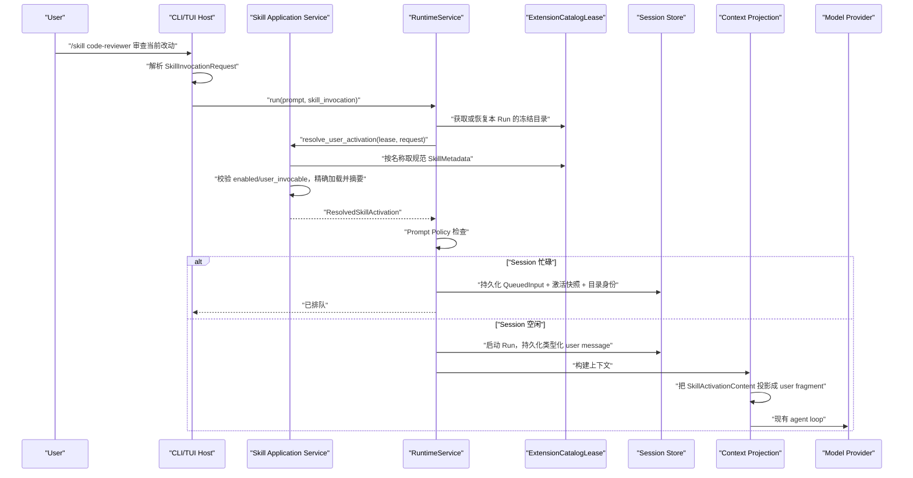

# Agent CLI 技能与 Slash 命令调研

> 文档类型：调研
> 调研日期：2026-08-02
> OURO 映射基线：2026-09-02
> 当前技能激活契约由现行架构与 Skills 规格定义。
>
> 调研对象：OpenAI Codex CLI、Kimi Code、OpenCode，以及 OURO 当前技能、CLI、上下文和 Run 生命周期。
> 约束基线：[OURO 编码准则](OURO_编码准则_ZH_2026-09-02.md)。

## 0. 结论先行

OURO 的终端显式技能调用贯穿 **Host 输入 → Application → Run 快照 → 用户角色上下文 → 持久化/恢复**。
它复用标准 `SKILL.md` 解析、用户/工作区/插件技能合并、Run 级扩展目录快照、上下文构建与持久化输入队列，
不建立第二个技能加载器。

现行固定命令为：

```text
/skills
/skill <skill-name> [task-or-arguments...]
```

- `/skills` 只查询，不启动 Run；
- `/skill` 是一次性、Run 级用户输入，不是 Session 持久模式；
- CLI 只解析名称和尾随文本，不读取技能文件、不拼接模型提示词；
- Application 在该 Run 的冻结扩展目录中解析技能，校验 `enabled` 与 `user_invocable`，按目录记录的精确路径加载；
- 技能正文以**用户角色的类型化内容块**进入上下文，不能提升成 system/developer 指令；
- 激活时固化正文与摘要，保证排队、进程恢复和插件热更新后仍使用同一份激活说明；
- `disable_model_invocation=true` 只禁止模型隐式选择，不禁止用户显式调用；
- 技能激活不能扩大现有工具权限，当前实现不解释或执行 `allowed_tools`；
- 不引入动态 `/<skill-name>`、`$skill` 别名、参数模板语言、多技能组合或新的通用命令框架。

该能力是 Application 原生输入语义，不是 `interactive.py` 中的字符串替换逻辑。

### 0.1 当前实现映射

实现按上述垂直契约分层：

- Core 定义可持久化的 `SkillActivationContent`，限定只能出现在 user message，并在统一 Provider 投影边界
  转成带转义边界的技能说明；
- Skills 按冻结 `SkillMetadata.location` 精确加载并复核元数据，不在激活时重新扫描目录；
- Application 使用 Host-neutral `SkillInvocationRequest` 与 `SkillActivationService`，接通 prospective Run、
  Prompt Policy、持久队列、恢复、事件摘要和 compaction 保护；
- CLI 提供 `/skill <name> [task]`；`/skills` 查询 Runtime 的当前 Catalog 视图，两者都不导入 loader 或
  discovery；
- `disable_model_invocation=true` 仍允许用户显式调用，`enabled=false` 与 `user_invocable=false` 明确拒绝；
- active Run 只允许把技能调用作为 follow-up 排队，`/steer /skill ...` 在创建 Run 前拒绝；
- 未引入动态技能短命令、模板 DSL、多技能组合、Session 粘性激活、模型技能工具或权限扩张。

本文第 4 节与第 11 节保留调研时的问题定义和实施分解，用于说明架构取舍，不代表当前代码缺陷。

## 1. 调研范围与术语

本文区分三件经常被混称为“技能命令”的能力：

| 能力 | 例子 | 是否产生模型 Run |
| --- | --- | --- |
| 技能管理命令 | `/skills` 列表、启用、禁用 | 通常不产生 |
| 用户显式激活 | `/skill foo ...`、`$foo ...`、`/foo ...` | 产生 |
| 模型隐式激活 | 模型根据技能描述调用 `skill` 工具或读取 `SKILL.md` | 已在进行中的 Run 内发生 |

本方案的主目标是第二项。第三项与它共用目录和加载规则，但触发方式、权限字段和上下文时序不同，不能混成一条
“万能技能调用”分支。

调研只采用项目官方文档和官方仓库。源码事实固定到调研时的提交，避免把不断变化的 `main`/`dev` 当成稳定契约：

- Codex：`openai/codex@1e85ca099e4265bf89f4016772d299816e231bb3`；
- OpenCode：`anomalyco/opencode@32f278b48f1a495611165d8a9f1ace0b512933e2`；
- Kimi Code：`MoonshotAI/kimi-code@e22479a62eed9c3b78a67b313f4332c2c0ba9670`。

## 2. 三个实现的输入与 Harness 范式

### 2.1 Codex：界面选择转成结构化 UserInput，再由 Core 注入

Codex CLI 同时支持通过 `/skills` 菜单选择技能，以及在输入中使用 `$skill-name`。重要的不是表面语法，
而是选中后没有直接把路径或正文留给 TUI 处理：

1. `/skills` 打开技能菜单；菜单选中项被插入为结构化 `UserInput::Skill { name, path }`；
2. Core 同时收集结构化选择和文本中的 `$skill-name`，按规范路径去重；
3. 显式路径优先于名称猜测，名称只有在无歧义时才解析；
4. Core 读取完整 `SKILL.md`，生成 `SkillInjection`；
5. 注入实现为 `ContextualUserFragment`，模型角色是 `user`，内容包含名称、路径和技能正文；
6. 读取失败和显式调用有独立告警/观测，不伪装成普通用户文本。

相关材料：

- [Codex Skills 官方文档](https://developers.openai.com/codex/skills)
- [Codex CLI slash commands 官方文档](https://developers.openai.com/codex/cli/slash-commands)
- [显式技能解析与注入源码](https://github.com/openai/codex/blob/1e85ca099e4265bf89f4016772d299816e231bb3/codex-rs/core-skills/src/injection.rs)
- [技能用户上下文片段源码](https://github.com/openai/codex/blob/1e85ca099e4265bf89f4016772d299816e231bb3/codex-rs/core-skills/src/skill_instructions.rs)
- [TUI 技能菜单源码](https://github.com/openai/codex/blob/1e85ca099e4265bf89f4016772d299816e231bb3/codex-rs/tui/src/chatwidget/skills.rs)

可迁移范式：**UI 语法尽早变成结构化意图；规范路径由目录解析；技能正文由 Core/Application 加载；显式技能以
用户上下文进入模型。**

### 2.2 Kimi Code：动态命令目录 + 独立的用户激活流水线

Kimi Code 的用户语法更接近本需求：

```text
/skill:<name> [extra text]
/<name> [extra text]          # 外部技能且不与内置命令冲突时的简写
```

其实现把内置命令、技能命令和插件命令先解析为不同 intent。技能 intent 进入 `AgentSkillService.activate`：

1. 等待 Session 技能目录就绪并按名称解析；
2. 校验技能类型是否允许用户激活；
3. 用尾随参数渲染技能内容；
4. 生成用户角色的技能上下文消息；
5. 记录结构化来源，包括技能名、类型、路径、来源、参数与 `user-slash` trigger；
6. 作为一个新的 turn 入队，而不是在当前流式 turn 中临时改变系统提示词。

模型自动调用是另一条路径：它受 `disableModelInvocation` 和嵌套深度约束，并投递到当前 turn。官方文档同时说明，
slash 激活在流式响应和压缩期间不可用。

相关材料：

- [Kimi Code Skills 官方文档](https://www.kimi.com/code/docs/en/kimi-code-cli/customization/skills.html)
- [Kimi Code Slash Commands 官方文档](https://www.kimi.com/code/docs/en/kimi-code-cli/reference/slash-commands.html)
- [技能命令目录源码](https://github.com/MoonshotAI/kimi-code/blob/e22479a62eed9c3b78a67b313f4332c2c0ba9670/apps/kimi-code/src/tui/commands/skills.ts)
- [技能激活服务源码](https://github.com/MoonshotAI/kimi-code/blob/e22479a62eed9c3b78a67b313f4332c2c0ba9670/packages/agent-core-v2/src/agent/skill/skillService.ts)
- [技能提示投影源码](https://github.com/MoonshotAI/kimi-code/blob/e22479a62eed9c3b78a67b313f4332c2c0ba9670/packages/agent-core-v2/src/agent/skill/prompt.ts)

可迁移范式：**用户显式激活与模型自动激活共享目录但分开调度；激活拥有来源记录；用户 slash 是新 turn，而非
粘性的 Session 模式。**

### 2.3 OpenCode：统一命令编译与原生 Skill Tool 并存

OpenCode 的稳定版和 v2/开发版展示了两种互补入口：

- 模型侧：系统上下文只广告技能元数据，原生 `skill` 工具在调用时解析名称、检查权限、返回完整正文、基础目录和
  支持文件信息；
- 用户侧：技能可进入命令目录并表现为 `/<id>`。选择技能后走通用 command 编译管线，把技能模板与参数编译成
  一次普通用户 prompt；内置命令优先，技能只在无冲突时占用动态命令名。

OpenCode 的参数编译支持 `$1`、`$ARGUMENTS` 等替换；若模板没有占位符，则把参数追加到模板。这个能力依赖其
command template 契约，不是 Agent Skills 的通用必备语义。

相关材料：

- [OpenCode Skills 官方文档](https://opencode.ai/docs/skills/)
- [OpenCode v2 Skills 官方文档](https://opencode.ai/v2/docs/skills/)
- [技能工具源码](https://github.com/anomalyco/opencode/blob/32f278b48f1a495611165d8a9f1ace0b512933e2/packages/opencode/src/tool/skill.ts)
- [命令目录合并源码](https://github.com/anomalyco/opencode/blob/32f278b48f1a495611165d8a9f1ace0b512933e2/packages/opencode/src/command/index.ts)
- [命令编译与 Session Prompt 源码](https://github.com/anomalyco/opencode/blob/32f278b48f1a495611165d8a9f1ace0b512933e2/packages/opencode/src/session/prompt.ts)

可迁移范式：**显式 UI 命令与模型工具可以并存；二者共享目录和权限规则，但不必共享同一种模型上下文投影；动态
短命令必须有明确的冲突优先级。**

### 2.4 横向比较

| 维度 | Codex | Kimi Code | OpenCode | 对 OURO 的启示 |
| --- | --- | --- | --- | --- |
| 用户入口 | `/skills` 菜单、`$name` | `/skill:name`、可选 `/name` | `/name`、技能对话框 | 第一版保留显式命名空间，别名以后再做 |
| UI 到 Core | 结构化 `UserInput::Skill` | 结构化 skill intent | command descriptor/模板 | CLI 不应直接注入正文 |
| 名称解析 | 冻结列表、路径优先、去重 | Session 目录解析 | 统一命令目录并处理冲突 | 使用 Run 的同一扩展快照 |
| 正文加载 | Core 读取技能文件 | SkillService 激活 | Tool/command 层按入口加载 | 建立唯一精确加载服务 |
| 模型角色 | user fragment | user context message | user prompt 或 tool result | 显式用户激活保持 user 角色 |
| 作用域 | 当前请求/turn | 新 turn | 当前 command 或 tool call | Run 级，不做 Session 粘性模式 |
| 参数 | 后续用户文本 | 参数渲染 | 模板占位符 | 第一版保留原文，不引入模板 DSL |
| 模型隐式入口 | 元数据触发、按需读取 | 独立工具路径 | 原生 `skill` 工具 | 与用户入口分开但共用解析器 |
| 可观测性 | 显式调用事件/告警 | 结构化 origin | command/tool 事件 | Queue/Message 保留状态，Event 提供投影，Run 绑定目录 |

## 3. 可复用的 Harness 设计范式

### P1. 语法属于 Host，激活属于 Application

`/skill`、`$name` 或菜单只是输入方法。进入 Harness 后都应归一化为同一种类型化请求，不能让模型或运行时再次
解析终端命令。这样 CLI、未来 TUI、IDE 或 API 可以复用同一能力。

### P2. 目录元数据常驻，完整正文按需加载

常驻上下文只需要技能名称、描述和可调用性；完整正文只在用户或模型选择后加载。这能控制 token，又保留发现能力。
OURO 当前 `render_agent_skills_prompt` 已采用元数据广告，显式激活只需补齐按需正文路径。

### P3. 解析、授权、加载必须在同一个冻结目录中完成

如果 `/skills` 显示时使用一个目录，真正运行时重新扫描另一个目录，就会出现 TOCTOU：同名技能可能被覆盖、插件
可能已更新、路径可能已变化。用户输入的名称只能是 selector，权威身份必须由该 Run 的 `ExtensionCatalogLease`
解析。

### P4. 显式技能是用户上下文，不是系统策略

用户选择技能等价于“请按这份用户选定的工作说明完成任务”。把它拼进 system prompt 会无意提升权限和优先级，
也会让技能跨 turn 泄漏。Codex 和 Kimi 的用户角色设计更符合指令层级。

### P5. 交互文本、规范身份和模型投影三者分离

- 交互文本：用户输入的 `/skill foo ...`；
- 规范身份：冻结目录解析出的名称、来源、路径、摘要；
- 模型投影：带边界标记的技能正文、基础目录和用户任务。

只保存最终拼接字符串会丢失身份，只保存路径会导致恢复时读到新版本。正确做法是保存类型化激活快照，再在
Provider 边界投影成文本。

### P6. 用户激活和模型激活共享服务，不共享调度语义

二者可以共享：目录解析、精确文件加载、摘要、诊断与投影格式。二者不能混用：`user_invocable`、
`disable_model_invocation`、新 Run/当前 turn、事件 trigger 都不同。

### P7. 技能说明不能绕过工具权限

技能正文可能要求写文件、调用网络或使用某工具，但真正的动作空间仍由 OURO 当前工具目录、Tool Policy、审批和
Session 模式决定。显式调用技能绝不能自动提高权限。

## 4. OURO 实现前基础与缺口（历史基线）

### 4.1 已有基础

| 能力 | 当前位置 | 状态 |
| --- | --- | --- |
| 标准技能元数据与正文解析 | `ouro/skills/models.py`、`parser.py`、`loader.py` | 已有 |
| 用户/工作区/插件技能合并与遮蔽 | `ouro/skills/context.py`、插件 generation resources | 已有 |
| `enabled`、`user_invocable`、`disable_model_invocation`、`argument_hint` | `SkillMetadata` | 已有 |
| 技能元数据广告 | `render_agent_skills_prompt` → `ContextBuilder` system prompt | 已有 |
| `/skills` 列表 | `ouro/cli/interactive_commands.py` | 已有，但 CLI 直接发现技能 |
| Run 级扩展冻结 | `ExtensionCatalogLease`、`RuntimeService._bind_extension_snapshot` | 已有 |
| 忙碌时输入持久队列 | `QueuedInput`、`QueuedInputQueue` | 已有 |
| 输入消息、Run、事件和恢复 | `MessageRecord`、`RunRecord`、Runtime lifecycle | 已有 |
| Provider 中立的上下文投影 | `ContextBuilder`、`ContextPreparationService` | 已有 |

### 4.2 关键缺口

1. `/skills` 只有查询，没有显式激活命令；
2. `CommandResult` 只能返回文本或插件归属的 Session Input，没有“用户技能激活”输出；
3. `RuntimeService.run` 只接收字符串 prompt 和资源引用，没有类型化技能 selector；
4. `QueuedInput` 无法携带激活身份，排队后只剩普通文本；
5. `SkillLoader.load_content(name)` 会从 root/内部缓存按名称查找，缺少“按冻结元数据的精确路径加载”契约；
6. 当前技能元数据广告进入 system prompt，但没有用户角色的完整技能正文投影；
7. `MessageRecord` 不能表达“这是一段技能激活内容”，只能把它伪装成普通 text 或 synthetic system message；
8. `/skills` 直接在 CLI 层调用发现函数，绕过了 Application 的扩展快照视图；
9. Queue/Message/Event 没有显式技能激活的结构化身份；
10. 上下文压缩尚无“当前 Run 的激活说明不可被提前丢弃”的显式不变量。

### 4.3 可行性判断

可行性为**高**，原因是目录、加载、Run 快照和持久化循环都已存在。真正需要新增的是一条垂直契约，而非新子系统。
但它横跨 Core/Application/CLI，不能合理地压成 `handle_command()` 内的局部补丁。

## 5. 路径选择

| 路径 | 优点 | 根本问题 | 结论 |
| --- | --- | --- | --- |
| CLI 读取技能并把正文拼进 prompt | 改动最小 | 绕过快照、策略、队列和恢复；无法审计；角色不清 | 拒绝 |
| 把每个技能注册成 Plugin Command | 复用现有 slash | 技能是目录资源而非插件可执行贡献；产生所有权和命名冲突 | 拒绝 |
| `/skill` 切换 Session 当前技能 | 连续对话看似方便 | 技能本质多为一次任务说明；易泄漏到后续 turn；退出/恢复复杂 | 拒绝 |
| 每个技能动态占用 `/<name>` | 输入短 | 与内置/插件命令冲突；命令目录重建与补全成本高 | 第一版不做 |
| 新建泛化 Command Bus/Prompt Template DSL | 可覆盖更多未来需求 | 当前只有一个明确缺口，抽象没有第二个稳定用例 | 拒绝 |
| Application 原生、Run 级类型化激活 | 快照一致、可恢复、可审计、跨 Host 复用 | 需要贯穿若干稳定边界 | 推荐 |

## 6. OURO 采用的交互契约

### 6.1 命令语法

```text
/skills
/skill <skill-name> [task-or-arguments...]
```

解析规则：

1. 命令名大小写按现有 built-in 规则归一化；技能名保持目录中的规范值；
2. 技能名是第一个非空白 token，不使用 shell quoting；标准技能名本身不含空格；
3. 技能名之后的文本去掉命令分隔所需的首部空白，其他内容原样保留；
4. 尾随文本允许为空。空参数表示“执行该技能定义的默认工作流”，不是由 Host 伪造一句自然语言任务；
5. `/skill` 缺少名称时返回 usage，不创建 Session/Run/Message；
6. `/skills` 展示名称、简短描述、来源、可用状态和 `argument_hint`；
7. `/skill` 是保留内置命令，优先级高于插件命令；
8. 第一版不支持 `/skill:<name>`、`/<name>`、`$name` 作为别名。

示例：

```text
/skill code-reviewer 审查当前工作区的未提交改动
/skill release-notes 比较 v1.4.0 与 v1.5.0
/skill interactive-onboarding
```

### 6.2 忙碌与排队语义

OURO 已有持久化 follow-up queue，因此没有必要照搬 Kimi 的“流式期间拒绝”：

- Session 空闲：立即创建新 Run；
- Session 有 active Run：作为一个**新的 follow-up Run** 入队；
- 不能用技能激活去 steer 当前 Run；`/steer /skill ...` 第一版返回明确错误；
- 入队时完成目录冻结、策略检查和技能正文固化，而不是消费队列时重新扫描；
- `all_at_once` 合并只能合并拥有相同扩展目录契约且技能激活快照兼容的输入。最稳妥的第一版是：带技能激活的
  输入单独成 Run，不与相邻普通 follow-up 合并。

这比简单“忙碌时禁用”更符合 OURO 已有运行模型，也避免用户稍后执行时技能已变成另一个版本。

### 6.3 字段语义

| 元数据字段 | 用户显式 `/skill` | 模型隐式调用 |
| --- | --- | --- |
| `enabled=false` | 禁止 | 禁止 |
| `user_invocable=false` | 禁止 | 不据此禁止 |
| `disable_model_invocation=true` | 允许 | 禁止广告/调用 |
| `argument_hint` | 仅用于 help/补全 | 不参与运行 |
| `allowed_tools` | 不改变权限 | 不改变权限 |

## 7. OURO 采用的领域与应用契约

以下是设计形状，不是要求照抄的代码。

### 7.1 输入 selector

```python
class SkillInvocationRequest(OuroModel):
    name: str
    arguments: str = ""
```

它只表达用户意图，不携带路径、正文或来源。CLI 不被授权从任意路径加载文件。

### 7.2 已解析激活快照

```python
class ResolvedSkillActivation(OuroModel):
    name: str
    source: Literal["user", "workspace", "plugin"]
    location: str
    base_directory: str
    instructions: str
    content_digest: str
    arguments: str = ""
```

约束：

- `location` 必须来自当前 Run 的技能目录，不接受 Host 自报路径；
- 直接解析该精确 `SKILL.md`，不从 root 再按名称搜索；
- 再次解析出的名称必须与目录元数据相同；
- `content_digest` 覆盖被激活的规范元数据和正文；
- `instructions` 是解析后的技能正文，frontmatter 仍由 Harness 解释；
- `base_directory` 供技能正文中的相对资源路径使用；
- 激活时保存完整正文是有意的：只存路径无法保证队列/恢复的确定性。

这里的确定性边界是“被激活的 `SKILL.md` 元数据与正文”，不是整个技能目录的文件系统快照。插件技能的附属
资源通常由 generation lease 保持在不可变包路径；用户/工作区技能的脚本、references 和 assets 仍可能在排队后
变化或消失。第一版不复制整个目录：模型后续读取这些资源时使用正常文件工具和当前权限，缺失则显式失败。如果
未来要求对任意工作区资源做完全可重复执行，应由统一的 content-addressed artifact 能力解决，而不是在 `/skill`
里私建目录复制器。

### 7.3 类型化用户内容块

建议在持久化 `MessageRecord` 的内容联合中加入专用块，而不是把激活塞进 `metadata`：

```python
class SkillActivationContent(OuroModel):
    type: Literal["skill_activation"] = "skill_activation"
    name: str
    source: Literal["user", "workspace", "plugin"]
    location: str
    base_directory: str
    instructions: str
    content_digest: str
```

该用户消息由两个有序部分组成：

1. `SkillActivationContent`；
2. 可选的普通 `TextContent(arguments)`。

好处：

- Durable Core 保存语义，而不是保存某家 Provider 的 XML 字符串；
- UI/history 可以紧凑显示 `/skill <name>`，不必把整份正文刷到终端；
- Provider 投影时才渲染技能正文；
- token 估算、压缩、导出和事件都能识别它；
- 旧的普通文本消息不需要迁移，新字段是加法契约。

Core 中使用自己的有界 Literal（或下沉后的中立 identity contract），不能为了复用一个类型而反向依赖
`ouro.skills` feature 包。

不要用 system role 承载它。该角色会提升用户所选技能的指令优先级，与 Codex/Kimi 的 user-role 语义相悖；
是否由 Harness 注入应另以 scaffold 字段表达。

### 7.4 Application 服务

新增一个窄职责的技能应用服务即可，不建通用命令框架：

```text
SkillApplicationService
├── list_for_host(catalog_lease) -> SkillListView
└── resolve_user_activation(catalog_lease, request) -> ResolvedSkillActivation
```

职责：目录查询、用户可调用性校验、精确加载、摘要与诊断。它不执行 Run、不调用 Provider、不决定工具权限。

`RuntimeService` 负责在正确时序调用它：

1. 获取/恢复 Run 的 `ExtensionCatalogLease`；
2. 解析并固化激活；
3. 让 Prompt Policy 看到用户 prompt 与激活元数据；
4. 启动 Run；
5. 持久化类型化用户消息；
6. 进入现有模型循环。

### 7.5 Prompt Policy 可见性

技能类似资源附件：它会改变模型实际收到的上下文，因此 Prompt Policy 不能只看到尾随任务。建议给
`PromptPolicyCall` 增加可选的只读摘要：

```text
skill_activation = {
  name, source, location, content_digest
}
```

不把完整正文复制给每个策略回调；用户尾随文本仍放在现有 `prompt`。这是一处 SDK 契约扩展，需要单独做 schema 和
边界测试，不能偷塞进 `metadata: dict`。

### 7.6 Provider 投影

在模型边界把 `SkillActivationContent` 渲染为清晰、可转义的用户片段，例如：

```text
<ouro-skill-activation>
  <name>code-reviewer</name>
  <source>workspace</source>
  <location>...</location>
  <base-directory>...</base-directory>
  <instructions>
  ...skill body...
  </instructions>
</ouro-skill-activation>
```

随后是用户尾随任务。边界渲染必须转义正文中可能闭合 `ouro-skill-activation` 的标签，不能用裸字符串格式化。

投影不应把 frontmatter 原样交给模型，也不应替换正文内的 `$ARGUMENTS`。第一版参数是独立用户文本；只有在 OURO
未来定义自己的明确模板契约后，才考虑占位符。

## 8. 端到端流程



### 8.1 关键时序不变量

1. 技能解析发生在 Run 目录绑定之后、Run/用户消息正式持久化之前；
2. Prompt Policy 拒绝、技能不存在或不可调用时，不留下半个 Session/Run/Message；
3. 排队输入在接受时固化正文，消费时不重新扫描当前目录；
4. 当前 Run 的技能激活消息在该 Run 所有 model round 中可见；
5. 自动压缩不得在所属 Run 完成前只留下不含技能说明的摘要；
6. Run 结束后，激活不会自动作用于下一个普通用户 turn；历史中的消息可按正常压缩策略处理；
7. 插件更新只影响未来目录快照，不改变已排队或运行中的激活。

## 9. 模块职责边界

| 模块 | 应做 | 不应做 |
| --- | --- | --- |
| `ouro/cli/interactive_commands.py` | 识别 `/skill`，解析 selector，返回类型化用户运行请求；更新 help | 发现目录、读文件、渲染正文 |
| `ouro/cli/interactive.py` | 让普通输入和技能命令汇入同一个用户 Run 提交流程 | 为技能另写一套模型循环 |
| `ouro/application/skill_activations.py` | 按冻结目录解析用户激活并精确加载 | 管终端输出、执行工具 |
| `ouro/application/runtime.py` | 绑定快照、策略检查、排队/启动、事件 | 解析 slash 字符串 |
| `ouro/application/queued_inputs.py` | 持久化可选激活快照，校验队列兼容性 | 消费时重新加载技能 |
| `ouro/skills/loader.py` | 按 `SkillMetadata.location` 精确加载 | 在激活时重新做全 root 搜索 |
| `ouro/core/messages.py` | 定义并校验 `SkillActivationContent` | 依赖 CLI 或插件实现 |
| `ouro/core/context.py` | 用户角色投影、token 估算 | 把技能写入 system prompt |
| `ouro/application/compaction.py` | 保证 active Run 激活说明保留；正确估算/压缩 | 建技能专用第二套压缩器 |
| Prompt Policy SDK/registry | 接受类型化激活摘要 | 从无类型 metadata 猜语义 |
| Runtime Event | 在输入与队列事件中记录 name/digest 摘要 | 在事件里复制完整技能正文 |

`/skills` 调用 Application 查询接口，从当前扩展目录视图生成输出；CLI 不直接调用
`discover_available_skills(home=...)`，因此命令查询视图与实际 Run 目录遵循同一边界。

## 10. 错误与事件契约

### 10.1 用户可见错误

| 场景 | 行为 | 是否创建 Run/Message |
| --- | --- | --- |
| 缺少技能名 | 显示 usage | 否 |
| 未知技能 | 报名称不存在，可附有限近似名称 | 否 |
| `enabled=false` | 报技能已禁用 | 否 |
| `user_invocable=false` | 报只允许模型/内部调用 | 否 |
| 路径消失或正文失效 | 报技能在目录冻结后不可加载，并显示有界诊断 | 否 |
| Prompt Policy 拒绝 | 复用现有拒绝错误 | 否 |
| active Run | 固化并进入 follow-up queue | 当前 Run 不变；未来 Run 尚未开始 |
| `/steer /skill ...` | 报错：不支持把技能注入当前 Run | 否 |
| Provider 上下文超预算 | 走现有压缩/ContextBlockedError | Run 按现有失败/恢复语义处理 |

### 10.2 事件边界

技能激活不建立专用事件状态机。现有 follow-up/steering queue 事件和 Session input 事件携带
`skill_name` 与 `skill_content_digest` 摘要；完整正文只保存在 canonical QueuedInput/Message 内容中。加载失败走
现有错误通道，不把正文写入 event payload。可恢复状态以 QueuedInput 和 MessageRecord 为准，RunRecord 只关联
Run 与冻结目录身份，事件保持为有界投影。

## 11. 调研形成的实施分解

### Phase 1：建立领域语义和精确加载边界

1. 定义 `SkillInvocationRequest`、`ResolvedSkillActivation`、`SkillActivationContent`；
2. 给 loader 增加按冻结元数据精确读取、校验和摘要的接口；
3. 实现用户调用字段语义：`enabled`、`user_invocable`、`disable_model_invocation`；
4. 建立用户角色 Provider 投影和 token 估算；
5. 为投影边界添加 delimiter escaping 测试。

完成条件：Application 可在给定 lease 内把 selector 解析成可持久化、可投影的激活快照。

### Phase 2：接入 Run、队列和恢复

1. `RuntimeService.run` 接受可选 `SkillInvocationRequest`；
2. 在扩展快照绑定后解析技能；
3. `QueuedInput` 保存激活快照和目录契约；
4. 用户消息持久化 `SkillActivationContent + TextContent(arguments)`；
5. Prompt Policy 获得激活摘要；
6. 更新队列兼容性、恢复和 compaction 不变量；
7. 记录有界事件。

完成条件：直接运行、排队、进程重启恢复、插件更新并发四条路径使用同一份技能正文。

### Phase 3：接入 CLI/TUI

1. 增加 `/skill` 解析与 help；
2. 抽取现有普通用户输入提交的小型 Host helper，使普通 prompt 和技能命令共用 `runtime.run` 路径；
3. `/skills` 改走 Application 查询视图并展示 `argument_hint`/可调用状态；
4. 处理 `/steer /skill`、附件和新 Session 标题：有参数时由参数生成标题，无参数时使用 `Skill: <name>`；
5. 保持插件命令解析顺序不变，内置 `/skill` 优先。

完成条件：CLI 不导入技能 loader/discovery，不包含模型投影字符串。

### Phase 4：边界验证与文档转正

1. 完成分层测试与端到端测试；
2. 更新当前架构文档、CLI help 和用户文档；
3. 只有实现与验收全部通过后，才把本文中的稳定部分转写为当前契约；本文继续保留为设计依据。

## 12. 测试矩阵

### 12.1 Skills/Core

- 精确路径加载不重新扫描 root；
- 同名遮蔽后只解析 lease 中的胜出项；
- 目录元数据名称与重新解析名称不一致时拒绝；
- enabled、user-only、model-only 组合符合表格；
- 正文、相对路径和特殊 closing tag 正确投影；
- 摘要稳定，正文改变时 digest 改变；
- `SkillActivationContent` JSON round-trip；
- token 估算包含技能正文，而不是只计算尾随参数。

### 12.2 Application/Runtime

- 新 Session 显式激活成功；
- 现有空闲 Session 激活成功；
- active Run 时激活进入 follow-up queue；
- 重启后消费队列仍使用入队时正文；
- 插件 generation 更新不改变旧队列/旧 Run；
- Prompt Policy 拒绝前不创建 Session/Run/Message；
- 用户消息 role 为 `user`，并独立声明是否为 scaffold；
- 同一 Run 多个 model round 都能看到一次语义相同的激活；
- 不会在每一轮重复累加正文；
- 当前 Run 自动压缩后仍有完整有效指令；
- Run 完成后的普通下一 turn 不会重新激活技能；
- `allowed_tools` 不会扩大工具集或绕过审批；
- 未知/禁用/不可调用/损坏技能均为显式类型错误。

### 12.3 CLI

- `/skill name task`、`/skill name`、多空白和非 ASCII 参数；
- `/skill` usage；
- `/skills` 来源、状态、argument hint；
- `/steer /skill ...` 明确拒绝；
- 与插件 `/skill` 或同名动态命令的优先级；
- 新 Session 标题和当前 Session 身份；
- 附件引用仍按现有规则附到同一用户消息/Run；
- CLI 层的 import boundary 测试确保不依赖 loader/parser。

### 12.4 验收场景

```text
1. 工作区有 skill A，插件也提供同名 A；目录规则判定插件/工作区胜出项。
2. 用户输入 /skill A 完成任务 X。
3. 当前 Session 正忙，输入被排队。
4. 排队后插件热更新，工作区 A 也被修改。
5. 进程重启并消费队列。
6. 模型仍收到步骤 2 接受时固化的 A 正文，Run 记录可说明其来源和 digest。
7. 技能要求写文件时，仍经过现有工具权限和审批。
```

该场景通过，才说明实现的是 Harness 能力；只在空闲 CLI 中“看起来能用”不算完成。

## 13. 明确不做

第一版不包含：

- 动态 `/<skill-name>`、`$skill` 或 `/skill:<name>` 别名；
- 技能名自动补全菜单；
- 一次输入激活多个技能；
- Session 级“当前技能”开关；
- `$ARGUMENTS`、`$1` 等模板语言；
- 模型原生 `skill` tool；
- 按技能修改工具白名单或审批模式；
- 自动安装、下载或启用缺失技能；
- 递归技能调用和嵌套深度控制；
- 新的通用 Command Bus、Workflow Engine 或 Prompt Template 框架。

这些能力只有在出现独立、稳定的第二个用例后再评估。尤其是模型原生 `skill` tool：它可以在未来复用
`SkillApplicationService` 的解析/加载部分，但需要单独设计 Tool Policy、嵌套、当前 turn 投递和观测，不应夹带在
本次终端命令实现里。

## 14. 风险与控制

| 风险 | 控制 |
| --- | --- |
| 技能正文提升到 system 权限 | 强制用户角色类型块；边界测试 |
| 路径/名称 TOCTOU | Run lease 内解析；按精确路径加载；入队时固化 |
| 队列 metadata 体积增加 | 只保存一次正文；事件不复制；暂不建 artifact store |
| 模型上下文过大 | 纳入现有 token 估算与压缩；不另造任意大小阈值 |
| 正文闭合结构标签 | 专用转义函数与恶意正文测试 |
| 插件热更新破坏旧 Run | 保存 digest/正文并保留 extension generation contract；明确工作区附属资源不在快照内 |
| 命令冲突 | 第一版只保留固定 `/skill`；内置优先 |
| 参数模板行为不一致 | 参数独立、原样传递；不解释第三方占位符 |
| 技能暗示越权 | 工具目录/策略/审批仍为唯一执行授权 |
| 核心模型被 feature import 污染 | Core 只定义中立内容块；解析和加载留在 Skills/Application |

## 15. 与编码准则的对应

| 编码准则 | 本方案落实 |
| --- | --- |
| 入口只解析与适配 | CLI 只产出 `SkillInvocationRequest` |
| 行为进入 Application/Core | 解析、加载、Run 绑定、投影分别进入稳定边界 |
| 使用类型化契约 | selector、resolved activation、content block、policy summary 均为模型 |
| 不用 `dict[str, Any]` 承载关键语义 | 激活不塞进 Message/Run metadata 猜测 |
| 明确错误而非静默回退 | 未知、禁用、失效、不可调用均拒绝，不降级成普通 prompt |
| 无兼容补丁默认值 | 第一版只支持一个规范命令，不同时维护多种历史语法 |
| 最小必要重构 | 复用现有目录、lease、queue、context、lifecycle；只补垂直契约 |
| 边界测试优先 | CLI import、role、snapshot、queue/recovery、tool permission 均有测试 |
| 第一性原理 | 先定义“用户选择了一个版本确定的指令资源”，再决定 UI 语法 |

## 16. 最终结论

OURO 的合理路径不是复制某家的表面命令，而是吸收三者共同的底层结构：

```text
Host syntax
  → typed skill selector
  → Run-scoped frozen catalog
  → exact resolve/load/authorize
  → durable user-role activation content
  → provider projection
  → existing agent loop and permission gates
```

具体语法采用 `/skill <name> [arguments]`；架构吸收 Codex 的结构化输入与 user fragment、Kimi 的独立用户激活
流水线和来源记录、OpenCode 的目录/工具双入口分离。当前实现用最少的新概念形成完整的垂直语义，同时为未来
模型原生 skill tool 留出复用点。
